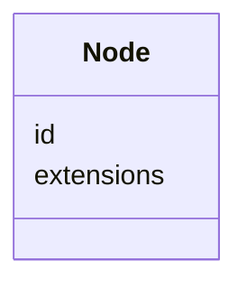
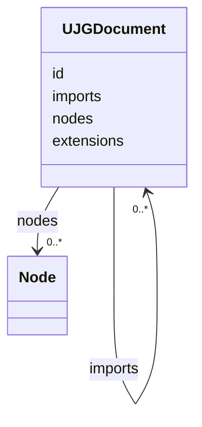

## Overview

This module defines the shared Core artifacts for UJG documents.

The Core module is published under `https://ujg.specs.openuji.org/ed/ns/`. Implementations should use these canonical URLs when referencing the Core vocabulary, JSON-LD context, and SHACL validation shape.

The Core module consists of:

- `core.ttl`: the ontology for Core classes and properties, published at `https://ujg.specs.openuji.org/ed/ns/core`
- `core.context.jsonld`: the JSON-LD context for compact UJG documents, published at `https://ujg.specs.openuji.org/ed/ns/core.context.jsonld`
- `core.shape.ttl`: the SHACL shape used for Core validation, published at `https://ujg.specs.openuji.org/ed/ns/core.shape`

## Terminology

- <dfn>UJGDocument</dfn>: The Core document container, serialized as JSON-LD or YAML-LD.
- <dfn>Node</dfn>: The base Core class for addressable objects that may appear in `nodes`.
- <dfn>Source document</dfn>: One retrieved resource, identified by its canonical source location,
  containing exactly one authored UJGDocument root. Its source location is distinct from its
  semantic document identifier and JSON-LD base IRI.
- <dfn>Local definition</dfn>: An expanded node object with an explicit IRI identity that carries
  a type or property assertion in one source document, rather than merely referring to a node.
- <dfn>Effective membership</dfn>: The set of locally defined modeled nodes in one source document,
  independent of nesting depth and excluding its UJGDocument container.
- <dfn>Main spec family</dfn>: The shared UJG specification family that defines the common
  interoperability baseline for UJG documents and tools, excluding optional modules and document
  extensions.
- <dfn>UJG module</dfn>: A published UJG specification unit that defines vocabulary terms, JSON-LD
  context entries, validation shapes, or processing rules. A UJG module may belong to the
  [=main spec family=] or to the optional module family.
- <dfn>Optional module</dfn>: A UJG module for a capability that not every compliant UJG document or
  tool needs.
- <dfn>First-level UJG module</dfn>: An optional module whose dependencies are limited to the
  [=main spec family=].
- <dfn>First-level bridge module</dfn>: A first-level UJG module designed to stay small and reusable
  so more specialized modules can build on it.
- <dfn>Second-level UJG module</dfn>: An optional module that depends on at least one first-level UJG
  module to describe a more specialized capability.
- <dfn>Third-level UJG module</dfn>: An optional module that depends on at least one second-level UJG
  module to build on that module's vocabulary.

## Node {data-cop-concept="node"}

[=Node=] is the base Core class for addressable objects that may appear in a [=UJGDocument=]
`nodes` collection. Most documents use concrete subclasses from Graph, Surface, Runtime, or optional
modules rather than plain `Node`.



Plain `Node` is useful for Core-only extension payloads. Interoperable graph, runtime, surface, or
module semantics should use a defined concrete class.

Example node:

```ujg-example
./examples/example-07.yamlld
```

## UJGDocument {data-cop-concept="ujg-document"}

A [=UJGDocument=] is the Core document container. It may import other UJG documents, list root and
standalone [=Node=] definitions in `nodes`, and carry document-level `extensions`. Addressable
definitions may also be embedded in node-valued module relationships. `nodes` is not an exhaustive
inventory; embedded definitions do not need redundant root-level references.



Example document:

```ujg-example
./examples/example-06.yamlld
```

## Serialization and Identity {data-cop-concept="serialization"}

<spec-statement>
1. A source document **MUST** contain exactly one authored `UJGDocument` root with an explicit IRI
   identity. This is checked before imported data or ontology statements are composed.
2. JSON-LD input **MUST** follow JSON-LD 1.1. YAML-LD input **MUST** follow the Basic profile of
   [[YAML-LD]], based on YAML 1.2.2 and JSON-LD 1.1.
3. A UJG YAML-LD resource **MUST** contain exactly one YAML document. Empty streams and additional
   stream documents **MUST** be rejected rather than silently ignored.
4. Addressable UJG definitions, whether root-level or embedded, **MUST** have explicit IRI
   identities. Blank-node identifiers and implicitly generated identities **MUST NOT** identify
   addressable UJG definitions.
5. Node-valued module relationships **MAY** contain definitions, references, or mixtures, subject
   to their module's constraints. This permission does not turn external resource locations,
   literals, or opaque JSON payloads into embeddable UJG definitions.
6. Embedding **MUST NOT** introduce ownership, traversal, execution, inheritance, or ordering beyond
   the semantics of the expressed module relationship. Definitions need not precede references.
7. Consumers **MUST** support standard JSON-LD keywords as well as the context's authoring aliases.
   `id` and `type` alias `@id` and `@type`; they do not define a separate data model.
</spec-statement>

The referenced YAML-LD 1.0 publication is the **24 October 2026 Working Draft**, not a W3C
Recommendation. `.jsonld` and `application/ld+json` identify JSON-LD; `.yamlld` is the preferred UJG
YAML-LD extension and `application/ld+yaml` its draft media type. YAML-LD also permits `.yaml`.
Format detection is a loader concern and MUST NOT change identity or module semantics.

YAML anchors and aliases follow YAML-LD: aliases are resolved by value, anchor names and comments
carry no UJG semantics, and cyclic alias structures are rejected. YAML scalar processing MUST use
YAML-LD's scalar rules, including plain-string dates, JSON-compatible numbers, and string mapping
keys. JSON literal payloads remain opaque even when their authoring syntax is YAML.

## Definition Discovery and Membership {data-cop-concept="document-membership"}

<spec-statement>
1. Consumers **MUST** discover local definitions after context interpretation and before flattening
   or composing source documents. Discovery **MUST** use expanded node objects, not key spelling,
   graph reachability, or the eventual set of RDF subjects.
2. A node object establishes a local definition when it has an explicit IRI `@id` and at least one
   nonempty `@type` or RDF property assertion. Reverse-property assertions also qualify.
3. An IRI string, reference-only node object, or object containing only identity and index metadata
   **MUST NOT** establish a local definition. Null or empty properties discarded by expansion do
   not establish one either.
4. Discovery **MUST** traverse embedded node objects and the contents of `@graph`, `@included`,
   `@list`, and `@set` wrappers. A wrapper's graph name or index alone does not define a UJG node.
   Context declarations and value-object contents, including `@json`, **MUST NOT** be traversed as
   modeled nodes.
5. The document's effective membership **MUST** contain every local modeled node definition,
   excluding its `UJGDocument` container. An embedded definition **MUST NOT** need another `nodes`
   association to become a member.
6. Consumers **MUST** retain each definition's canonical source location. Repeated definitions of
   one identity contribute statements without first-definition or last-definition precedence.
   Each source that contributes a definition retains that local membership.
7. Referencing or importing an externally defined node **MUST NOT** establish local membership.
8. `members` **MUST NOT** be authored. Consumers **MUST** derive it from local definitions and
   producers **MUST NOT** automatically serialize derived inventory links.
9. Authored syntax, identities, and `nodes` values **MUST** be checked before deriving membership.
   Derivation **MUST NOT** discard or repair invalid authored input.
</spec-statement>

The **authored RDF graph** is the RDF interpretation after Core import normalization, without
membership augmentation. Authored `nodes` relationships remain intact. The **validation dataset**
composes authored data with applicable vocabularies and retains source-scoped derived membership
in separate named graphs. A membership graph has one source scope and contains
`document-id ujg:members node-id` statements. Its graph identifier is an implementation-owned IRI
mapped to the canonical source location. It MUST NOT collide with an authored graph name.

Membership constraints MUST query one source scope at a time. Two sources declaring the same
semantic document identifier MUST NOT have their memberships merged. Implementations MAY use an
equivalent provenance table or another representation if validation results are identical.

RDF alone does not retain definition provenance. Equal domain RDF graphs are therefore insufficient
to establish equivalent UJG document membership. Flat and nested documents with the same local
definitions have the same effective membership even if their authored `nodes` triples differ.

## Normative Artifacts

### Ontology {data-cop-concept="ontology"}

The normative Core ontology is defined in the Turtle document below and is published at `https://ujg.specs.openuji.org/ed/ns/core`. It declares the `UJGDocument` and `Node` classes together with the Core properties used by this module.

:::include ./core.ttl :::

### JSON-LD Context {data-cop-concept="jsonld-context"}

The normative Core JSON-LD context is defined below and is published at `https://ujg.specs.openuji.org/ed/ns/core.context.jsonld`. The preferred authoring terms are `id`, `type`, `imports`, `nodes`, and `extensions`. `members` is derived for validation only.

:::include ./core.context.jsonld :::

#### Context Composition

<spec-statement>A compact UJG document **MUST** include the Core JSON-LD context.</spec-statement>

<spec-statement>A specification that defines compact terms not defined by Core **MUST** normatively identify the published URL of the JSON-LD context that defines those terms.</spec-statement>

<spec-statement>A compact UJG document that uses terms not defined by Core **MUST** compose the Core context with the published contexts that define those terms.</spec-statement>

<spec-statement>When a compact UJG document uses terms not defined by Core, its `@context` **MUST** reference the published URLs of the contexts that define those terms.</spec-statement>

<spec-statement>Specifications or deployments **MAY** publish convenience aggregate contexts that compose the Core context with additional contexts, but such aggregate contexts are outside the scope of Core.</spec-statement>

Context composition uses a JSON-LD `@context` array. The convenience aggregate at
`https://ujg.specs.openuji.org/ed/ns/context.jsonld` includes Core, Graph, Surface, and Runtime;
other modules require their own published contexts.

##### Composed Context Example
```ujg-example
./examples/example-05.yamlld
```

#### Module Layering

<spec-statement>A [=UJG module=] that defines compact terms not defined by Core **MUST** publish a JSON-LD context for those terms.</spec-statement>

<spec-statement>A [=UJG module=] that depends on Core or another UJG module **MUST** identify the modules whose terms, classes, or validation semantics it relies on.</spec-statement>

<spec-statement>A [=first-level UJG module=] **MUST** identify only [=main spec family=] modules as dependencies and **MUST NOT** depend on another [=optional module=].</spec-statement>

<spec-statement>A [=first-level UJG module=] **MAY** define references from Core [=Node=] instances or classes defined by [=main spec family=] modules, provided those references do not alter Core identity, import resolution, reference resolution, graph traversal, or runtime ordering.</spec-statement>

<spec-statement>A [=first-level bridge module=] **SHOULD** define a narrow, domain-neutral vocabulary that can be specialized by modules that depend on it.</spec-statement>

<spec-statement>A [=second-level UJG module=] **MUST** depend on at least one [=first-level UJG module=] and **MAY** also depend on [=main spec family=] modules.</spec-statement>

<spec-statement>A [=second-level UJG module=] **MUST NOT** attach specialized domain semantics directly to Core or Graph nodes when an appropriate first-level bridge module exists for that domain.</spec-statement>

<spec-statement>A [=third-level UJG module=] **MUST** depend on at least one [=second-level UJG module=] and **MAY** also depend on [=first-level UJG module|first-level UJG modules=] and [=main spec family=] modules.</spec-statement>

<spec-statement>A [=third-level UJG module=] **MUST NOT** attach specialized domain semantics directly to Core or Graph nodes when an appropriate lower-level optional module exists for that domain.</spec-statement>

<spec-statement>Module references **MUST NOT** create hidden graph traversal, runtime ordering, mapping conformance, or profile requirements unless those semantics are explicitly defined by the module that owns the references.</spec-statement>

<spec-statement>Consumers that do not implement an [=optional module=] **MAY** ignore that module's terms, provided they preserve JSON-LD identity and unknown extension data according to Core processing rules.</spec-statement>

#### Extensions

<spec-statement>`extensions` **MAY** appear on a [=UJGDocument=] or any [=Node=].</spec-statement>

<spec-statement>[=UJGDocument=]-level `extensions` attach document extensions to the containing
document. [=Node=]-level `extensions` attach opaque extension payloads to the containing
node.</spec-statement>

<spec-statement>If present, `extensions` **MUST** be a JSON object.</spec-statement>

<spec-statement>Each top-level key in `extensions` **MUST** be a namespace string controlled by the extension author. Authors **SHOULD** use reverse-DNS names or URI-based identifiers.</spec-statement>

<spec-statement>Each top-level value in `extensions` **MUST** be a JSON object.</spec-statement>

<spec-statement>Consumers **MUST** preserve unknown extension entries during read-transform-write unless operating in an explicitly lossy mode.</spec-statement>

<spec-statement>Consumers **MUST NOT** let unknown extensions affect Core identity, import
resolution, reference resolution, Graph traversal, or Graph semantics.</spec-statement>

<spec-statement>Consumers **MAY** apply namespace-specific processing for recognized extensions.</spec-statement>

<spec-statement>Extensions that change core graph meaning **SHOULD** be standardized as first-class UJG modules rather than hidden inside `extensions`.</spec-statement>

<spec-statement>Terms intended to participate in interoperable graph semantics, reference resolution, validation, or RDF querying **MUST** be defined by published JSON-LD contexts and corresponding module artifacts rather than being hidden inside `extensions`.</spec-statement>

<spec-statement>Identifiers that appear only inside `extensions` **MUST NOT** be treated as Core or Graph references for standardized UJG processing unless an implementation applies explicit namespace-specific processing outside module conformance.</spec-statement>

#### Import Resolution

<spec-statement>
1. `imports` values **MUST** be IRI references, expressed as strings or reference-only node objects.
   Embedded imported document definitions **MUST NOT** replace import retrieval.
2. Consumers **MUST** identify the import property through the active context while retaining its
   lexical reference values. Before normal JSON-LD expansion, consumers **MUST** normalize these
   values in a processing copy against the importing source document's location, independently of
   `@base`. Both retrieval and the resulting `ujg:imports` relationships **MUST** use those absolute
   retrieval IRIs. Authored source text need not be rewritten.
3. HTTP(S) resources use their final retrieved document URL as source location; file resources use
   their file URL. An in-memory resource with relative imports **MUST** have a caller-supplied
   absolute source location. Core defines no workspace, package, or manifest root.
4. Ordinary node identities and semantic references **MUST** follow JSON-LD base resolution.
   A semantic document `id` **MUST NOT** replace its source location for resolving imports.
5. Consumers claiming complete document processing **MUST** resolve the transitive import closure,
   preserve each imported resource's own location and semantic base, and cache resources by
   canonical source location so import cycles terminate. Retrieval aliases from redirects **MUST**
   resolve to the same cached resource.
6. Imports **MAY** mix declared supported serializations. A missing resource or unsupported format
   **MUST** prevent a complete conformance result. Ordinary node references **MUST NOT** trigger
   implicit document retrieval.
</spec-statement>

The import target names the retrieved resource and need not equal its semantic `UJGDocument.id`.
Imports do not change Journey ownership, Graph traversal, runtime order, or local membership.
Relative imports are recommended within a portable document package whose directory layout stays
constant. Changing the semantic base does not change where those imports are retrieved.

### Validation {data-cop-concept="validation"}

The normative Core SHACL shape is defined below and is published at `https://ujg.specs.openuji.org/ed/ns/core.shape`. It constrains [=UJGDocument=] and [=Node=] instances and is the validation artifact for Core semantics.

:::include ./core.shape.ttl :::

## Examples

The examples below are informative. Each example uses `https://ujg.specs.openuji.org/ed/ns/core.context.jsonld` as its JSON-LD context and stays within the Core vocabulary. Graph-native optional terms belong in composed module contexts, not inside `extensions`.

### Minimal Document

```ujg-example
./examples/example-04.yamlld
```

### Document With Extension Payload

```ujg-example
./examples/example-03.yamlld
```

### Document With Relative Imports

```ujg-example
./examples/example-02.yamlld
```

Resolved imports:

- `./shared/states.jsonld` → `https://example.com/ujg/flows/order/shared/states.jsonld`
- `../runtime/events.jsonld` → `https://example.com/ujg/flows/runtime/events.jsonld`
- `https://example.com/ujg/common/errors.jsonld` → unchanged

These retrieval targets follow [[RFC3986]] relative-reference resolution against the source
location. Ordinary node identities and semantic references follow [[JSON-LD 1.1.]] base resolution.

### Document With Nodes

```ujg-example
./examples/example-01.yamlld
```
