## Overview

This module defines the vocabulary for intended user flow. It extends [[UJG Core]] to support structured, interactive graphs with composition through one or more child-Journey references, exported exits from nested journeys, organization tags, and state-scoped navigation and invocation affordances. Graph describes intended topology and possible movement; it does not prescribe execution, scheduling, condition evaluation, or event processing.

## Terminology

- <dfn>Journey</dfn>: A named container for local traversable user flow topology.
- <dfn>Local vertex</dfn>: A node of one [=Journey=]'s local topology: a [=State=] or [=CompositeState=] listed in its `stateRefs`, or a [=JourneyExit=] listed in its `exitRefs`. [=Transition|Transitions=] connect local vertices of the same Journey.
- <dfn>JourneyEntry</dfn>: An explicit entry contract for a [=Journey=].
- <dfn>JourneyEntryIndex</dfn>: A catalogue of addressable [=JourneyEntry=] contracts that does not define traversal.
- <dfn>State</dfn>: A discrete node in the experience (e.g., a screen, modal). A State is the only [=Local vertex|local vertex=] that offers [=Entry transition|entry transitions=].
- <dfn>State occurrence</dfn>: A concrete experienced occurrence of a [=State=] during traversal.
- <dfn>Transition</dfn>: A structural directed edge between [=Local vertex|local vertices=] of a [=Journey=].
- <dfn>Command</dfn>: A stable semantic identity of an intentional invocation in the modeled experience.
- <dfn>CompositeState</dfn>: A [=Local vertex|local vertex=] that groups [=Co-present|co-present=] child [=Journey|Journeys=]. It is not a [=State=].
- <dfn>Composite scope</dfn>: The set of child Journeys referenced by one [=CompositeState=].
- <dfn>Co-present</dfn>: Journeys are co-present when the user can perceive and act on each of them at the same time in the same experience frame: the viewport, window, screen, or dialog session that stays in place while its content changes.
- <dfn>JourneyExit</dfn>: A terminal [=Local vertex|local vertex=] and exported completion contract declared by a [=Journey=].
- <dfn>OutgoingTransition</dfn>: A navigational affordance that enters a [=Journey=] through a [=JourneyEntry=].
- <dfn>InvokingTransition</dfn>: An affordance that invokes a [=Journey=] through a [=JourneyEntry=] and resumes the source [=State occurrence=] when that Journey reaches one of its exits.
- <dfn>Entry transition</dfn>: An [=OutgoingTransition=] or [=InvokingTransition=]: an affordance available at a [=State=] that enters a [=Journey=] through a [=JourneyEntry=].

---

## State {data-cop-concept="state"}

A [=State=] is the graph node for a discrete point in an intended user experience, such as a page, screen, modal, or other user-visible step. It is a leaf of the local topology: it does not contain Journeys. Nested composition is the job of a [=CompositeState=], which is a separate class.

This section defines the State node. A State also lists the
[=Entry transition|entry transitions=] it offers, as described in the subsection below; the
transition classes themselves are defined in the Transitions section.

<spec-statement>
1. A [=State=] **MUST** be identified by an IRI.
2. A [=State=] **MUST** declare exactly one `label`.
3. A [=State=] **MAY** declare one or more `tags`.
4. Multiple concrete occurrences of the same [=State=] **MAY** exist within an active [=Journey=];
   Graph does not define occurrence identity, cardinality, lifecycle, or materialization.
</spec-statement>

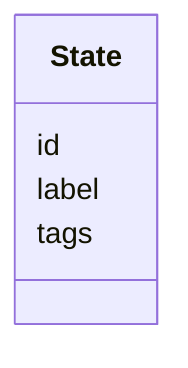

Example JSON node:

```json
{
  "@type": "State",
  "@id": "urn:ujg:state:search-form",
  "label": "Search form",
  "tags": [
    "phase:search"
  ]
}
```

### State-scoped entry transitions {data-cop-concept="state-scoped-entry-transitions"}

A [=State=] lists the [=Entry transition|entry transitions=] it offers in `entryTransitionRefs`.
Entry transitions are for navigation and invocation options, not for ordinary internal progression
through a journey.

An entry transition is a node of its own, so several States can list the same one. A link offered on
several pages is one [=OutgoingTransition=] listed by the State of each of those pages.

<spec-statement>
1. Only a [=State=] **MAY** declare `entryTransitionRefs`. A [=CompositeState=], a [=Journey=], and
   every other Graph class **MUST NOT**.
2. Each `entryTransitionRefs` value **MUST** reference an [=OutgoingTransition=] or an
   [=InvokingTransition=]. One State **MAY** list both.
3. Each [=State=] that lists an entry transition is an effective source of that transition, at its
   own occurrences only.
4. An entry transition is not inherited. It is not available at a State merely because that State is
   nested in a [=CompositeState=], shares a child Journey with the State that lists it, or is a
   sibling of it.
5. Entry transitions are not members of the enclosing [=Journey=]'s `transitionRefs`.
6. An entry transition's `toEntryRef` remains the same fixed IRI at every State that lists it.
   Consumers **MUST NOT** reinterpret that destination relative to the source state.
7. When the intended destination entry varies with the source, Producers **MUST** use
   source-specific [=OutgoingTransition|OutgoingTransitions=] or
   [=InvokingTransition|InvokingTransitions=] instead of one shared transition.
</spec-statement>

Share one entry transition across States only when the same destination entry is correct from each
of them. A shared transition cannot express “re-enter whichever state is currently active.” When an
affordance preserves one of several possible source states—such as a state-preserving locale
switch—model a separate [=OutgoingTransition=] for each source state and target a [=JourneyEntry=]
whose `stateRef` is that state. The entries and transitions are distinct even when the affordances
have the same label and locale metadata.

A [=CompositeState=] lists no entry transitions. While it is current, the current States of its child
Journeys offer theirs.

While an [=InvokingTransition=] is in progress, its retained source is suspended, so entry
transitions available at the source are not offered inside the invoked Journey. They are available
there only when the invoked Journey's own States list them.

A State of Journey J that lists an [=InvokingTransition=] into J lets J invoke itself. Each
activation enters J again and retains the current State occurrence of J, so invocations of J nest.
For example, the States of a privacy settings Journey normally do not list the entry transition that
opens the privacy settings.

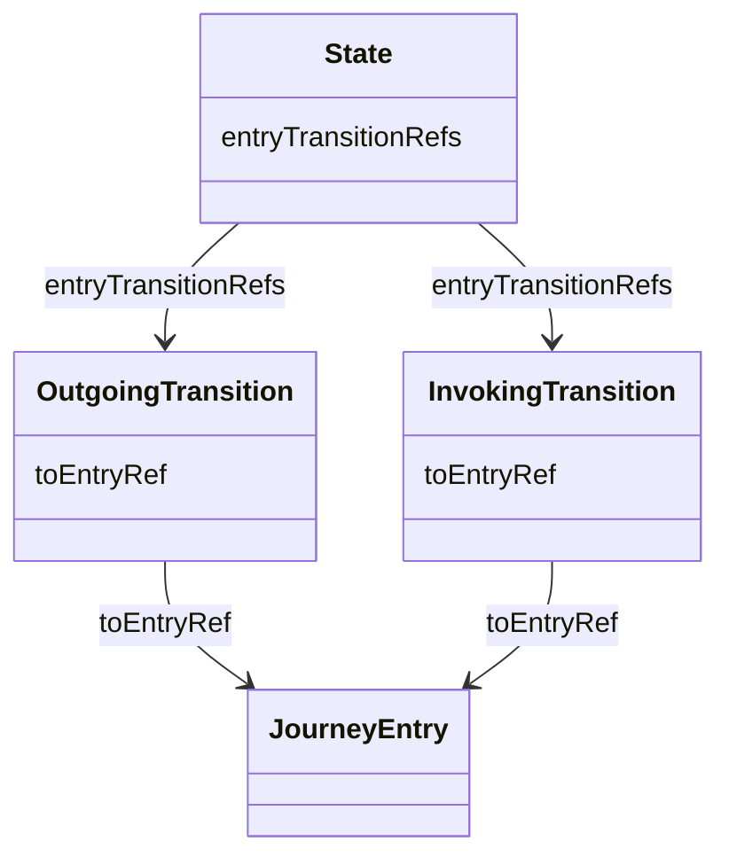

Example JSON nodes:

```json
{
  "@type": "State",
  "@id": "urn:ujg:state:w3c-searchpage-form",
  "label": "Search form",
  "entryTransitionRefs": [
    "urn:ujg:ot:w3c-searchpage-form-back-home"
  ]
}
```

```json
[
  {
    "@type": "Journey",
    "@id": "urn:ujg:journey:w3c-homepage",
    "defaultEntryRef": "urn:ujg:entry:w3c-homepage",
    "entryRefs": ["urn:ujg:entry:w3c-homepage"],
    "stateRefs": ["urn:ujg:state:w3c-root-homepage"]
  },
  {
    "@type": "JourneyEntry",
    "@id": "urn:ujg:entry:w3c-homepage",
    "stateRef": "urn:ujg:state:w3c-root-homepage"
  },
  {
    "@type": "State",
    "@id": "urn:ujg:state:w3c-root-homepage",
    "label": "W3C homepage"
  },
  {
    "@type": "OutgoingTransition",
    "@id": "urn:ujg:ot:w3c-searchpage-form-back-home",
    "label": "Back to home page",
    "toEntryRef": "urn:ujg:entry:w3c-homepage"
  }
]
```

This is a "Back to home page" navigation affordance, not an internal [=Transition=]. The source
Journey references the destination entry contract, never the destination State directly.

An example that mixes navigation and invocation is shown in the [=InvokingTransition=] section.

---


## Transitions {data-cop-concept="transitions"}

Graph has three transition classes. A [=Transition=] is ordinary progression inside one
[=Journey=]. [=OutgoingTransition=] and [=InvokingTransition=] are
[=Entry transition|entry transitions=]: affordances available at a State that enter a Journey
through an explicit [=JourneyEntry=]. The two entry transition classes differ only in what happens
to the source [=State occurrence=].

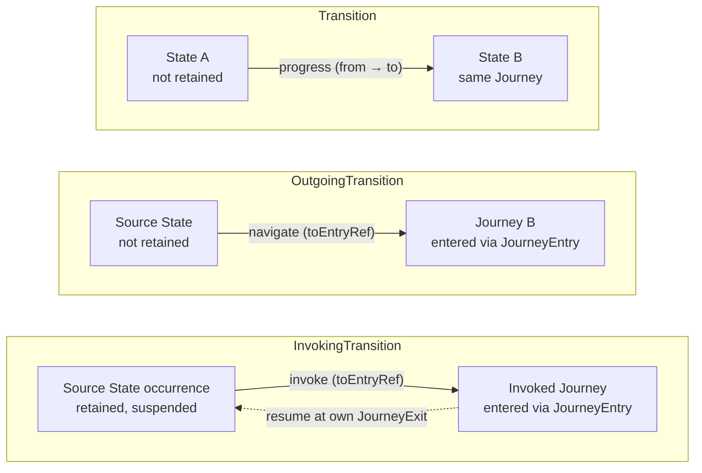

| | [=Transition=] | [=OutgoingTransition=] | [=InvokingTransition=] |
| --- | --- | --- | --- |
| Source | Explicit local `from` vertex | State where the affordance is available | State where the affordance is available |
| Destination | Local `to` vertex | `toEntryRef` entry contract | `toEntryRef` entry contract |
| Declared through | `transitionRefs` on a [=Journey=] | `entryTransitionRefs` on a [=State=] | `entryTransitionRefs` on a [=State=] |
| Source State occurrence | Not retained | Not retained | Retained and suspended until the invocation completes or is cancelled |
| Meaning | Ordinary progression inside one Journey | Leave local progression and enter a Journey through a named entry | Enter a Journey through a named entry, then resume the source when that Journey exits |

An entry transition has no `from` property. Its effective source is each [=State=] that lists it in
`entryTransitionRefs`. All three classes can reference a [=Command=] with `commandRef`.

### Transition {data-cop-concept="transition"}

A [=Transition=] is a structural directed edge between [=Local vertex|local vertices=] of a [=Journey=]. It models ordinary progression inside the local topology of a [=Journey=].

A [=Transition=] is not owned by either endpoint state. It is owned by a journey through `transitionRefs`.

A [=Transition=] applies to every concrete occurrence of the [=Local vertex|local vertex=] its `from`
value references.
The [=Transition=] itself remains one stable Graph node.

The presence of multiple child Journeys in one [=CompositeState=] does not create implicit
Transitions between them.

<spec-statement>
1. A [=Transition=] **MUST** be identified by an IRI, declare exactly one `from`, and declare exactly one `to`.
2. A [=Transition=] **MAY** declare one `label`.
3. A [=Transition=] **MAY** reference one [=Command=] with `commandRef`.
4. When listed in a [=Journey=]'s `transitionRefs`, `from` **MUST** reference a [=State=] or [=CompositeState=] in that journey's `stateRefs`.
5. When listed in a [=Journey=]'s `transitionRefs`, `to` **MUST** reference a [=State=] or [=CompositeState=] in that journey's `stateRefs`, or a [=JourneyExit=] in that journey's `exitRefs`.
6. [=Transition=] endpoints **MUST** stay local to the enclosing [=Journey=].
7. `toEntryRef` **MAY** be used only on parent transitions into [=CompositeState=] nodes, and `fromExitRef` only on parent transitions from them, as defined under [=CompositeState=].
8. A [=Transition=] **MUST** remain one Graph node regardless of how many concrete occurrences its endpoints have; per-instance transition properties are outside Graph.
9. A child Journey's [=Transition=] **MUST NOT** connect directly to a [=State=], [=CompositeState=], or [=JourneyExit=] owned only by another child Journey.
</spec-statement>

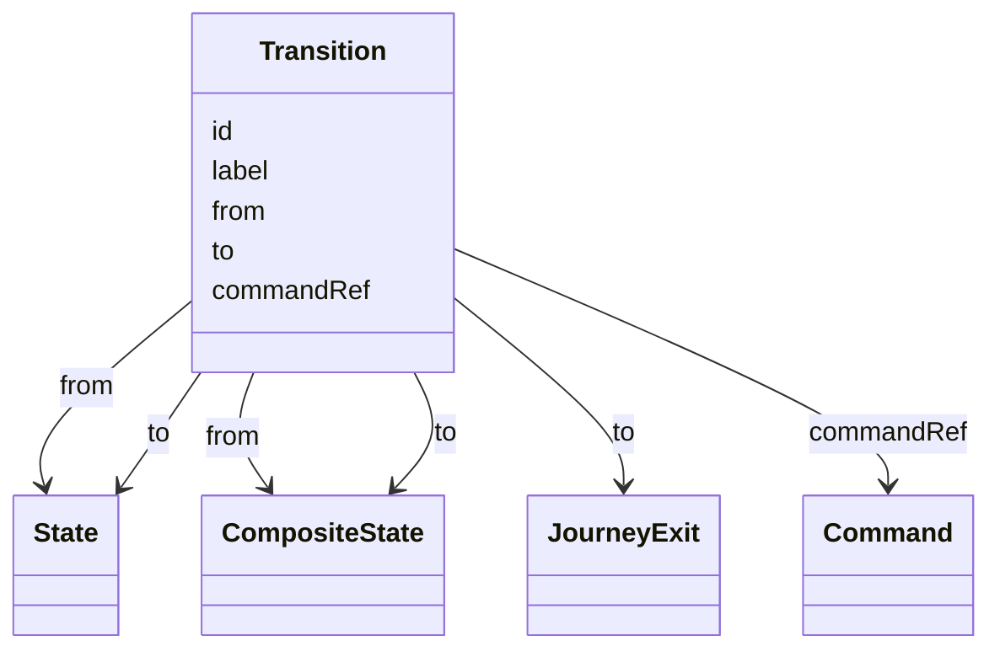

Example JSON node:

```json
{
  "@type": "Transition",
  "@id": "urn:ujg:transition:search-form-to-results",
  "label": "Submit search",
  "from": "urn:ujg:state:search-form",
  "to": "urn:ujg:state:results",
  "commandRef": "urn:ujg:command:submit-search"
}
```

### OutgoingTransition {data-cop-concept="outgoing-transition"}

An [=OutgoingTransition=] is a navigational affordance that enters a Journey through an explicit
[=JourneyEntry=]. It does not declare structural progression in the source Journey's local topology.

The destination entry's `stateRef` identifies the first local [=State=] or [=CompositeState=] of the
destination Journey. Consumers do not bypass the entry contract by linking the outgoing affordance
directly to that state.

<spec-statement>
1. An [=OutgoingTransition=] **MUST** be identified by an IRI and **MAY** declare one `label`.
2. An [=OutgoingTransition=] **MUST** declare exactly one `toEntryRef`.
3. An [=OutgoingTransition=] **MAY** reference one [=Command=] with `commandRef`.
4. `toEntryRef` **MUST** reference a [=JourneyEntry=] owned by exactly one [=Journey=].
5. The destination entry's `stateRef` **MUST** reference a [=State=] or [=CompositeState=] in that
   owner Journey's `stateRefs`.
6. The destination entry **MAY** belong to the Journey where the affordance is available. Such a
   target is explicit Journey re-entry, including when the entry points to the effective source state.
7. An [=OutgoingTransition=] **MUST NOT** declare `from`, `fromExitRef`, `to`, or
   `entryTransitionRefs`, target a [=JourneyExit=], appear in `transitionRefs`, or model ordinary
   internal progression.
</spec-statement>

A [=JourneyEntryIndex=] may catalogue the destination entry for discovery, but index membership is
not required for navigation. The entry remains owned by its declaring Journey.

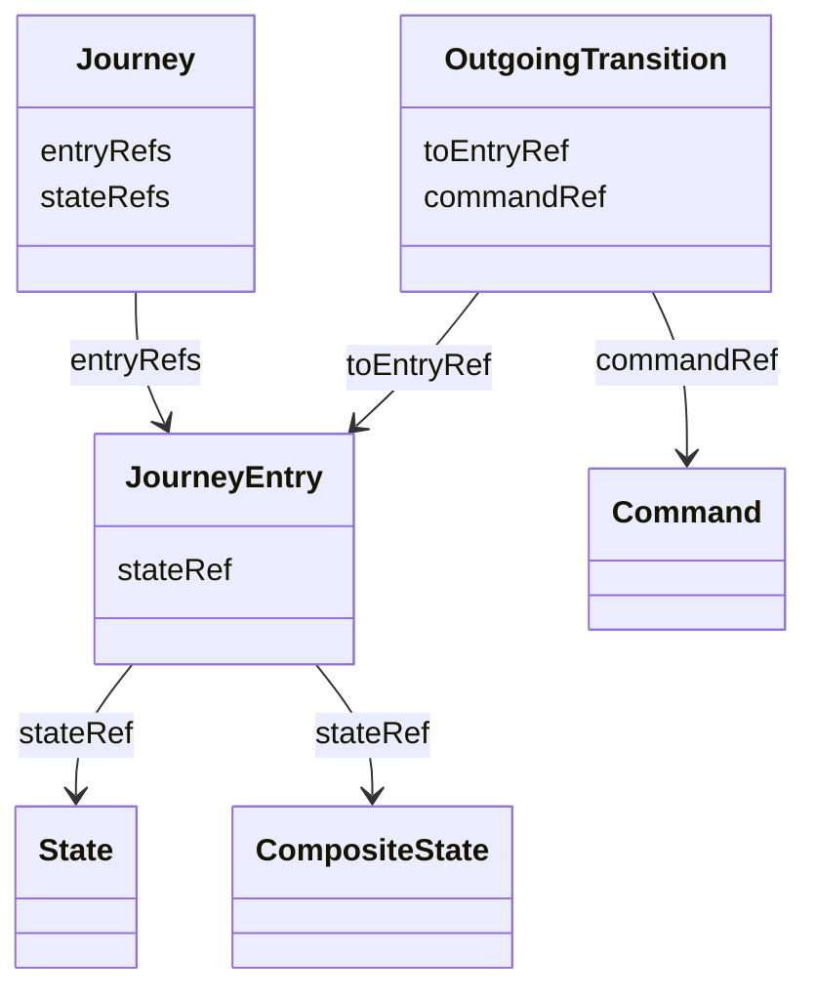

Cross-Journey navigation names the destination entry rather than its State:

```json
[
  {
    "@type": "Journey",
    "@id": "urn:ujg:journey:home",
    "defaultEntryRef": "urn:ujg:entry:home",
    "entryRefs": ["urn:ujg:entry:home"],
    "stateRefs": ["urn:ujg:state:home"]
  },
  {
    "@type": "JourneyEntry",
    "@id": "urn:ujg:entry:home",
    "label": "Home entry",
    "stateRef": "urn:ujg:state:home"
  },
  {
    "@type": "State",
    "@id": "urn:ujg:state:home",
    "label": "Home"
  },
  {
    "@type": "OutgoingTransition",
    "@id": "urn:ujg:ot:go-home",
    "label": "Home",
    "toEntryRef": "urn:ujg:entry:home",
    "commandRef": "urn:ujg:command:go-home"
  },
  {
    "@type": "Command",
    "@id": "urn:ujg:command:go-home",
    "label": "Go home"
  }
]
```

The same pattern represents same-state re-entry: the OutgoingTransition targets a JourneyEntry whose
`stateRef` is the state where the affordance is available. This remains explicit re-entry, not an
implicit relative target.

```json
[
  {
    "@type": "Journey",
    "@id": "urn:ujg:journey:confirmation",
    "defaultEntryRef": "urn:ujg:entry:confirmation",
    "entryRefs": ["urn:ujg:entry:confirmation"],
    "stateRefs": ["urn:ujg:state:confirmation"]
  },
  {
    "@type": "JourneyEntry",
    "@id": "urn:ujg:entry:confirmation",
    "stateRef": "urn:ujg:state:confirmation"
  },
  {
    "@type": "State",
    "@id": "urn:ujg:state:confirmation",
    "label": "Confirmation",
    "entryTransitionRefs": ["urn:ujg:ot:reenter-confirmation"]
  },
  {
    "@type": "OutgoingTransition",
    "@id": "urn:ujg:ot:reenter-confirmation",
    "label": "Re-enter confirmation",
    "toEntryRef": "urn:ujg:entry:confirmation"
  }
]
```

### InvokingTransition {data-cop-concept="invoking-transition"}

An [=InvokingTransition=] invokes a Journey through an explicit [=JourneyEntry=]. It has the same
source and destination model as an [=OutgoingTransition=]. The difference is lifecycle: the source
[=State occurrence=] is retained, and it resumes when the invoked Journey reaches one of its exits.

<spec-statement>
1. An [=InvokingTransition=] **MUST** be identified by an IRI and **MAY** declare one `label`. It
   **MUST** declare exactly one `toEntryRef` and **MAY** reference one [=Command=] with
   `commandRef`. It **MUST NOT** declare `from`, `fromExitRef`, `to`, or `entryTransitionRefs`,
   target a [=JourneyExit=], appear in `transitionRefs`, model ordinary internal progression, or
   also be typed [=OutgoingTransition=].
2. The effective source of an [=InvokingTransition=] is each [=State=] that lists it in
   `entryTransitionRefs`, exactly as for an [=OutgoingTransition=].
3. `toEntryRef` **MUST** reference a [=JourneyEntry=] owned by exactly one [=Journey=], and the
   entry's `stateRef` **MUST** reference a [=State=] or [=CompositeState=] in that owner Journey's
   `stateRefs`. That Journey is the *invoked Journey*. The invoked Journey **MUST** declare at least
   one `exitRefs` value.
4. The invoked Journey **MAY** be the Journey where the affordance is available. Each activation is a
   separate, nested invocation.
5. Activating an [=InvokingTransition=] enters the invoked Journey through `toEntryRef` and retains
   the source [=State occurrence=], including any active composite scope. The source occurrence is
   not left. While the invocation is in progress, the retained source occurrence, together with any
   composite scope retained with it, is suspended: no [=Transition=] or entry transition is taken
   from the source occurrence, and no parent Transition is taken from a retained
   [=CompositeState=]. State occurrences inside that composite scope that are not the source, such
   as States of a sibling child Journey, are not suspended and keep their own transitions and entry
   transitions. A parent Transition that a sibling's child exit triggers meanwhile is taken after the
   invocation completes, and not at all if it is cancelled.
6. Reaching a [=JourneyExit=] listed in the invoked Journey's own `exitRefs` completes the
   invocation. The retained source occurrence then resumes without entering a [=JourneyEntry=] or
   taking a [=Transition=]. A child [=JourneyExit=] reached inside a [=CompositeState=] of the
   invoked Journey is not completion; it follows the [=CompositeState=] rules.
7. The reached [=JourneyExit=] is the outcome of the invocation. Graph assigns no per-outcome
   continuation.
8. An invocation is cancelled, not completed, when the invoked Journey is left in any way other than
   reaching one of its own exits. Traversing an [=OutgoingTransition=] from any [=State occurrence=]
   of the invoked Journey, including one inside its composite scopes, leaves the invoked Journey,
   even when the destination entry belongs to the invoked Journey itself. Activating an
   [=InvokingTransition=] from inside the invoked Journey does not leave it.
9. An invocation is also cancelled when its retained source occurrence is left before the
   invocation completes, for example because an [=OutgoingTransition=] is taken from a State of a
   sibling child Journey, which is not suspended. The invoked Journey is then left as well, which
   cancels any invocation nested inside it. A sibling child Journey reaching a [=JourneyExit=] does
   not leave the source.
10. When an invocation is cancelled, Consumers **MUST NOT** infer a return, and the retained source
    occurrence **MUST NOT** be resumed. A source occurrence that is still retained is left, including
    its active composite scope. If that source occurrence is inside a Journey that was itself
    invoked, that Journey is left as well, which cancels its invocation in turn. Cancellation
    therefore releases every retained occurrence in the invocation chain.
11. An [=InvokingTransition=] does not add the invoked Journey to any `subjourneyRefs`. The invoked
    Journey occurrence is not a child of any [=CompositeState=] occurrence, even when the same
    Journey is listed in some CompositeState's `subjourneyRefs`. The [=CompositeState=] rules for
    child exits therefore do not apply to its exits, and completion never leaves a CompositeState,
    neither one that lists the invoked Journey nor one that contains the source.
12. Graph does not define invocation identifiers or association data between source and invoked
    occurrences.
</spec-statement>

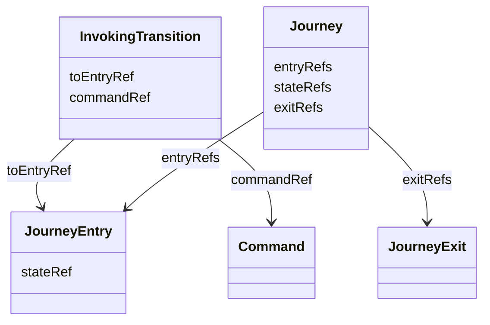

A privacy settings dialog invoked from an article page. Either exit completes the invocation, and
the Article State occurrence resumes. `settings-saved` and `settings-dismissed` are distinguishable
outcomes, but neither is a destination.

```json
[
  {
    "@type": "State",
    "@id": "urn:ujg:state:article",
    "label": "Article",
    "entryTransitionRefs": ["urn:ujg:it:adjust-privacy-settings"]
  },
  {
    "@type": "InvokingTransition",
    "@id": "urn:ujg:it:adjust-privacy-settings",
    "label": "Adjust privacy settings",
    "toEntryRef": "urn:ujg:entry:privacy-settings",
    "commandRef": "urn:ujg:command:adjust-privacy-settings"
  },
  {
    "@type": "Command",
    "@id": "urn:ujg:command:adjust-privacy-settings",
    "label": "Adjust privacy settings"
  },
  {
    "@type": "Journey",
    "@id": "urn:ujg:journey:privacy-settings",
    "defaultEntryRef": "urn:ujg:entry:privacy-settings",
    "entryRefs": ["urn:ujg:entry:privacy-settings"],
    "stateRefs": ["urn:ujg:state:privacy-settings"],
    "transitionRefs": [
      "urn:ujg:transition:privacy-settings-save",
      "urn:ujg:transition:privacy-settings-dismiss"
    ],
    "exitRefs": [
      "urn:ujg:exit:settings-saved",
      "urn:ujg:exit:settings-dismissed"
    ]
  },
  {
    "@type": "JourneyEntry",
    "@id": "urn:ujg:entry:privacy-settings",
    "stateRef": "urn:ujg:state:privacy-settings"
  },
  {
    "@type": "State",
    "@id": "urn:ujg:state:privacy-settings",
    "label": "Privacy settings"
  },
  {
    "@type": "Transition",
    "@id": "urn:ujg:transition:privacy-settings-save",
    "label": "Save",
    "from": "urn:ujg:state:privacy-settings",
    "to": "urn:ujg:exit:settings-saved"
  },
  {
    "@type": "Transition",
    "@id": "urn:ujg:transition:privacy-settings-dismiss",
    "label": "Back",
    "from": "urn:ujg:state:privacy-settings",
    "to": "urn:ujg:exit:settings-dismissed"
  },
  {
    "@type": "JourneyExit",
    "@id": "urn:ujg:exit:settings-saved",
    "label": "Settings saved"
  },
  {
    "@type": "JourneyExit",
    "@id": "urn:ujg:exit:settings-dismissed",
    "label": "Settings dismissed"
  }
]
```

Several pages can share entry transitions of both classes. "Privacy policy" navigates away
from the current page. "Adjust privacy settings" invokes the privacy settings Journey from the
example above and returns to the current page when that Journey exits. Each page's State lists the
same two transitions; each node's class determines its semantics.

```json
[
  {
    "@type": "State",
    "@id": "urn:ujg:state:article",
    "label": "Article",
    "entryTransitionRefs": [
      "urn:ujg:ot:privacy-policy",
      "urn:ujg:it:adjust-privacy-settings"
    ]
  },
  {
    "@type": "State",
    "@id": "urn:ujg:state:search-results",
    "label": "Search results",
    "entryTransitionRefs": [
      "urn:ujg:ot:privacy-policy",
      "urn:ujg:it:adjust-privacy-settings"
    ]
  },
  {
    "@type": "OutgoingTransition",
    "@id": "urn:ujg:ot:privacy-policy",
    "label": "Privacy policy",
    "toEntryRef": "urn:ujg:entry:privacy-policy"
  },
  {
    "@type": "Journey",
    "@id": "urn:ujg:journey:privacy-policy",
    "defaultEntryRef": "urn:ujg:entry:privacy-policy",
    "entryRefs": ["urn:ujg:entry:privacy-policy"],
    "stateRefs": ["urn:ujg:state:privacy-policy"]
  },
  {
    "@type": "JourneyEntry",
    "@id": "urn:ujg:entry:privacy-policy",
    "stateRef": "urn:ujg:state:privacy-policy"
  },
  {
    "@type": "State",
    "@id": "urn:ujg:state:privacy-policy",
    "label": "Privacy policy"
  }
]
```

Mapping and Metrics do not yet account for [=InvokingTransition=]. Mapping gives the invoked
Journey's steps their own local scope, so its exits end no [=CompositeState=] occurrence. Otherwise,
until they do, Mapping treats both the entry into the invoked Journey and the resumption of the
source State as unexplained movements, so each completed invocation adds two derived jumps, and two
to `unexplainedMovementCount`, across the execution's JourneyMappings.

---


## Command {data-cop-concept="command"}

A [=Command=] identifies the stable semantic identity of an intentional invocation in the modeled
experience.

A [=Command=] can be referenced by [=Transition=], [=OutgoingTransition=], and
[=InvokingTransition=] nodes through `commandRef`. Multiple transitions may reference the same [=Command=]. Sharing a `commandRef`
establishes only common invocation identity. Graph does not assign branching, selection, ordering,
resolution, execution-result, or effect semantics to that relationship.

A [=Command=] is not a transition endpoint and does not replace [=Transition=],
[=OutgoingTransition=], or [=InvokingTransition=]. Structural, automatic, expiry-driven, or otherwise non-invoked transitions
can remain without `commandRef`.

<spec-statement>
1. A [=Command=] **MUST** be identified by an IRI.
2. A [=Command=] **MAY** declare one `label` and one or more `tags`.
3. A [=Command=] **MUST NOT** declare `from`, `to`, branching, condition resolution, effect execution, visual representation, runtime execution, or execution-result semantics.
4. `commandRef` **MAY** appear on a [=Transition=], [=OutgoingTransition=], or [=InvokingTransition=] and **MUST** reference a [=Command=].
5. A [=Transition=], [=OutgoingTransition=], or [=InvokingTransition=] **MUST NOT** reference more than one [=Command=].
6. Absence of `commandRef` makes no claim that the transition represents an intentional invocation.
</spec-statement>

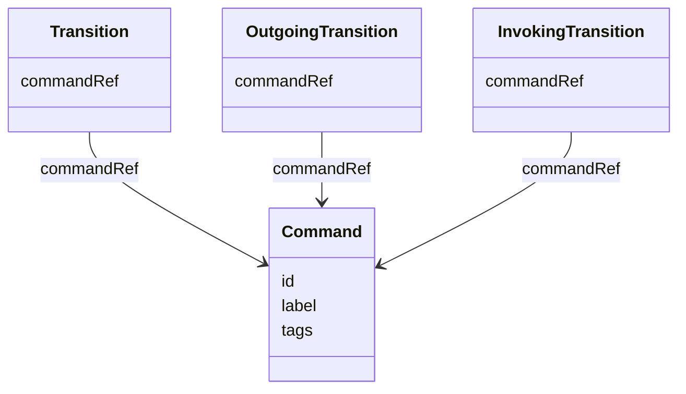

Example JSON node:

```json
{
  "@type": "Command",
  "@id": "urn:ujg:command:start-registration",
  "label": "Start registration"
}
```

Example transition associated with a command:

```json
{
  "@type": "Transition",
  "@id": "urn:ujg:transition:start-registration",
  "from": "urn:ujg:state:registration-open",
  "to": "urn:ujg:state:registration-form",
  "commandRef": "urn:ujg:command:start-registration"
}
```

---

## Journey {data-cop-concept="journey"}

A [=Journey=] is the local container for intended flow topology. It lists the experiential states that belong to the journey, the terminal exits exported by the journey, and, when present, the transitions that connect those [=Local vertex|local vertices=].

Use [=Journey=] when the modeled object owns local traversal, progression, or structural order. If the model only needs to list known entry points into pages, surfaces, flows, or journeys, use [=JourneyEntryIndex=] instead.

The subsections below define the two contracts a Journey declares besides its states and
transitions: its entries (`entryRefs`) and its exits (`exitRefs`).

<spec-statement>
1. A [=Journey=] **MUST** be identified by an IRI and declare at least one `entryRefs` value and one `stateRefs` value.
2. A [=Journey=] **MAY** declare one `defaultEntryRef`; if present, it **MUST** also appear in `entryRefs`.
3. `entryRefs`, `stateRefs`, `transitionRefs`, and `exitRefs` **MUST** reference nodes of the corresponding Graph classes.
4. A [=Journey=]'s [=Local vertex|local vertices=] are its `stateRefs` plus its `exitRefs`.
5. `stateRefs` lists the Journey's [=State=] and [=CompositeState=] vertices. It **MUST** describe local experiential topology, not destinations that are merely reachable through [=OutgoingTransition=] navigation or [=InvokingTransition=] invocation.
6. A [=Journey=] **MUST NOT** declare `entryTransitionRefs`. Entry transitions are listed by the
   States that offer them.
7. A [=State=] or [=CompositeState=] **MUST NOT** be listed in the `stateRefs` of more than one
   [=Journey=]. To reuse topology, reuse the Journey: it can be referenced by more than one
   [=CompositeState=] and entered through [=OutgoingTransition|OutgoingTransitions=] and
   [=InvokingTransition|InvokingTransitions=].
</spec-statement>

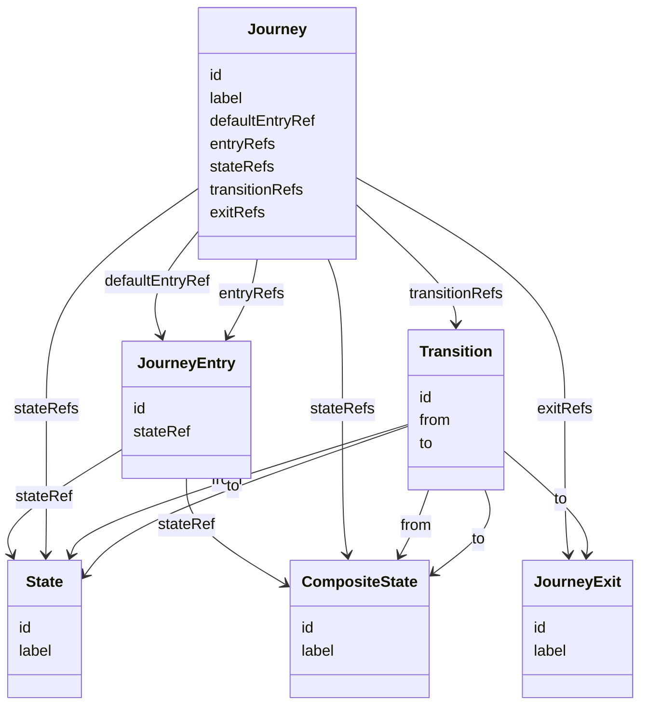

Example JSON node:

```json
[
  {
    "@type": "Journey",
    "@id": "urn:ujg:journey:site-search",
    "label": "Site search",
    "defaultEntryRef": "urn:ujg:entry:site-search-default",
    "entryRefs": [
      "urn:ujg:entry:site-search-default"
    ],
    "stateRefs": [
      "urn:ujg:state:search-form",
      "urn:ujg:state:results"
    ],
    "transitionRefs": [
      "urn:ujg:transition:search-form-to-results"
    ]
  },
  {
    "@type": "JourneyEntry",
    "@id": "urn:ujg:entry:site-search-default",
    "stateRef": "urn:ujg:state:search-form"
  }
]
```

A single-state journey can omit `transitionRefs`:

```json
[
  {
    "@type": "Journey",
    "@id": "urn:ujg:journey:privacy-policy",
    "label": "Privacy policy",
    "defaultEntryRef": "urn:ujg:entry:privacy-policy-default",
    "entryRefs": [
      "urn:ujg:entry:privacy-policy-default"
    ],
    "stateRefs": [
      "urn:ujg:state:privacy-policy"
    ]
  },
  {
    "@type": "JourneyEntry",
    "@id": "urn:ujg:entry:privacy-policy-default",
    "stateRef": "urn:ujg:state:privacy-policy"
  }
]
```

A journey can also omit `defaultEntryRef` when no entry is semantically a general fallback. In that
case, entry selection is unresolved by Graph unless an execution or materialization context selects
exactly one listed [=JourneyEntry=].

```json
[
  {
    "@type": "Journey",
    "@id": "urn:ujg:journey:workshop-detail",
    "label": "Workshop detail",
    "entryRefs": [
      "urn:ujg:entry:workshop-registration-open",
      "urn:ujg:entry:workshop-waitlist-open",
      "urn:ujg:entry:workshop-registration-closed"
    ],
    "stateRefs": [
      "urn:ujg:state:workshop-registration-open",
      "urn:ujg:state:workshop-waitlist-open",
      "urn:ujg:state:workshop-registration-closed"
    ]
  },
  {
    "@type": "JourneyEntry",
    "@id": "urn:ujg:entry:workshop-registration-open",
    "label": "Registration open",
    "stateRef": "urn:ujg:state:workshop-registration-open"
  },
  {
    "@type": "JourneyEntry",
    "@id": "urn:ujg:entry:workshop-waitlist-open",
    "label": "Waitlist open",
    "stateRef": "urn:ujg:state:workshop-waitlist-open"
  },
  {
    "@type": "JourneyEntry",
    "@id": "urn:ujg:entry:workshop-registration-closed",
    "label": "Registration closed",
    "stateRef": "urn:ujg:state:workshop-registration-closed"
  }
]
```

### JourneyEntry {data-cop-concept="journey-entry"}

A [=JourneyEntry=] is an explicit entry contract for a [=Journey=]. It identifies the local [=State=] or [=CompositeState=] where traversal begins without making that entry node part of the local transition topology.

<spec-statement>
1. A [=JourneyEntry=] **MUST** be identified by an IRI and declare exactly one `stateRef`.
2. `stateRef` **MUST** reference a [=State=] or [=CompositeState=] listed in the declaring [=Journey=]'s `stateRefs`.
3. A [=JourneyEntry=] **MUST** be listed in exactly one [=Journey=]'s `entryRefs`.
4. A [=JourneyEntry=] **MUST NOT** be used as a [=Transition=] endpoint.
5. A [=JourneyEntry=] **MAY** declare one `label` and one or more `tags`.
</spec-statement>

Top-level traversal of a [=Journey=] begins at an explicitly selected [=JourneyEntry=]. If no
entry is explicitly selected and the [=Journey=] declares `defaultEntryRef`, traversal begins at
the `stateRef` of that default entry. If neither applies, entry selection remains unresolved by
Graph.

When Graph leaves entry selection unresolved, a materialization or execution context may select one
listed entry. Consumers do not infer a default from `entryRefs` order, and contextual entry selection
does not change Graph topology. If no entry can be selected, traversal into that [=Journey=] remains
unresolved; that does not make the Graph invalid.

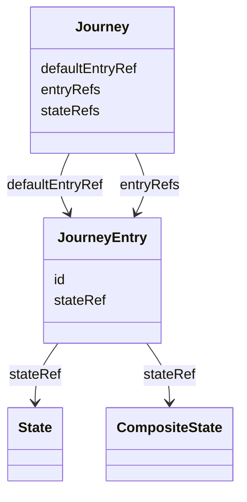

Example JSON node:

```json
{
  "@type": "JourneyEntry",
  "@id": "urn:ujg:entry:site-search-default",
  "label": "Default search entry",
  "stateRef": "urn:ujg:state:search-form"
}
```

### JourneyExit {data-cop-concept="journey-exits"}

A [=JourneyExit=] is a terminal local graph vertex and exported completion contract declared by a [=Journey=]. It represents a terminal journey outcome that can be reached by a local [=Transition=].

A parent journey can use exported exits to distinguish which outcome of a child journey was reached, without directly referencing child states.

<spec-statement>
1. A [=JourneyExit=] **MUST** be identified by an IRI and listed in exactly one [=Journey=]'s `exitRefs`.
2. A [=JourneyExit=] **MAY** declare one `label` and one or more `tags`.
3. A [=JourneyExit=] **MAY** be the `to` endpoint of a [=Transition=] in the declaring [=Journey=].
4. A [=JourneyExit=] is terminal: it **MUST NOT** be a `from` endpoint or expose entry transitions.
5. A [=JourneyExit=] **MUST NOT** model runtime facts, submitted values, analytics facts, or ordinary internal child movement.
6. A [=JourneyExit=] is neither a [=State=] nor a [=CompositeState=]: a node **MUST NOT** be typed [=JourneyExit=] and also [=State=] or [=CompositeState=].
</spec-statement>

If a completion point is an actual user-visible screen, page, modal, or step, it should remain a normal [=State=]. A journey can then transition from that state to a [=JourneyExit=] that represents the exported terminal outcome.

Informative pattern:

```text
CheckoutForm -> SuccessScreen -> CheckoutCompleteExit
```

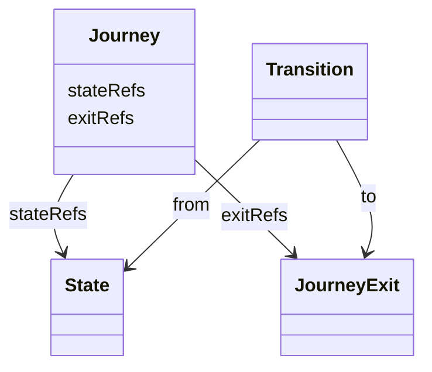

Example JSON nodes:

```json
{
  "@type": "JourneyExit",
  "@id": "urn:ujg:exit:checkout-complete",
  "label": "Checkout complete"
}
```

```json
{
  "@type": "Transition",
  "@id": "urn:ujg:transition:checkout-form-to-complete",
  "label": "Submit checkout",
  "from": "urn:ujg:state:checkout-form",
  "to": "urn:ujg:exit:checkout-complete"
}
```

---

## JourneyEntryIndex {data-cop-concept="journey-index"}

A [=JourneyEntryIndex=] is a Graph class and Core [=Node=] that acts as a catalogue of addressable [=JourneyEntry=] contracts. It is not a subclass of [=Journey=] and does not define traversal. A Consumer **MUST NOT** infer that indexed entries are reachable from one another, ordered as a path, or part of a parent-owned progression.

Use [=Journey=] when modeling local topology. Use [=JourneyEntryIndex=] when listing known entry points into modeled journeys. A root [=Journey=] should only be used when the root itself owns real traversal, progression, or structural order.

In common use, a [=JourneyEntryIndex=] lists default or named [=JourneyEntry=] contracts for modeled pages, surfaces, flows, or journeys. The referenced entries remain owned by their declaring [=Journey=].

<spec-statement>
1. A [=JourneyEntryIndex=] **MUST** be identified by an IRI and declare at least one `entryRefs` value.
2. Each `entryRefs` value **MUST** reference a [=JourneyEntry=] owned by exactly one [=Journey=].
3. A [=JourneyEntryIndex=] is a catalogue only: it **MUST NOT** own topology, entries, states, transitions, exits, or child-journey mappings.
4. `entryRefs` on a [=JourneyEntryIndex=] **MUST NOT** imply order, reachability, progression, a user path, or parent continuation.
</spec-statement>

[=JourneyEntryIndex=] is intended for top-level page maps, product surface indexes, search-result target indexes, documentation indexes, entry catalogues, and other collections of known journey entry points. Do not use [=JourneyEntryIndex=] to model page-segment order, local journey progression, child completion, runtime observations, or experience annotations.

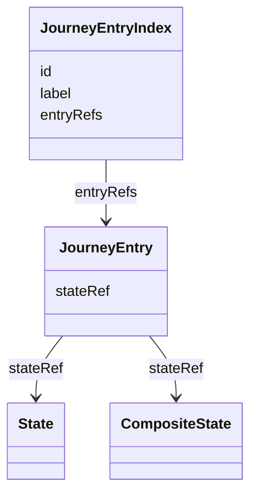

Example JSON node:

```json
{
  "@type": "JourneyEntryIndex",
  "@id": "urn:ujg:index:site-pages",
  "label": "Site page index",
  "entryRefs": [
    "urn:ujg:entry:home-page-default",
    "urn:ujg:entry:search-page-default",
    "urn:ujg:entry:profile-page-default"
  ]
}
```

The indexed entries are known entry contracts. Their order above does not define a path from the home page to search to profile.

---

## CompositeState {data-cop-concept="composition"}

A [=CompositeState=] groups the child [=Journey|Journeys=] that share one experience frame, such as
page content beside a sticky header. The parent Journey treats it as one
[=Local vertex|local vertex=]. It is not a [=State=]: it offers no affordances itself.

<spec-statement>
1. A [=CompositeState=] **MUST** be identified by an IRI, declare exactly one `label`, and declare one
   or more `subjourneyRefs`, each resolving to a [=Journey=]. It **MAY** declare one or more `tags`.
2. A [=CompositeState=] **MUST NOT** be typed [=State=] or [=JourneyExit=], and **MUST NOT** declare
   `stateRefs` or `entryTransitionRefs`.
3. Its child Journeys **MUST** be [=Co-present|co-present=]. Content the user reaches by moving
   through other content, such as by scrolling or paging, is a [=State=] reached by a [=Transition=].
4. The parent [=Journey=] treats the [=CompositeState=] as one [=Local vertex|local vertex=]: it can
   be a [=Transition=] `from` or `to` and a [=JourneyEntry=] `stateRef`. Child States are never
   listed by the parent, and nested composition is never flattened.
5. While a [=CompositeState=] occurrence is current, the user is at the current [=State=] of each
   child Journey, through nested CompositeStates. Each of those States offers its own
   [=Entry transition|entry transitions=].
6. Child Journeys are independent. `subjourneyRefs` is an unordered set. Consumers **MUST NOT** infer
   order, priority, dependency, synchronization, or joint completion between child Journeys, and
   movement in one does not move another.
7. A [=Journey=] **MAY** be a child of more than one [=CompositeState=]. Each reference is a separate
   child occurrence.
8. A parent [=Transition=] into a [=CompositeState=] **MAY** select one child entry with `toEntryRef`,
   owned by exactly one child Journey. It selects nothing for the other child Journeys.
9. Reaching a child [=JourneyExit=] does not leave the [=CompositeState=]. A parent [=Transition=]
   whose `from` is the CompositeState and whose `fromExitRef` is that exit is taken when the exit is
   reached; without one, the CompositeState stays current. Taking any parent Transition from a
   CompositeState leaves it and all of its child Journeys.
</spec-statement>

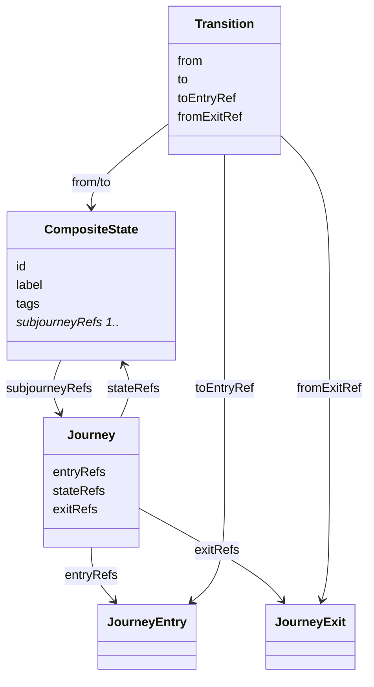

Whether two concerns share a CompositeState depends on co-presence, not on whether one page contains
both:

| If the user can… | Model it as |
| --- | --- |
| act on both in the frame at once | child Journeys of one [=CompositeState=] |
| reach one by moving through the other, such as by scrolling | States of one [=Journey=] connected by [=Transition|Transitions=] |
| act on one only after it covers the other, as a modal does | an [=InvokingTransition=] |

A sticky header stays in the viewport while the page content scrolls, so it is a child Journey of
each page that shows it. The header Journey is declared once, and each page references it:

```json
[
  {
    "@type": "CompositeState",
    "@id": "urn:ujg:state:home-page",
    "label": "Home page",
    "subjourneyRefs": ["urn:ujg:journey:home-content", "urn:ujg:journey:sticky-header"]
  },
  {
    "@type": "CompositeState",
    "@id": "urn:ujg:state:article-page",
    "label": "Article page",
    "subjourneyRefs": ["urn:ujg:journey:article-content", "urn:ujg:journey:sticky-header"]
  }
]
```

A footer is reached by scrolling, so it is a State of the page's content Journey, reached by a
Transition. Because a State belongs to one Journey, each content Journey declares its own footer
State; those States can list the same entry transition nodes.

A one-page checkout shows shipping and payment side by side:

```text
Checkout CompositeState
  Shipping Journey: Address -> DeliveryOption -> Confirmed
  Payment Journey:  Authorizing -> PaymentFailureExit
```

A parent Transition can enter Checkout at a specific shipping entry. That selects nothing for
Payment:

```json
{
  "@type": "Transition",
  "@id": "urn:ujg:transition:cart-to-checkout",
  "label": "Start checkout",
  "from": "urn:ujg:state:cart",
  "to": "urn:ujg:state:checkout",
  "toEntryRef": "urn:ujg:entry:shipping-address"
}
```

A parent Transition can react to the payment failure. Reaching `PaymentFailureExit` takes it and
leaves Checkout. Without it, Payment is complete and Shipping continues:

```json
{
  "@type": "Transition",
  "@id": "urn:ujg:transition:checkout-to-payment-error",
  "label": "Show payment error",
  "from": "urn:ujg:state:checkout",
  "to": "urn:ujg:state:payment-error",
  "fromExitRef": "urn:ujg:exit:payment-failed"
}
```

---


## Normative Artifacts

This module is published through the following artifacts:

- `graph.ttl`: ontology, published at `https://ujg.specs.openuji.org/ed/ns/graph`
- `graph.context.jsonld`: JSON-LD term mappings, published at `https://ujg.specs.openuji.org/ed/ns/graph.context.jsonld`
- `graph.shape.ttl`: SHACL validation rules, published at `https://ujg.specs.openuji.org/ed/ns/graph.shape`

Examples on this page use compact JSON-LD fragments. Complete documents can use the aggregate
context `https://ujg.specs.openuji.org/ed/ns/context.jsonld`, which preserves Graph's compact
`stateRef` term for [=JourneyEntry=].

### Ontology {data-cop-concept="ontology"}

The normative Graph ontology is defined below and is published at `https://ujg.specs.openuji.org/ed/ns/graph`. It is the authoritative structural definition for Graph classes and properties, including `Journey`, `JourneyEntry`, `JourneyEntryIndex`, `State`, `CompositeState`, `Transition`, `Command`, `JourneyExit`, `OutgoingTransition`, `InvokingTransition`, `defaultEntryRef`, `entryRefs`, `stateRef`, `exitRefs`, `toEntryRef`, `fromExitRef`, `commandRef`, `subjourneyRefs`, and `entryTransitionRefs`.

:::include ./graph.ttl :::

### JSON-LD Context {data-cop-concept="jsonld-context"}

The normative Graph JSON-LD context is defined below and is published at `https://ujg.specs.openuji.org/ed/ns/graph.context.jsonld`. It provides the compact JSON-LD term mappings for the Graph vocabulary used by the examples on this page.

:::include ./graph.context.jsonld :::

---

### Validation {data-cop-concept="validation"}

The normative Graph SHACL shape is defined below and is published at `https://ujg.specs.openuji.org/ed/ns/graph.shape`. It is the authoritative validation artifact for Graph structural constraints.

:::include ./graph.shape.ttl :::

---

## Graph Integrity and Resolution {data-cop-concept="graph-integrity"}

The rules below define additional graph integrity and resolution behavior beyond the structural constraints captured by the SHACL shape.

<spec-statement>
To ensure graph integrity, the following constraints **MUST** be met:

1. Every Graph reference **MUST** resolve within the current scope or imported modules.
2. References **MUST** resolve to the class expected by the property that uses them.
3. Local [=Transition=] endpoints **MUST** stay inside the declaring [=Journey=]'s
   [=Local vertex|local vertices=], also inside child Journeys.
4. On a [=Transition=], `toEntryRef` and `fromExitRef` **MUST** resolve through one of the child
   Journeys referenced by the relevant [=CompositeState=]'s `subjourneyRefs`. The referenced
   [=JourneyEntry=] or [=JourneyExit=] **MUST** be owned by exactly one such child Journey.
5. On an [=OutgoingTransition=] or [=InvokingTransition=], `toEntryRef` **MUST** resolve to a
   [=JourneyEntry=] owned by exactly one [=Journey=], and the entry's `stateRef` **MUST** resolve
   inside that Journey's `stateRefs`.
6. Each [=OutgoingTransition=] and [=InvokingTransition=] **MUST** declare exactly one `toEntryRef`
   and **MUST NOT** declare `from`, `fromExitRef`, or `to`.
7. Each `commandRef` **MUST** resolve to a [=Command=].
8. The [=Journey=] that owns an [=InvokingTransition=]'s `toEntryRef` **MUST** declare at least one
   `exitRefs` value.
</spec-statement>
