## Overview

This module defines the vocabulary for intended user flow. It extends [[UJG Core]] to support structured, interactive graphs with composition through one or more child-Journey references, exported exits from nested journeys, organization tags, and state-scoped navigation and invocation affordances. Graph describes intended topology and possible movement; it does not prescribe execution, scheduling, condition evaluation, or event processing.

## Terminology

- <dfn>Journey</dfn>: A named container for local traversable user flow topology.
- <dfn>Local vertex</dfn>: A node of one [=Journey=]'s local topology: a [=State=] or [=CompositeState=] listed in its `states`, or a [=JourneyExit=] listed in its `exits`. [=Transition|Transitions=] and [=AdjacentTransition|AdjacentTransitions=] connect local vertices of the same Journey.
- <dfn>JourneyEntry</dfn>: An explicit entry contract for a [=Journey=].
- <dfn>JourneyEntryIndex</dfn>: A catalogue of addressable [=JourneyEntry=] contracts that does not define traversal.
- <dfn>State</dfn>: A discrete node in the experience (e.g., a screen, modal). A State is the only [=Local vertex|local vertex=] that offers [=Entry transition|entry transitions=].
- <dfn>State occurrence</dfn>: A concrete experienced occurrence of a [=State=] during traversal.
- <dfn>Transition</dfn>: A structural directed edge between [=Local vertex|local vertices=] of a [=Journey=].
- <dfn>AdjacentTransition</dfn>: A structural edge between two [=Local vertex|local vertices=] of a [=Journey=], or between two [=Collection member|members=] of a [=StateCollection=], that sit next to each other in the same experience frame and share a border. The user can cross that border in either direction.
- <dfn>Command</dfn>: A stable semantic identity of an intentional invocation in the modeled experience.
- <dfn>CompositeState</dfn>: A [=Local vertex|local vertex=] that nests one or more child [=Journey|Journeys=] in its parent Journey. It is not a [=State=].
- <dfn>Composite scope</dfn>: The set of child Journeys referenced by one [=CompositeState=].
- <dfn>Co-present</dfn>: Journeys are co-present when the user can perceive and act on each of them at the same time in the same experience frame: the viewport, window, screen, or dialog session that stays in place while its content changes.
- <dfn>JourneyExit</dfn>: A terminal [=Local vertex|local vertex=] and exported completion contract declared by a [=Journey=].
- <dfn>OutgoingTransition</dfn>: A navigational affordance that enters a [=Journey=] through a [=JourneyEntry=].
- <dfn>InvokingTransition</dfn>: An affordance that invokes a [=Journey=] through a [=JourneyEntry=] and resumes the source [=State occurrence=] when that Journey reaches one of its exits.
- <dfn>Entry transition</dfn>: An [=OutgoingTransition=] or [=InvokingTransition=]: an affordance available at a [=State=] that enters a [=Journey=] through a [=JourneyEntry=], named in the Graph or selected when the transition is taken.
- <dfn>EntrySelector</dfn>: A Graph node that lets an [=Entry transition|entry transition=] enter a [=JourneyEntry=] selected each time the transition is taken, instead of one named in the Graph.
- <dfn>StateCollection</dfn>: A Graph node that lets one [=State=] or [=CompositeState=], its *member State*, stand for several similar parts of an experience, its [=Collection member|members=].
- <dfn>Collection member</dfn>: One of the parts of an experience that a [=StateCollection=]'s member State stands for, such as one row of a list.
- <dfn>Member transition</dfn>: A [=Transition=] or [=AdjacentTransition=] listed in a [=StateCollection=]'s `memberTransitions`. It moves the user from one [=Collection member|member=] to another member of the same collection.

---

## State {data-cop-concept="state"}

A [=State=] is the graph node for a discrete point in an intended user experience, such as a page, screen, modal, or other user-visible step. It is a leaf of the local topology: it does not contain Journeys. Nested composition is the job of a [=CompositeState=], which is a separate class.

This section defines the State node. A State also lists the
[=Entry transition|entry transitions=] it offers, as described in the State-scoped entry transitions
subsection below; the transition classes themselves are defined in the Transitions section.

<spec-statement>
1. A [=State=] **MUST** be identified by an IRI.
2. A [=State=] **MUST** declare exactly one `label`.
3. A [=State=] **MAY** declare one or more `tags`.
4. Multiple concrete occurrences of the same [=State=] **MAY** exist within an active [=Journey=];
   Graph does not define occurrence identity, cardinality, lifecycle, or materialization.
</spec-statement>

When one State stands for many similar parts of an experience, such as the rows of a list, a
[=StateCollection=] declares those parts as its members, as described in the StateCollection
subsection below.

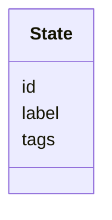

Example node:

```ujg-example
./examples/example-23.yamlld
```

### State-scoped entry transitions {data-cop-concept="state-scoped-entry-transitions"}

A [=State=] lists the [=Entry transition|entry transitions=] it offers in `entryTransitions`.
Entry transitions are for navigation and invocation options, not for ordinary internal progression
through a journey.

An entry transition is a node of its own, so several States can list the same one, such as a link
offered on several pages.

<spec-statement>
1. Only a [=State=] **MAY** declare `entryTransitions`. A [=CompositeState=], a [=Journey=], and
   every other Graph class **MUST NOT**.
2. Each `entryTransitions` value **MUST** reference an [=OutgoingTransition=] or an
   [=InvokingTransition=]. One State **MAY** list both.
3. Each [=State=] that lists an entry transition is an effective source of that transition, at its
   own occurrences only.
4. An entry transition is not inherited. It is not available at a State merely because that State is
   nested in a [=CompositeState=], shares a child Journey with the State that lists it, or is a
   sibling of it.
5. Entry transitions are not members of the enclosing [=Journey=]'s `transitions`.
6. An entry transition's destination, its fixed `toEntry` or its [=EntrySelector=], is the same
   at every State that lists it. Consumers **MUST NOT** reinterpret that destination relative to
   the source state.
7. When the intended destination entry varies with the source, Producers **MUST** use
   source-specific [=OutgoingTransition|OutgoingTransitions=] or
   [=InvokingTransition|InvokingTransitions=] instead of one shared transition.
</spec-statement>

Share one entry transition across States only when the same destination entry is correct from each
of them. A shared transition cannot express “re-enter whichever state is currently active.” When an
affordance preserves one of several possible source states—such as a state-preserving locale
switch—model a separate [=OutgoingTransition=] for each source state and target a [=JourneyEntry=]
whose `state` is that state. The entries and transitions are distinct even when the affordances
have the same label and locale metadata.

A [=CompositeState=] lists no entry transitions. While it is current, the current States of its child
Journeys offer theirs.

While an [=InvokingTransition=] is in progress, its retained source is suspended, so entry
transitions available at the source are not offered inside the invoked Journey. They are available
there only when the invoked Journey's own States list them.

A State of Journey J that lists an [=InvokingTransition=] into J lets J invoke itself. Each
activation enters J again and retains the current State occurrence of J, so invocations of J nest.
For example, the States of a privacy settings Journey normally do not list the entry transition that
opens the privacy settings.

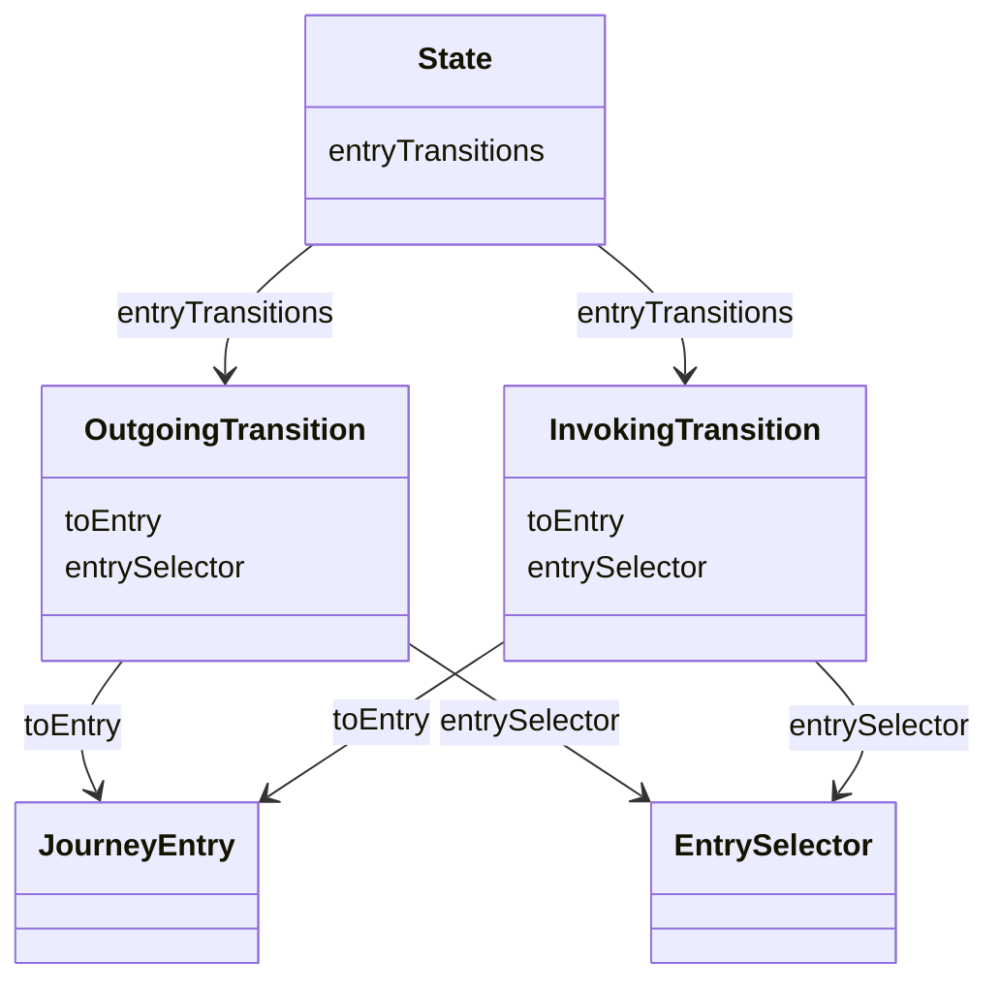

Example nodes:

```ujg-example
./examples/example-22.yamlld
```

```ujg-example
./examples/example-21.yamlld
```

This is a "Back to home page" navigation affordance, not an internal [=Transition=]. The source
Journey references the destination entry contract, never the destination State directly.

An example that mixes navigation and invocation is shown in the [=InvokingTransition=] section.

### StateCollection {data-cop-concept="state-collection"}

A [=StateCollection=] lets one State stand for many similar parts of an experience, such as the rows
of a list, the cards of a feed, or the slides of a carousel. Each part is a
[=Collection member|member=]. The State, called the member State, is modeled once, and every member
offers what it offers. The collection also lists the [=Member transition|member transitions=]: the
ways the user gets from one member to another, such as scrolling to the next card or pressing
"Next". Which member the user reaches is not part of the Graph.

When each part has steps of its own, the member State is a [=CompositeState=], so each member gets
its own child Journeys.

| The repeated parts… | Model |
| --- | --- |
| behave the same and have no steps of their own | A [=StateCollection=] whose member State is a [=State=] |
| behave the same, and each has steps of its own | A [=StateCollection=] whose member State is a [=CompositeState=] |
| behave differently | Separate [=State|States=] or Journeys |

<spec-statement>
1. A [=StateCollection=] lets its member State, a [=State=] or [=CompositeState=], stand for several
   distinct parts of an experience: its [=Collection member|members=]. Every member offers what the
   member State offers. Being at a member is an occurrence of the member State.
2. Members are independent. Taking a transition at one member does not take it at another. A
   [=Transition=] from the member State to itself that the [=Journey=] lists leaves and re-enters
   the member where it is taken. Other members change only through a declared effect.
3. A [=Member transition|member transition=] leaves the member it starts from and enters another
   member of the same collection, as any transition leaves its `from` vertex and enters its `to`
   vertex. Graph names neither member: both are known only when the movement happens.
   - A member [=AdjacentTransition=] crosses the border between neighboring members, in either
     direction.
   - A member [=Transition=] describes a move that has its own [=Command=], guard, or effect. When
     the member State is a [=CompositeState=], a child exit of the member it leaves can trigger it
     through `fromExit`, and it can select a child entry of the member it enters through
     `toEntry`, as a parent Transition of a CompositeState does.
4. The user moves from one member to another only through member transitions. Membership alone
   implies no order, neighbors, progression, synchronization, or priority among members.
5. Entering the member State from another vertex enters one of its members, and Graph does not
   name which. Leaving the member State for another vertex leaves the collection. An
   [=InvokingTransition=] activated at a member retains that member, and completion resumes it.
6. Members belong to one occurrence of the [=Journey=] that owns the member State. A member
   transition stays inside that Journey occurrence and inside every [=CompositeState=] occurrence
   that contains that Journey occurrence. Each occurrence of the Journey, for example as the child
   of different CompositeStates or as an invoked Journey, has its own members.
7. When the member State is a [=CompositeState=], each member has its own child Journey occurrences.
   A member transition leaves the child Journeys of the member it leaves and enters the member it
   moves to, as any Transition from and into a CompositeState does.
8. Graph does not define how many members exist or which they are, nor how members are told apart,
   ordered, added, removed, loaded, or presented.
9. Producers **SHOULD** declare a [=StateCollection=] when one State or CompositeState stands for
   several parts that the user moves between, instead of declaring one State per part. Parts that
   behave differently are different States. Parts that offer the same affordances behave the same,
   even when one of those affordances enters a different entry at each part. Producers **SHOULD
   NOT** add a member Transition that adds nothing to a member AdjacentTransition of the same
   collection: no Command, child entry or exit selection, guard, or effect.
</spec-statement>

An [=Entry transition|entry transition=] that the member State lists is offered at each member.
With an [=EntrySelector=], the entry it enters can differ from member to member.

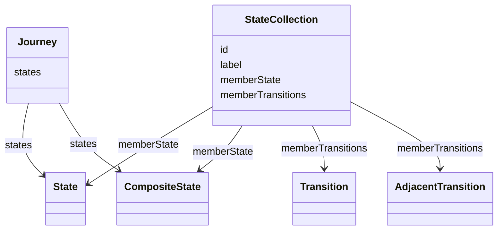

In the example below, "Toggle item" acts at the member where it is taken and stays there. Crossing
the border to a neighboring member, or invoking "Next item", moves to another member; neither names
which one.

```ujg-example
./examples/example-20.yamlld
```

---


## Transitions {data-cop-concept="transitions"}

Graph has four transition classes. A [=Transition=] is ordinary directed progression inside one
[=Journey=]. An [=AdjacentTransition=] connects two vertices of one Journey that share a border,
and the user can cross it in either direction. [=OutgoingTransition=] and [=InvokingTransition=] are
[=Entry transition|entry transitions=]: affordances available at a State that enter a Journey
through an explicit [=JourneyEntry=]. The two entry transition classes differ only in what happens
to the source [=State occurrence=].

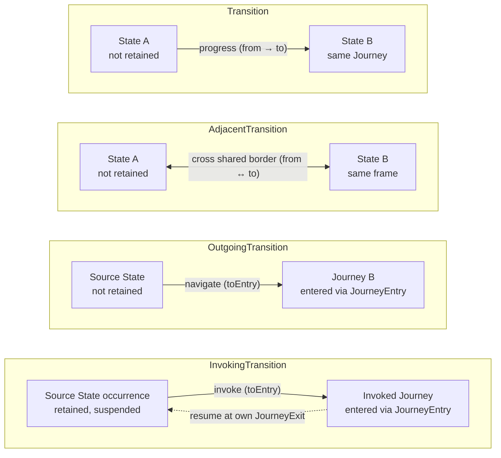

| | [=Transition=] | [=AdjacentTransition=] | [=OutgoingTransition=] | [=InvokingTransition=] |
| --- | --- | --- | --- | --- |
| Source | Explicit local `from` vertex | Either local vertex, `from` or `to` | State where the affordance is available | State where the affordance is available |
| Destination | Local `to` vertex, or another member for a [=Member transition|member transition=] | The other local vertex, or a neighboring member for a member transition | `toEntry` entry contract, or an entry selected through an [=EntrySelector=] | `toEntry` entry contract, or an entry selected through an [=EntrySelector=] |
| Declared through | `transitions` on a [=Journey=], or `memberTransitions` on a [=StateCollection=] | `transitions` on a [=Journey=], or `memberTransitions` on a [=StateCollection=] | `entryTransitions` on a [=State=] | `entryTransitions` on a [=State=] |
| Source State occurrence | Not retained | Not retained | Not retained | Retained and suspended until the invocation completes or is cancelled |
| Meaning | Ordinary progression inside one Journey | Cross a border that two vertices share in one experience frame, in either direction | Leave local progression and enter a Journey through an entry contract | Enter a Journey through an entry contract, then resume the source when that Journey exits |

An entry transition has no `from` property. Its effective source is each [=State=] that lists it in
`entryTransitions`. [=Transition=], [=OutgoingTransition=], and [=InvokingTransition=] can
reference a [=Command=] with `command`. An [=AdjacentTransition=] cannot.

An entry transition either names its [=JourneyEntry=] with `toEntry` or, when the entry is known
only when the transition is taken, references an [=EntrySelector=], described at the end of this
section.

### Transition {data-cop-concept="transition"}

A [=Transition=] is a structural directed edge between [=Local vertex|local vertices=] of a [=Journey=]. It models ordinary progression inside the local topology of a [=Journey=].

A [=Transition=] is not owned by either endpoint state. It is owned by a journey through `transitions`, or, as a [=Member transition|member transition=], by a [=StateCollection=] through `memberTransitions`.

A [=Transition=] applies to every concrete occurrence of the [=Local vertex|local vertex=] its `from`
value references.
The [=Transition=] itself remains one stable Graph node.

A [=Transition=] describes movement in one direction only. Movement back to its `from` vertex is
another Transition, unless the two vertices share a border, in which case one
[=AdjacentTransition=] describes both directions.

The presence of multiple child Journeys in one [=CompositeState=] does not create implicit
Transitions between them.

<spec-statement>
1. A [=Transition=] **MUST** be identified by an IRI, declare exactly one `from`, and declare exactly one `to`.
2. A [=Transition=] **MAY** declare one `label`.
3. A [=Transition=] **MAY** reference one [=Command=] with `command`.
4. When listed in a [=Journey=]'s `transitions`, `from` **MUST** reference a [=State=] or [=CompositeState=] in that journey's `states`.
5. When listed in a [=Journey=]'s `transitions`, `to` **MUST** reference a [=State=] or [=CompositeState=] in that journey's `states`, or a [=JourneyExit=] in that journey's `exits`.
6. [=Transition=] endpoints **MUST** stay local to the enclosing [=Journey=].
7. `toEntry` **MAY** be used only on parent transitions into [=CompositeState=] nodes, and `fromExit` only on parent transitions from them, as defined under [=CompositeState=].
8. A [=Transition=] **MUST** remain one Graph node regardless of how many concrete occurrences its endpoints have; per-instance transition properties are outside Graph.
9. A child Journey's [=Transition=] **MUST NOT** connect directly to a [=State=], [=CompositeState=], or [=JourneyExit=] owned only by another child Journey.
</spec-statement>

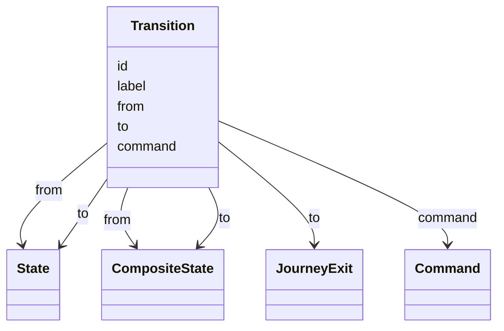

Example node:

```ujg-example
./examples/example-19.yamlld
```

### AdjacentTransition {data-cop-concept="adjacent-transition"}

An [=AdjacentTransition=] connects two [=Local vertex|local vertices=] of a [=Journey=] that sit
next to each other in the same experience frame and share a border. The user can cross that border
in either direction, so one AdjacentTransition describes movement both ways.

`from` and `to` name the vertex before and the vertex after the border in the frame's reading order.
That order does not restrict movement. As with a [=Transition=], crossing the border leaves one
vertex and makes the other current. Crossing back makes the first vertex current again, so a
[=State=] offers its [=Entry transition|entry transitions=] again. Parts of a frame that the user
acts on at the same time are not adjacent vertices.

A [=Member transition|member=] AdjacentTransition connects neighboring
[=Collection member|members=] of a [=StateCollection=]. Its `from` and `to` are both the member
State, and which neighbor it reaches is known only when the user crosses the border. Crossing it
leaves one member and enters the other.

<spec-statement>
1. An [=AdjacentTransition=] describes movement from its `from` vertex to its `to` vertex and from
   its `to` vertex to its `from` vertex. Each movement leaves the vertex it starts from, as taking a
   [=Transition=] does.
2. An [=AdjacentTransition=] **MUST** remain one Graph node regardless of the direction of movement
   and of how many concrete occurrences its endpoints have.
3. Moving across an [=AdjacentTransition=] into a [=CompositeState=] selects no child entry, as for a
   [=Transition=] without `toEntry`. Moving across it out of a [=CompositeState=] leaves the
   CompositeState and all of its child Journeys.
4. Producers **SHOULD NOT** also declare a [=Transition=] between the same two vertices, in either
   direction, that adds nothing to the adjacency: no [=Command=], child entry or exit selection,
   guard, or effect. The AdjacentTransition already describes that movement. For a
   [=Member transition|member=] AdjacentTransition, this applies to the member Transitions of the
   same collection, not to a Transition from the member State to itself that a Journey lists.
</spec-statement>

Adjacent vertices occur, for example, as consecutive sections of a scrolling view or as pages of a
pager that shows one page at a time. Use a [=Transition=] when a movement has its own [=Command=],
guard, effect, or child-entry selection. Both can connect the same two vertices: the
AdjacentTransition describes crossing the border, and the Transition describes that particular
movement.

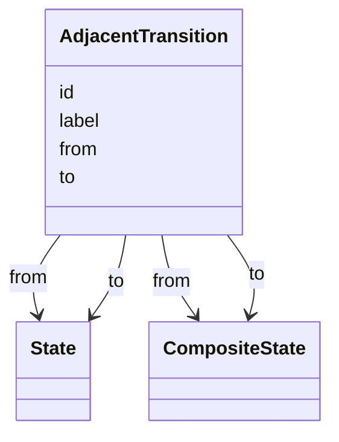

Example node:

```ujg-example
./examples/example-18.yamlld
```

### OutgoingTransition {data-cop-concept="outgoing-transition"}

An [=OutgoingTransition=] is a navigational affordance that enters a Journey through an explicit
[=JourneyEntry=]. It does not declare structural progression in the source Journey's local topology.

The destination entry's `state` identifies the first local [=State=] or [=CompositeState=] of the
destination Journey. Consumers do not bypass the entry contract by linking the outgoing affordance
directly to that state.

<spec-statement>
1. An [=OutgoingTransition=] **MUST** be identified by an IRI and **MAY** declare one `label`.
2. An [=OutgoingTransition=]'s destination entry is either fixed by `toEntry` or selected when
   the transition is taken, through the [=EntrySelector=] that `entrySelector` references.
3. An [=OutgoingTransition=] **MAY** reference one [=Command=] with `command`.
4. The destination entry, fixed or selected, **MUST** be a [=JourneyEntry=] owned by exactly one
   [=Journey=].
5. The destination entry's `state` **MUST** reference a [=State=] or [=CompositeState=] in that
   owner Journey's `states`.
6. The destination entry **MAY** belong to the Journey where the affordance is available. Such a
   target is explicit Journey re-entry, including when the entry points to the effective source state.
7. An [=OutgoingTransition=] **MUST NOT** declare `from`, `fromExit`, `to`, or
   `entryTransitions`, target a [=JourneyExit=], appear in `transitions`, or model ordinary
   internal progression.
</spec-statement>

A [=JourneyEntryIndex=] may catalogue the destination entry for discovery, but index membership is
not required for navigation. The entry remains owned by its declaring Journey.

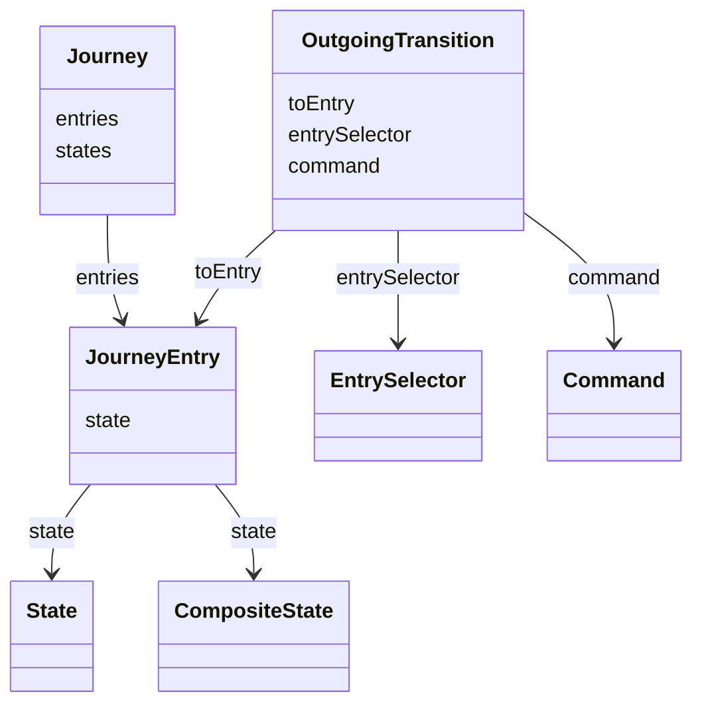

Cross-Journey navigation names the destination entry rather than its State:

```ujg-example
./examples/example-17.yamlld
```

The same pattern represents same-state re-entry: the OutgoingTransition targets a JourneyEntry whose
`state` is the state where the affordance is available. This remains explicit re-entry, not an
implicit relative target.

```ujg-example
./examples/example-16.yamlld
```

### InvokingTransition {data-cop-concept="invoking-transition"}

An [=InvokingTransition=] invokes a Journey through an explicit [=JourneyEntry=]. It has the same
source and destination model as an [=OutgoingTransition=]. The difference is lifecycle: the source
[=State occurrence=] is retained, and it resumes when the invoked Journey reaches one of its exits.

<spec-statement>
1. An [=InvokingTransition=] **MUST** be identified by an IRI and **MAY** declare one `label`. It
   names its destination entry as an [=OutgoingTransition=] does, fixed by `toEntry` or selected
   through an [=EntrySelector=], and **MAY** reference one [=Command=] with `command`. It
   **MUST NOT** declare `from`, `fromExit`, `to`, or `entryTransitions`,
   target a [=JourneyExit=], appear in `transitions`, model ordinary internal progression, or
   also be typed [=OutgoingTransition=].
2. The effective source of an [=InvokingTransition=] is each [=State=] that lists it in
   `entryTransitions`, exactly as for an [=OutgoingTransition=].
3. The destination entry, fixed or selected, **MUST** be a [=JourneyEntry=] owned by exactly one
   [=Journey=], and the entry's `state` **MUST** reference a [=State=] or [=CompositeState=] in
   that owner Journey's `states`. That Journey is the *invoked Journey*. With an
   [=EntrySelector=], each activation has its own invoked Journey. The invoked Journey **MUST**
   declare at least one `exits` value.
4. The invoked Journey **MAY** be the Journey where the affordance is available. Each activation is a
   separate, nested invocation.
5. Activating an [=InvokingTransition=] enters the invoked Journey through its destination entry and retains
   the source [=State occurrence=], including any active composite scope. The source occurrence is
   not left. While the invocation is in progress, the retained source occurrence, together with any
   composite scope retained with it, is suspended: no [=Transition=], [=AdjacentTransition=], or
   entry transition is taken from the source occurrence, and no parent Transition or
   AdjacentTransition is taken from a retained [=CompositeState=]. State occurrences inside that composite scope that are not the source, such
   as States of a sibling child Journey, are not suspended and keep their own transitions and entry
   transitions. A parent Transition that a sibling's child exit triggers meanwhile is taken after the
   invocation completes, and not at all if it is cancelled.
6. Reaching a [=JourneyExit=] listed in the invoked Journey's own `exits` completes the
   invocation. The retained source occurrence then resumes without entering a [=JourneyEntry=] or
   taking a [=Transition=]. A child [=JourneyExit=] reached inside a [=CompositeState=] of the
   invoked Journey is not completion; it follows the [=CompositeState=] rules.
7. The reached [=JourneyExit=] is the outcome of the invocation. Graph assigns no per-outcome
   continuation.
8. An invocation is cancelled, not completed, when the invoked Journey is left in any way other than
   reaching one of its own exits. Traversing an [=OutgoingTransition=] from any [=State occurrence=]
   of the invoked Journey, including one inside its composite scopes, leaves the invoked Journey,
   even when the destination entry belongs to the invoked Journey itself. Activating an
   [=InvokingTransition=] from inside the invoked Journey does not leave it.
9. An invocation is also cancelled when its retained source occurrence is left before the
   invocation completes, for example because an [=OutgoingTransition=] is taken from a State of a
   sibling child Journey, which is not suspended. The invoked Journey is then left as well, which
   cancels any invocation nested inside it. A sibling child Journey reaching a [=JourneyExit=] does
   not leave the source.
10. When an invocation is cancelled, Consumers **MUST NOT** infer a return, and the retained source
    occurrence **MUST NOT** be resumed. A source occurrence that is still retained is left, including
    its active composite scope. If that source occurrence is inside a Journey that was itself
    invoked, that Journey is left as well, which cancels its invocation in turn. Cancellation
    therefore releases every retained occurrence in the invocation chain.
11. An [=InvokingTransition=] does not add the invoked Journey to any `subjourneys`. The invoked
    Journey occurrence is not a child of any [=CompositeState=] occurrence, even when the same
    Journey is listed in some CompositeState's `subjourneys`. The [=CompositeState=] rules for
    child exits therefore do not apply to its exits, and completion never leaves a CompositeState,
    neither one that lists the invoked Journey nor one that contains the source.
12. Graph does not define invocation identifiers or association data between source and invoked
    occurrences.
</spec-statement>

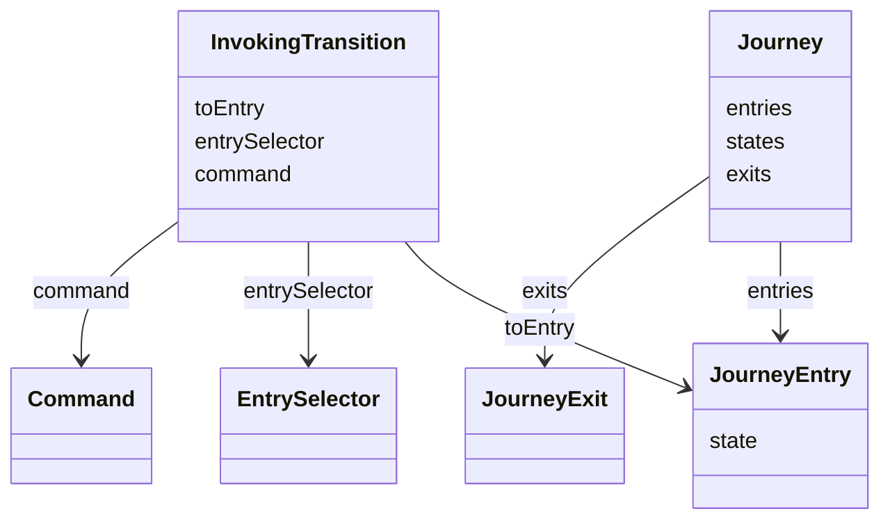

A privacy settings dialog invoked from an article page. Either exit completes the invocation, and
the Article State occurrence resumes. `settings-saved` and `settings-dismissed` are distinguishable
outcomes, but neither is a destination.

```ujg-example
./examples/example-15.yamlld
```

Several pages can share entry transitions of both classes. "Privacy policy" navigates away
from the current page. "Adjust privacy settings" invokes the privacy settings Journey from the
example above and returns to the current page when that Journey exits. Each page's State lists the
same two transitions; each node's class determines its semantics.

```ujg-example
./examples/example-14.yamlld
```

Mapping and Metrics do not yet account for [=InvokingTransition=]. Mapping gives the invoked
Journey's steps their own local scope, so its exits end no [=CompositeState=] occurrence. Otherwise,
until they do, Mapping treats both the entry into the invoked Journey and the resumption of the
source State as unexplained movements, so each completed invocation adds two derived jumps, and two
to `unexplainedMovementCount`, across the execution's JourneyMappings.

### EntrySelector {data-cop-concept="entry-selector"}

An [=EntrySelector=] lets one [=Entry transition|entry transition=] lead to a different entry each
time it is taken, such as an "Open" link on every row of a list where one row opens an article and
the next a topic page. The link is modeled once, and so is whether it navigates or invokes. Which
[=JourneyEntry=] it enters comes from the row, or more generally from the occurrence of the State
where the user takes it, and the Graph does not name it.

The transition references the selector with `entrySelector` instead of naming an entry with
`toEntry`. The selector can list the Journeys that the entry may belong to in
`candidateJourneys`. When the rows are the [=Collection member|members=] of a
[=StateCollection=], each member can open a different entry.

| The destination entry… | Model |
| --- | --- |
| is the same at every occurrence, and only the content shown there differs | `toEntry` |
| depends on which State lists the affordance | One entry transition per source State, as described under State-scoped entry transitions |
| differs between occurrences of the same State, such as between the members of a StateCollection | `entrySelector` |

<spec-statement>
1. An entry transition that references an [=EntrySelector=] enters a [=JourneyEntry=] that Graph
   does not name. The entry is known only when the transition is taken, and it can differ between
   occurrences of the State that lists the transition.
2. When the selection resolves, the transition enters exactly one JourneyEntry, and the movement
   is the one its class defines. An [=OutgoingTransition=] leaves the source [=State occurrence=]. An
   [=InvokingTransition=] retains it, and the Journey that owns the selected entry is the invoked
   Journey of that activation.
3. When the selector declares `candidateJourneys`, the selected entry belongs to one of those
   Journeys. Without candidates, it can belong to any Journey, including one defined in a document
   that becomes available only when the transition is taken.
4. When the selection resolves to no JourneyEntry, the transition enters no Journey, and Consumers
   **MUST NOT** infer traversal from it. An invocation cannot select an entry whose Journey declares
   no exits, because reaching one of those exits is what resumes the source.
5. Selecting an entry adds no State, Transition, or JourneyEntry to the Graph. The selection does
   not depend on which State lists the transition: when the destination does, Producers use
   source-specific entry transitions, as described under State-scoped entry transitions.
6. Graph does not define how candidate entries are produced, listed, ranked, or loaded, or how an
   occurrence resolves to an entry.
7. Producers **SHOULD** use `toEntry` when every occurrence enters the same entry. Producers
   **SHOULD** declare `candidateJourneys` when the possible Journeys are known: the candidates
   state where the user can go, and they let Consumers tell an explained movement from drift.
</spec-statement>

The candidates belong to the selector, not to the transitions that reference it. When an
[=InvokingTransition=] references a selector, every candidate Journey declares exits, also when
OutgoingTransitions share that selector.

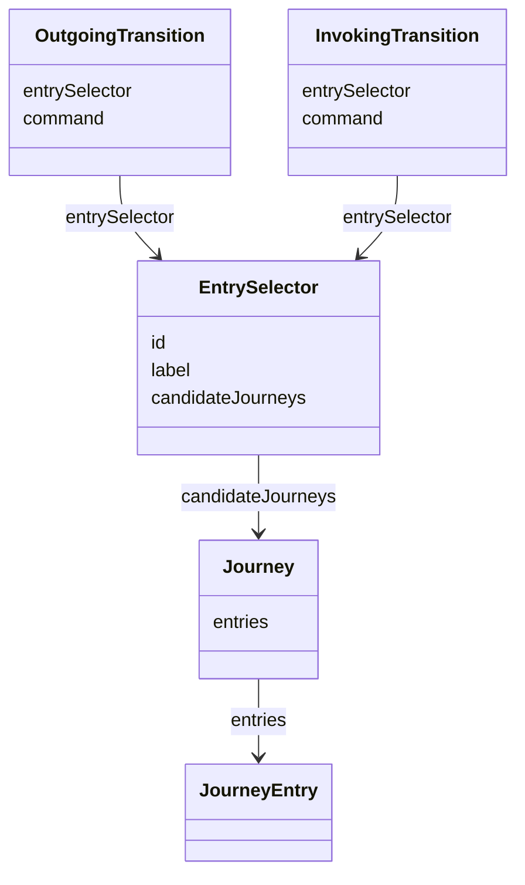

In the example below, each item of a list offers "Open item". Which entry it opens comes with the
item: an entry of the Article Journey or of the Topic Journey. The candidate Journeys are declared
elsewhere.

```ujg-example
./examples/example-13.yamlld
```

---


## Command {data-cop-concept="command"}

A [=Command=] identifies the stable semantic identity of an intentional invocation in the modeled
experience.

A [=Command=] can be referenced by [=Transition=], [=OutgoingTransition=], and
[=InvokingTransition=] nodes through `command`. Multiple transitions may reference the same [=Command=]. Sharing a `command`
establishes only common invocation identity. Graph does not assign branching, selection, ordering,
resolution, execution-result, or effect semantics to that relationship.

A [=Command=] is not a transition endpoint and does not replace [=Transition=],
[=OutgoingTransition=], or [=InvokingTransition=]. Structural, automatic, expiry-driven, or otherwise non-invoked transitions
can remain without `command`.

An [=AdjacentTransition=] never references a [=Command=]: crossing a shared border is not an
intentional invocation. A commanded movement between the same two vertices is a separate
[=Transition=] with `command`.

<spec-statement>
1. A [=Command=] **MUST** be identified by an IRI.
2. A [=Command=] **MAY** declare one `label` and one or more `tags`.
3. A [=Command=] **MUST NOT** declare `from`, `to`, branching, condition resolution, effect execution, visual representation, runtime execution, or execution-result semantics.
4. `command` **MAY** appear on a [=Transition=], [=OutgoingTransition=], or [=InvokingTransition=] and **MUST** reference a [=Command=].
5. A [=Transition=], [=OutgoingTransition=], or [=InvokingTransition=] **MUST NOT** reference more than one [=Command=].
6. Absence of `command` makes no claim that the transition represents an intentional invocation.
</spec-statement>

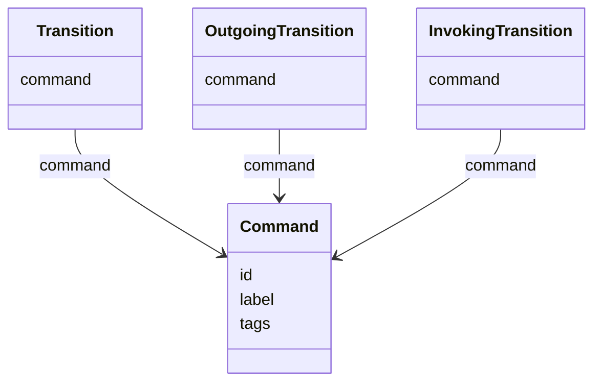

Example node:

```ujg-example
./examples/example-12.yamlld
```

Example transition associated with a command:

```ujg-example
./examples/example-11.yamlld
```

---

## Journey {data-cop-concept="journey"}

A [=Journey=] is the local container for intended flow topology. It lists the experiential states that belong to the journey, the terminal exits exported by the journey, and, when present, the transitions that connect those [=Local vertex|local vertices=]. [=Member transition|Member transitions=] are listed by their [=StateCollection=] instead.

Use [=Journey=] when the modeled object owns local traversal, progression, or structural order. If the model only needs to list known entry points into pages, surfaces, flows, or journeys, use [=JourneyEntryIndex=] instead.

The subsections below define the two contracts a Journey declares besides its states and
transitions: its entries (`entries`) and its exits (`exits`).

<spec-statement>
1. A [=Journey=] **MUST** be identified by an IRI and declare at least one `entries` value and one `states` value.
2. A [=Journey=] **MAY** declare one `defaultEntry`; if present, it **MUST** also appear in `entries`.
3. `entries`, `states`, `transitions`, and `exits` **MUST** reference nodes of the corresponding Graph classes. `transitions` values are [=Transition|Transitions=] or [=AdjacentTransition|AdjacentTransitions=].
4. A [=Journey=]'s [=Local vertex|local vertices=] are its `states` plus its `exits`.
5. `states` lists the Journey's [=State=] and [=CompositeState=] vertices. It **MUST** describe local experiential topology, not destinations that are merely reachable through [=OutgoingTransition=] navigation or [=InvokingTransition=] invocation.
6. A [=Journey=] **MUST NOT** declare `entryTransitions`. Entry transitions are listed by the
   States that offer them.
7. A [=State=] or [=CompositeState=] **MUST NOT** be listed in the `states` of more than one
   [=Journey=]. To reuse topology, reuse the Journey: it can be referenced by more than one
   [=CompositeState=] and entered through [=OutgoingTransition|OutgoingTransitions=] and
   [=InvokingTransition|InvokingTransitions=].
</spec-statement>

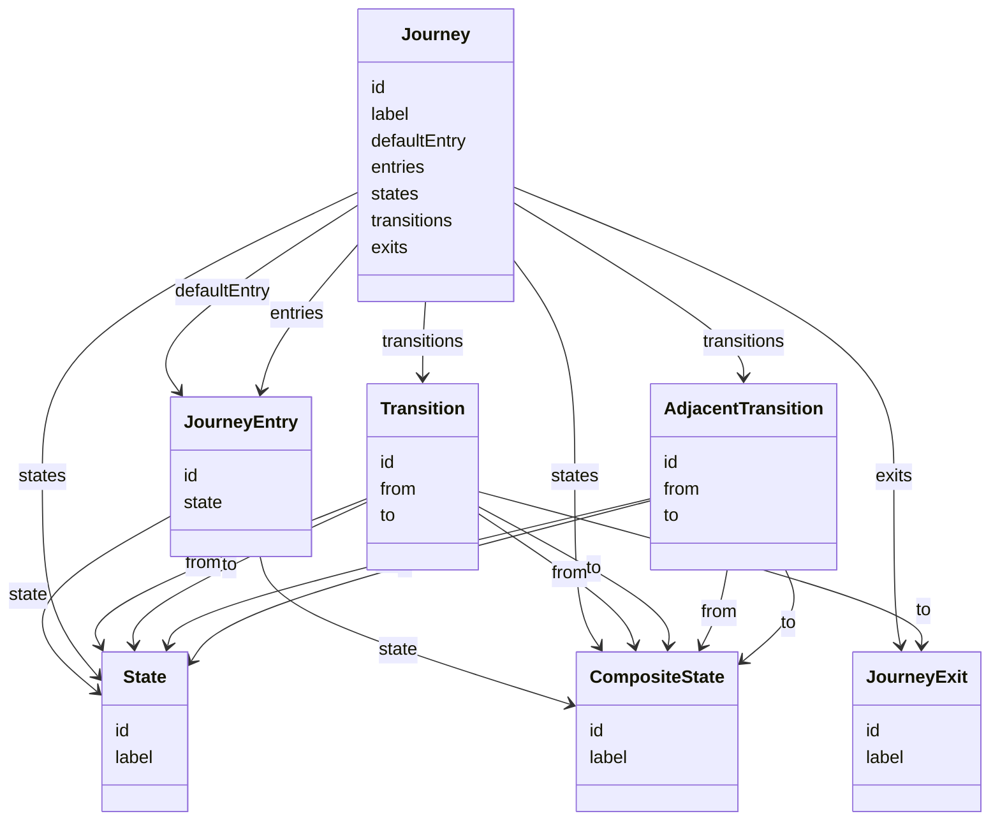

Example node:

```ujg-example
./examples/example-10.yamlld
```

A single-state journey can omit `transitions`:

```ujg-example
./examples/example-09.yamlld
```

A journey can also omit `defaultEntry` when no entry is semantically a general fallback. In that
case, entry selection is unresolved by Graph unless an execution or materialization context selects
exactly one listed [=JourneyEntry=].

```ujg-example
./examples/example-08.yamlld
```

### JourneyEntry {data-cop-concept="journey-entry"}

A [=JourneyEntry=] is an explicit entry contract for a [=Journey=]. It identifies the local [=State=] or [=CompositeState=] where traversal begins without making that entry node part of the local transition topology.

<spec-statement>
1. A [=JourneyEntry=] **MUST** be identified by an IRI and declare exactly one `state`.
2. `state` **MUST** reference a [=State=] or [=CompositeState=] listed in the declaring [=Journey=]'s `states`.
3. A [=JourneyEntry=] **MUST** be listed in exactly one [=Journey=]'s `entries`.
4. A [=JourneyEntry=] **MUST NOT** be used as a [=Transition=] or [=AdjacentTransition=] endpoint.
5. A [=JourneyEntry=] **MAY** declare one `label` and one or more `tags`.
</spec-statement>

Top-level traversal of a [=Journey=] begins at an explicitly selected [=JourneyEntry=]. If no
entry is explicitly selected and the [=Journey=] declares `defaultEntry`, traversal begins at
the `state` of that default entry. If neither applies, entry selection remains unresolved by
Graph.

When Graph leaves entry selection unresolved, a materialization or execution context may select one
listed entry. Consumers do not infer a default from `entries` order, and contextual entry selection
does not change Graph topology. If no entry can be selected, traversal into that [=Journey=] remains
unresolved; that does not make the Graph invalid.

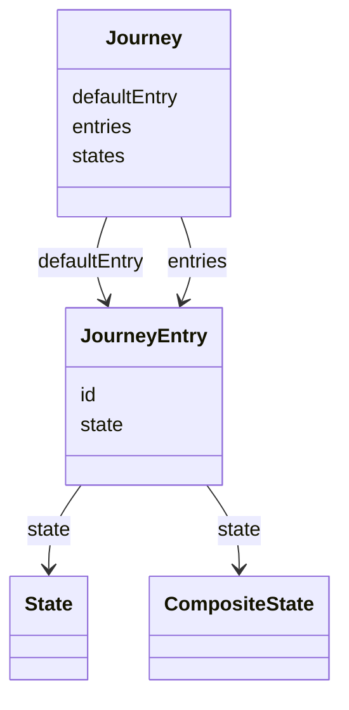

Example node:

```ujg-example
./examples/example-07.yamlld
```

### JourneyExit {data-cop-concept="journey-exits"}

A [=JourneyExit=] is a terminal local graph vertex and exported completion contract declared by a [=Journey=]. It represents a terminal journey outcome that can be reached by a local [=Transition=].

A parent journey can use exported exits to distinguish which outcome of a child journey was reached, without directly referencing child states.

<spec-statement>
1. A [=JourneyExit=] **MUST** be identified by an IRI and listed in exactly one [=Journey=]'s `exits`.
2. A [=JourneyExit=] **MAY** declare one `label` and one or more `tags`.
3. A [=JourneyExit=] **MAY** be the `to` endpoint of a [=Transition=] in the declaring [=Journey=].
4. A [=JourneyExit=] is terminal: it **MUST NOT** be a `from` endpoint or expose entry transitions.
5. A [=JourneyExit=] **MUST NOT** model runtime facts, submitted values, analytics facts, or ordinary internal child movement.
6. A [=JourneyExit=] is neither a [=State=] nor a [=CompositeState=]: a node **MUST NOT** be typed [=JourneyExit=] and also [=State=] or [=CompositeState=].
</spec-statement>

If a completion point is an actual user-visible screen, page, modal, or step, it should remain a normal [=State=]. A journey can then transition from that state to a [=JourneyExit=] that represents the exported terminal outcome.

Informative pattern:

```text
CheckoutForm -> SuccessScreen -> CheckoutCompleteExit
```

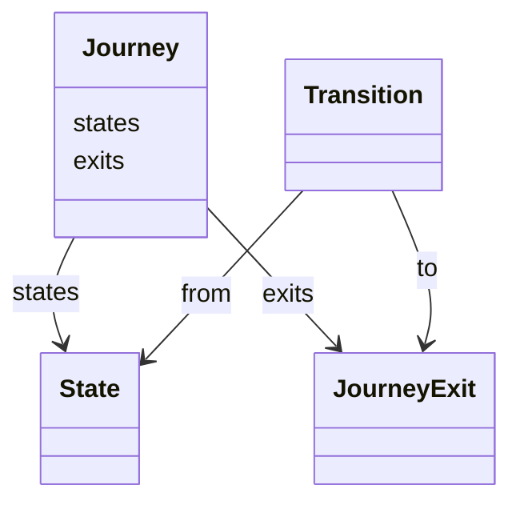

Example nodes:

```ujg-example
./examples/example-06.yamlld
```

```ujg-example
./examples/example-05.yamlld
```

---

## JourneyEntryIndex {data-cop-concept="journey-index"}

A [=JourneyEntryIndex=] is a Graph class and Core [=Node=] that acts as a catalogue of addressable [=JourneyEntry=] contracts. It is not a subclass of [=Journey=] and does not define traversal. A Consumer **MUST NOT** infer that indexed entries are reachable from one another, ordered as a path, or part of a parent-owned progression.

Use [=Journey=] when modeling local topology. Use [=JourneyEntryIndex=] when listing known entry points into modeled journeys. A root [=Journey=] should only be used when the root itself owns real traversal, progression, or structural order.

In common use, a [=JourneyEntryIndex=] lists default or named [=JourneyEntry=] contracts for modeled pages, surfaces, flows, or journeys. The referenced entries remain owned by their declaring [=Journey=].

<spec-statement>
1. A [=JourneyEntryIndex=] **MUST** be identified by an IRI and declare at least one `entries` value.
2. Each `entries` value **MUST** reference a [=JourneyEntry=] owned by exactly one [=Journey=].
3. A [=JourneyEntryIndex=] is a catalogue only: it **MUST NOT** own topology, entries, states, transitions, exits, or child-journey mappings.
4. `entries` on a [=JourneyEntryIndex=] **MUST NOT** imply order, reachability, progression, a user path, or parent continuation.
</spec-statement>

[=JourneyEntryIndex=] is intended for top-level page maps, product surface indexes, search-result target indexes, documentation indexes, entry catalogues, and other collections of known journey entry points. Do not use [=JourneyEntryIndex=] to model page-segment order, local journey progression, child completion, runtime observations, or experience annotations.

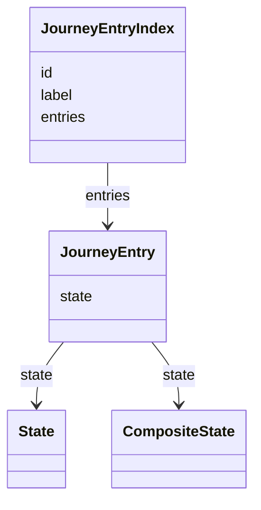

Example node:

```ujg-example
./examples/example-04.yamlld
```

The indexed entries are known entry contracts. Their order above does not define a path from the home page to search to profile.

---

## CompositeState {data-cop-concept="composition"}

A [=CompositeState=] nests Journeys: it is a step of the parent [=Journey=] that is itself a
Journey, with its own steps, entries, and exits. The parent Journey treats it as one
[=Local vertex|local vertex=] that can enter a chosen child entry and react to a child exit. With
several child Journeys, the user is in each of them at once, such as page content beside a sticky
header. It is not a [=State=]: it offers no affordances itself.

<spec-statement>
1. A [=CompositeState=] **MUST** be identified by an IRI, declare exactly one `label`, and declare one
   or more `subjourneys`, each resolving to a [=Journey=]. It **MAY** declare one or more `tags`.
2. A [=CompositeState=] **MUST NOT** be typed [=State=] or [=JourneyExit=], and **MUST NOT** declare
   `states` or `entryTransitions`.
3. When a [=CompositeState=] nests several child Journeys, they **MUST** be [=Co-present|co-present=]
   and independent: a movement in one never moves another. Parts that are co-present but not
   independent belong to one Journey.
4. The parent [=Journey=] treats the [=CompositeState=] as one [=Local vertex|local vertex=]: it can
   be a [=Transition=] or [=AdjacentTransition=] `from` or `to` and a [=JourneyEntry=] `state`. Child States are never
   listed by the parent, and nested composition is never flattened.
5. While a [=CompositeState=] occurrence is current, the user is at the current [=State=] of each
   child Journey, through nested CompositeStates. Each of those States offers its own
   [=Entry transition|entry transitions=].
6. `subjourneys` is an unordered set. Consumers **MUST NOT** infer order, priority, dependency,
   synchronization, or joint completion between child Journeys.
7. A [=Journey=] **MAY** be a child of more than one [=CompositeState=]. Each reference is a separate
   child occurrence.
8. A parent [=Transition=] into a [=CompositeState=] **MAY** select one child entry with `toEntry`,
   owned by exactly one child Journey. It selects nothing for the other child Journeys.
9. Reaching a child [=JourneyExit=] does not leave the [=CompositeState=]. A parent [=Transition=]
   whose `from` is the CompositeState and whose `fromExit` is that exit is taken when the exit is
   reached; without one, the CompositeState stays current. Taking any parent Transition from a
   CompositeState, or crossing a parent [=AdjacentTransition=] out of it, leaves it and all of its
   child Journeys.
</spec-statement>

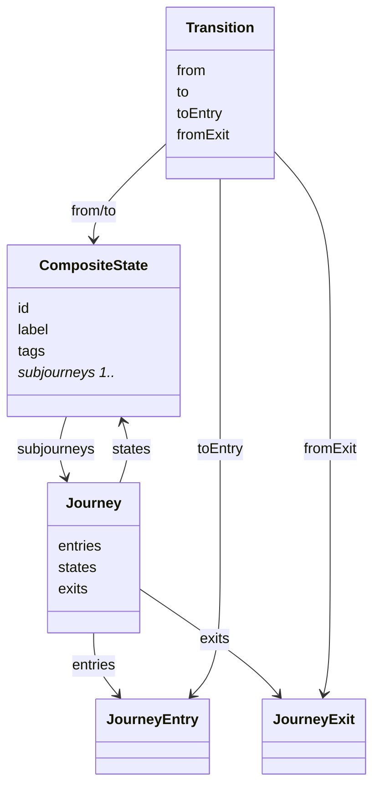

A CompositeState with one child Journey is valid, and several CompositeStates can reference the same
Journey, so a Journey's topology and the entry transitions its States list can be declared once and
reused at several points of a graph.

A sticky header that stays in the viewport while page content scrolls is co-present with that
content and independent of it. Each page can reference the same header Journey:

```ujg-example
./examples/example-03.yamlld
```

A one-page checkout shows shipping and payment side by side:

```text
Checkout CompositeState
  Shipping Journey: Address -> DeliveryOption -> Confirmed
  Payment Journey:  Authorizing -> PaymentFailureExit
```

A parent Transition can enter Checkout at a specific shipping entry. That selects nothing for
Payment:

```ujg-example
./examples/example-02.yamlld
```

A parent Transition can react to the payment failure. Reaching `PaymentFailureExit` takes it and
leaves Checkout. Without it, Payment is complete and Shipping continues:

```ujg-example
./examples/example-01.yamlld
```

---


## Normative Artifacts

This module is published through the following artifacts:

- `graph.ttl`: ontology, published at `https://ujg.specs.openuji.org/ed/ns/graph`
- `graph.context.jsonld`: JSON-LD term mappings, published at `https://ujg.specs.openuji.org/ed/ns/graph.context.jsonld`
- `graph.shape.ttl`: SHACL validation rules, published at `https://ujg.specs.openuji.org/ed/ns/graph.shape`

Examples on this page use compact JSON-LD or YAML-LD fragments. Complete documents can use the aggregate
context `https://ujg.specs.openuji.org/ed/ns/context.jsonld`, which preserves Graph's compact
`state` term for [=JourneyEntry=].

### Ontology {data-cop-concept="ontology"}

The normative Graph ontology is defined below and is published at `https://ujg.specs.openuji.org/ed/ns/graph`. It is the authoritative structural definition for Graph classes and properties, including `Journey`, `JourneyEntry`, `JourneyEntryIndex`, `State`, `CompositeState`, `Transition`, `AdjacentTransition`, `Command`, `JourneyExit`, `OutgoingTransition`, `InvokingTransition`, `StateCollection`, `EntrySelector`, `defaultEntry`, `entries`, `state`, `exits`, `toEntry`, `fromExit`, `command`, `subjourneys`, `entryTransitions`, `memberState`, `memberTransitions`, `entrySelector`, and `candidateJourneys`.

:::include ./graph.ttl :::

### JSON-LD Context {data-cop-concept="jsonld-context"}

The normative Graph JSON-LD context is defined below and is published at `https://ujg.specs.openuji.org/ed/ns/graph.context.jsonld`. It provides the compact JSON-LD term mappings for the Graph vocabulary used by the examples on this page.

:::include ./graph.context.jsonld :::

---

### Validation {data-cop-concept="validation"}

The normative Graph SHACL shape is defined below and is published at `https://ujg.specs.openuji.org/ed/ns/graph.shape`. It is the authoritative validation artifact for Graph structural constraints.

:::include ./graph.shape.ttl :::

---

## Graph Integrity and Resolution {data-cop-concept="graph-integrity"}

The rules below define additional graph integrity and resolution behavior beyond the structural constraints captured by the SHACL shape.

<spec-statement>
To ensure graph integrity, the following constraints **MUST** be met:

1. Every Graph reference **MUST** resolve within the current scope or imported modules.
2. References **MUST** resolve to the class expected by the property that uses them.
3. Local [=Transition=] and [=AdjacentTransition=] endpoints **MUST** stay inside the declaring [=Journey=]'s
   [=Local vertex|local vertices=], also inside child Journeys.
4. On a [=Transition=], `toEntry` and `fromExit` **MUST** resolve through one of the child
   Journeys referenced by the relevant [=CompositeState=]'s `subjourneys`. The referenced
   [=JourneyEntry=] or [=JourneyExit=] **MUST** be owned by exactly one such child Journey.
5. On an [=OutgoingTransition=] or [=InvokingTransition=], the destination entry, `toEntry` or
   the entry selected through its [=EntrySelector=], **MUST** resolve to a [=JourneyEntry=] owned
   by exactly one [=Journey=], and the entry's `state` **MUST** resolve inside that Journey's
   `states`.
6. Each [=OutgoingTransition=] and [=InvokingTransition=] **MUST** declare its destination and
   **MUST NOT** declare `from`, `fromExit`, or `to`.
7. Each `command` **MUST** resolve to a [=Command=].
8. The [=Journey=] that owns an [=InvokingTransition=]'s destination entry **MUST** declare at least
   one `exits` value. When the entry is selected, every candidate Journey of its
   [=EntrySelector=] **MUST** declare one as well.
9. A [=StateCollection=] **MUST** have effective membership in the same source document as its member State, so that
   every Consumer that resolves the member State also finds the collection.
10. An entry selected through an [=EntrySelector=] is not a reference of the authored Graph: it
    **MAY** be outside the current scope and imported modules until the transition is taken, and it
    **MUST** then resolve as rules 5 and 8 require. When it does not, the transition enters no
    Journey, and the Graph remains valid.
</spec-statement>
