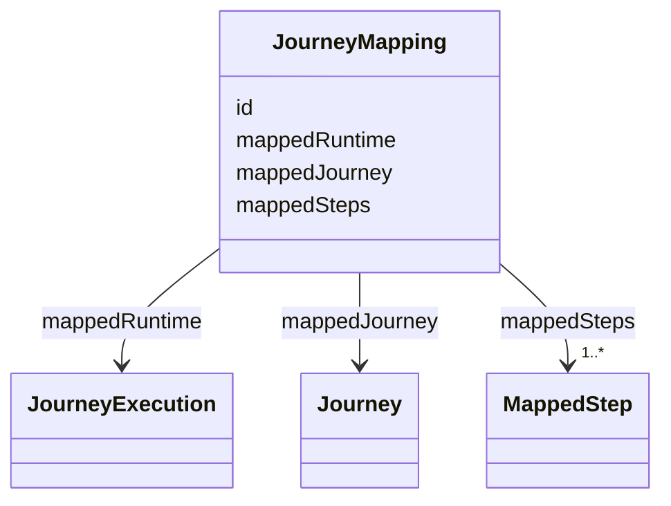
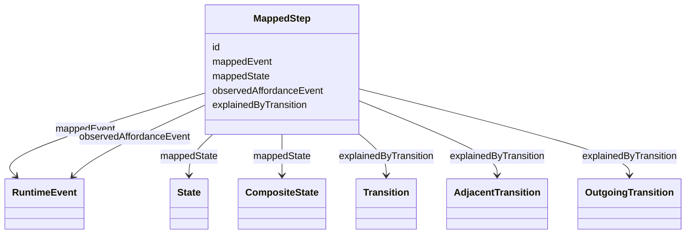
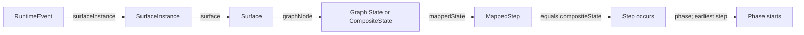

## Overview

This module defines the basic vocabulary and processing model for mapping causally ordered Runtime
events back to the intended Graph journey model.

Runtime records what happened. Graph defines the intended journey topology. Mapping connects the two
by resolving state-observation `RuntimeEvent.surfaceInstance` values to `SurfaceInstance` nodes,
then resolving each instance's `surface` to a `Surface` and that surface's `graphNode` to the
observed Graph state-like node. Mapping associates each journey-local segment of the resolved
execution with an explicit root Graph `Journey`.

Mapping roots are traversable Graph [=Journey|Journeys=]. A [=JourneyEntryIndex=] can help discover known
[=JourneyEntry=] contracts before mapping, but it is not a local traversal scope and is not the target of
`mappedJourney`.

Mapping surfaces model drift, tracking gaps, direct invocations, menu jumps, and other out-of-model
movement. It does not assume every jump is an error.

Examples in this page compose the shared baseline context `https://ujg.specs.openuji.org/ed/ns/context.jsonld`
with the Mapping context.

## Terminology

- <dfn>JourneyMapping</dfn>: An addressable mapping record that binds one journey-local segment of a
  Runtime execution chain to the root Graph `Journey` used to interpret that segment. The mapped
  journey is a traversable topology, not a `JourneyEntryIndex`.
- <dfn>Journey segment</dfn>: A causally ordered set of mapped state observations interpreted under
  one `mappedJourney`. Entering through an [=OutgoingTransition=] always starts a new segment.
- <dfn>MappedStep</dfn>: An addressable mapping record for one state-observation `RuntimeEvent` in
  the mapped chain.
- <dfn>Mapped runtime</dfn>: The `JourneyExecution` whose causal `RuntimeEvent` chain is being
  resolved.
- <dfn>Mapped state</dfn>: A Graph `State` or `CompositeState` resolved from a
  `RuntimeEvent.surfaceInstance` through `SurfaceInstance.surface` and
  `Surface.graphNode`.
- <dfn>Observed affordance</dfn>: A `Command` resolved from a runtime
  event's surface.
- <dfn>Relevant effective transition</dfn>: A Graph transition that can explain an observed movement
  between two resolved runtime states.
- <dfn>Jump</dfn>: A non-root mapped step where no relevant effective transition explains the
  observed movement.

## JourneyMapping {data-cop-concept="journey-mapping"}

A [=JourneyMapping=] binds one journey-local segment of a Runtime execution chain to the root Graph
Journey used to interpret that segment and to its MappedStep records.

<spec-statement>
1. A [=JourneyMapping=] **MUST** be identified by an IRI.
2. A [=JourneyMapping=] **MUST** declare exactly one `mappedRuntime` to a `JourneyExecution`.
3. A [=JourneyMapping=] **MUST** declare exactly one `mappedJourney` to a traversable `Journey`.
4. `mappedJourney` **MUST NOT** reference a `JourneyEntryIndex`.
5. A [=JourneyMapping=] **MUST** declare one or more `mappedSteps` values.
6. The JSON order of `mappedSteps` values **MUST NOT** define step order.
7. One `JourneyExecution` **MAY** be referenced by more than one [=JourneyMapping=].
8. [=JourneyMapping|JourneyMappings=] for the same `JourneyExecution` **MUST NOT** reference the
   same [=MappedStep=] or different MappedSteps whose `mappedEvent` values are equal.
</spec-statement>



Example node:

```ujg-example
./examples/example-05.yamlld
```

## MappedStep {data-cop-concept="mapped-step"}

A [=MappedStep=] records the Graph state-like node resolved for one state-observation RuntimeEvent.
Affordance events remain in the Runtime causal chain and may be referenced as evidence, but are not
serialized as separate MappedStep records.

<spec-statement>
1. A [=MappedStep=] **MUST** be identified by an IRI.
2. A [=MappedStep=] **MUST** declare exactly one `mappedEvent` to a state-observation `RuntimeEvent`.
3. A [=MappedStep=] **MUST** declare exactly one `mappedState` to the resolved `State` or `CompositeState`.
4. A [=MappedStep=] **MAY** declare at most one `observedAffordanceEvent` to its immediate predecessor event.
5. A [=MappedStep=] **MAY** declare at most one `explainedByTransition` to a relevant effective transition.
</spec-statement>



Example node:

```ujg-example
./examples/example-04.yamlld
```

## Mapping Model

A `JourneyMapping` links:

- `ujgmapping:mappedRuntime` to the Runtime `JourneyExecution` being mapped.
- `ujgmapping:mappedJourney` to the root Graph `Journey` for the interpreted segment.
- `ujgmapping:mappedSteps` to the state-resolving `MappedStep` records derived from the runtime
  chain.

Each `MappedStep` links:

- `ujgmapping:mappedEvent` to the state-observation Runtime `RuntimeEvent` being interpreted.
- `ujgmapping:observedAffordanceEvent`, when present, to the immediately preceding Runtime
  `RuntimeEvent` whose surface resolves to an observed affordance [=Command=].
- `ujgmapping:mappedState` to the resolved Graph `State` or `CompositeState`.
- `ujgmapping:explainedByTransition`, when present, to the effective `Transition`,
  `AdjacentTransition`, or `OutgoingTransition` that explains the movement.

Runtime events whose surfaces resolve to [=Command=] are affordance events. They remain in the
Runtime causal chain but are not serialized as separate `MappedStep` records. When an affordance
event appears immediately before a state-observation event, the following `MappedStep` can reference
it with `observedAffordanceEvent`.

Mapping does not serialize a separate step scope or segment link. Segment membership is expressed by
`mappedSteps`. For each `MappedStep`, the local Graph `Journey` scope is derived from the mapped
state's containment path rooted at `mappedJourney`.

The Runtime event order remains defined by Runtime's causal chain: a root event followed by the
unique successor sequence obtained through `previousEvent`. `mappedSteps` is a set of step records;
its JSON order is not normative.

## Processing Rules {data-cop-concept="processing-rules"}

The rules below define the remaining module semantics beyond the structural constraints captured by
the SHACL shape.

1. **Runtime chain source:** A consumer mapping runtime behavior MUST reconstruct event order using
   the Runtime causal chain model.
2. **Step correspondence:** Each `MappedStep` MUST identify one state-observation `RuntimeEvent` in
   the mapped runtime chain through `mappedEvent`.
3. **Surface resolution:** For each `MappedStep`, the Consumer MUST resolve the referenced
   `RuntimeEvent.surfaceInstance` to a [=SurfaceInstance=], then follow `surface` to a
   [=Surface=].
4. **State resolution:** Each `MappedStep.mappedState` MUST be the Graph `State` or
   `CompositeState` resolved from the `mappedEvent` event surface's `graphNode` in the mapped
   journey's containment path or imported documents. Runtime events whose surfaces resolve to
   `Command` MUST NOT be serialized as `MappedStep` records.
5. **Journey ownership:** `mappedJourney` identifies the root Graph `Journey` for one mapped
   segment. `mappedJourney` MUST NOT reference a [=JourneyEntryIndex=].
6. **Step order:** Mapping does not define a separate step order. Consumers MUST order mapped steps
   and segments by applying Runtime chain reconstruction to each step's `mappedEvent`.
7. **Segment start:** The initial segment begins with the Runtime root state observation. A new
   segment begins when an [=OutgoingTransition=] is traversed or when an unexplained movement first
   resolves outside the current segment's mapped Journey containment path. Every outgoing traversal
   starts a new segment, including re-entry into the same Journey or the same State.
8. **Outgoing destination segment:** For an explained outgoing traversal, the destination segment's
   `mappedJourney` MUST identify the unique Journey that owns the OutgoingTransition's
   destination entry, as rule 16 determines it. The segment's first `mappedState` MUST equal that
   JourneyEntry's `state`.
9. **Cross-segment predecessor:** For the first MappedStep of a segment entered through an
   OutgoingTransition, the movement predecessor is the latest earlier mapped State or CompositeState
   in Runtime causal order, even though it belongs to the preceding segment. Intervening Command
   events do not replace that state predecessor.
10. **Unexplained destination segment:** A movement that first resolves into another Journey without
    a matching effective OutgoingTransition starts a segment for that Journey. Its first MappedStep
    is a jump.
11. **Local journey scope:** Within a segment, a Consumer MUST derive each MappedStep's local
    [=Journey=] scope from the mapped state and the containment path rooted at `mappedJourney`. If
    the mapped state is listed in the mapped root journey's `states`, the local scope is the mapped
    root journey. If the mapped state is listed in a child journey reached through a containing
    [=CompositeState=]'s `subjourneys`, the local scope is that child journey for that containing
    composite occurrence. A mapped [=CompositeState=] belongs to the parent journey scope that lists
    it in `states`. Steps of an invoked Journey are scoped by rule 19 instead.
12. **Composite occurrence scope:** When the same [=CompositeState=] occurs more than once in the
    Runtime chain, Consumers MUST treat each occurrence as a separate containing scope for child
    journey predecessor lookup. Mapping does not serialize occurrence identifiers.
13. **Origin derivation:** Only the step whose RuntimeEvent omits `previousEvent` is the execution root
    and is not an observed movement. The first observation in a later segment is a movement. The first
    ordered observation in each local child journey scope for a containing composite occurrence is a
    local origin unless it is also a segment entry explained by an OutgoingTransition.
14. **Local origin evidence:** A local origin in a child journey MUST NOT use a mapped step from a
    sibling child journey as its predecessor. The origin is consistent with a parent Transition's
    `toEntry`, the child Journey's `defaultEntry`, or materialization or execution context
    selecting a child entry. A local origin needs no `explainedByTransition`.
15. **Affordance event correlation:** If the immediate `RuntimeEvent.previousEvent` predecessor of a
    `MappedStep.mappedEvent` event resolves through Surface to a `Command`, the MappedStep MAY
    reference that predecessor with `observedAffordanceEvent`. `observedAffordanceEvent` MUST
    NOT reference any event other than that immediate predecessor.
16. **Transition lookup:** A non-root MappedStep is explained when `explainedByTransition` points
    to one relevant effective transition. For a Graph `Transition` or [=AdjacentTransition=], the
    local predecessor is the latest earlier MappedStep in Runtime causal order in the same local
    Journey scope and containing composite occurrence; observations from sibling child Journeys may
    interleave without becoming that predecessor. A Transition is relevant when its local `from` and `to` match that predecessor
    and the current mapped state. An AdjacentTransition is relevant when its `from` and `to` match
    them in either order. A [=Member transition|member transition=] of a [=StateCollection=] whose
    member State is in the local Journey scope is an effective transition of that scope. When the
    predecessor and the current mapped state are both that member State, the two steps are at the
    same [=Collection member|member=] if their events reference the same `surfaceInstance`, and
    at different members otherwise. A member transition is relevant only to steps at different
    members, and a Transition from the member State to itself in a Journey's `transitions` only
    to steps at the same member. An [=OutgoingTransition=] is relevant when:
    - it is listed in the `entryTransitions` of a current State. The predecessor is current, and
      so is every [=CompositeState=] occurrence that contains it. For each current CompositeState
      occurrence, the mapped state of the latest earlier MappedStep in each of its child Journey
      scopes is current as well, at any depth. A CompositeState lists no entry transitions;
    - its destination entry is owned by the destination segment's `mappedJourney`; and
    - that entry's `state` equals the destination segment's first `mappedState`.

    The destination entry is the OutgoingTransition's `toEntry`. For an OutgoingTransition that
    references an [=EntrySelector=], it is any JourneyEntry owned by a Journey the selector admits:
    one of its `candidateJourneys`, or any Journey when it declares none.
17. **Composite occurrence end:** A child [=JourneyExit=] does not by itself end the containing
    [=CompositeState=] occurrence for Mapping, and observations from sibling child Journeys stay in
    scope after it. The occurrence ends when a parent [=Transition=] from the CompositeState, or a
    parent [=AdjacentTransition=] with the CompositeState as one endpoint, explains the movement out
    of it, or when an observation first resolves outside its containment. This includes a member
    transition whose member State is the CompositeState: it ends the occurrence of the member it
    leaves, and rule 12 treats the member it enters as a new occurrence. Steps of
    an invoked Journey (rule 19) whose invocation started inside the occurrence are not outside it:
    the occurrence is retained while the invocation runs and continues when the source resumes. Later
    observations from any child Journey of the ended occurrence require a later occurrence of the
    containing composite or are out-of-scope movement under existing Mapping rules. A child exit does
    not imply simultaneous, joint, or all-child completion for sibling child journeys.
18. **Observed affordance evidence:** When `observedAffordanceEvent` is present and resolves to a
    `Command`, `explainedByTransition` SHOULD identify a relevant `Transition` or
    `OutgoingTransition` whose `command` references that same Command, if one exists for the
    movement from the predecessor to the current mapped state. Otherwise, when a relevant
    [=AdjacentTransition=] explains the movement, `explainedByTransition` SHOULD identify that
    AdjacentTransition. A relevant OutgoingTransition that references an [=EntrySelector=] yields to
    every other relevant transition, including a member transition, unless the observed affordance
    event resolves to its `command`.
19. **Invoked Journey scope:** An [=InvokingTransition=] is recognized for a step when it is listed
    in the `entryTransitions` of a current State (rule 16, taking the latest earlier mapped State
    or CompositeState in Runtime causal order as the predecessor), and its destination entry has a
    `state` equal to the step's mapped state. The destination entry is its `toEntry`, or an
    entry its [=EntrySelector=] admits, as in rule 16. When a relevant Transition or AdjacentTransition
    from the step's local-scope predecessor (rule 16) also explains the step, that reading wins unless
    the observed affordance event resolves to the InvokingTransition's `command`. The recognized step, and
    every following step that resolves to a State of the invoked Journey or to a State nested in its
    CompositeStates, belongs to the invoked Journey's own local scope. This continues until a step
    resolves elsewhere: the resumption of the source State occurrence, or a departure from the
    invoked Journey. That scope has no
    containing [=CompositeState=] occurrence from the enclosing segment, even if the invoked Journey
    is also listed in some CompositeState's `subjourneys`, so a [=JourneyExit=] listed in the
    invoked Journey's own `exits` is not a child exit of any CompositeState occurrence. Recognition
    only scopes steps; it does not make the entry or the resumption an explained movement.
20. **Condition eligibility:** If a consumer implements [[UJG Conditions]], a guarded transition
    only explains a mapped step when the transition is eligible under Condition semantics.
21. **Jump derivation:** A non-root mapped step is a jump when no relevant effective transition
    explains the observed movement. This includes the first step of an unexplained destination
    segment. A jump is a derived processing result, not serialized Mapping vocabulary.
22. **No intent assumption:** A derived jump reports that the observed movement is not explained by
    the mapped graph. It does not by itself decide whether the movement is legitimate or erroneous.

Mapping binds the members that a member transition connects from the observed SurfaceInstances and
does not serialize member identity. When the member State is a [=CompositeState=], Mapping sees a
move between members only when the Runtime chain observes the CompositeState itself; observations of
its child States alone do not show which member they belong to.

Mapping does not serialize the entry that an [=EntrySelector=] selected: it is the entry that rule
16 matched, owned by the destination segment's `mappedJourney`. A selector without
`candidateJourneys` admits every Journey, so an OutgoingTransition that references it explains
any movement into an entry State from the States that list it. Candidates keep other movements
visible as jumps.

## Step Occurrence and Phase Start {data-cop-concept="step-occurrence"}

For documents that use [[UJG Phase]], Mapping also derives when [=Step|Steps=]
occur and when their [=Phase|Phases=] start. These are processing results, not serialized Mapping
vocabulary, and they do not change Runtime records, Graph traversal, or the `JourneyMapping` and
`MappedStep` wire shapes.

<spec-statement>
1. A Consumer deriving experience occurrence **MUST** order [=MappedStep|MappedSteps=] by applying
   Runtime chain reconstruction to each step's `mappedEvent`.
2. A [=Step=] occurs at the earliest ordered [=MappedStep=] whose `mappedState` equals
   that Step's `compositeState`.
3. A [=Phase=] starts at the earliest occurrence of any Step whose `phase` resolves to that Phase.
4. Repeated matching RuntimeEvents **MUST NOT** restart an already occurred Step or Phase.
5. A Step without `phase` may occur but **MUST NOT** start a Phase.
6. A Phase with no occurring Step **MUST NOT** be considered started.
7. RuntimeEvents whose surfaces resolve to `Command` **MUST NOT** trigger a Step directly; only
   ordered [=MappedStep=] state observations are considered.
8. Serialized node order, `mappedSteps` order, `Step.order`, and `Phase.order` **MUST NOT** determine occurrence or start time.
</spec-statement>



In the following fragment, the shipping step and checkout phase both begin at event `:100`.
The repeated mapped step for the same composite state at event `:200` does not restart either result.

```ujg-example
./examples/example-03.yamlld
```

## Normative Artifacts

This module is published through the following artifacts.

### Ontology {data-cop-concept="ontology"}

The normative Mapping ontology is defined below and is published at
`https://ujg.specs.openuji.org/ed/ns/mapping`.

:::include ./mapping.ttl :::

### JSON-LD Context {data-cop-concept="jsonld-context"}

The normative Mapping JSON-LD context is defined below and is published at
`https://ujg.specs.openuji.org/ed/ns/mapping.context.jsonld`.

:::include ./mapping.context.jsonld :::

### Validation {data-cop-concept="validation"}

The normative Mapping SHACL shape is defined below and is published at
`https://ujg.specs.openuji.org/ed/ns/mapping.shape`.

:::include ./mapping.shape.ttl :::

## Examples

### Minimal Example

```ujg-example
./examples/example-02.yamlld
```

This example states that the causal event chain for `urn:ujg:execution:12345` has been resolved
against the checkout root journey. The first mapped step is the root event. The later mapped steps
record the relevant effective transitions that explain the observed movements.

If a mapped movement is explained by an outgoing transition, `explainedByTransition` points to
the `OutgoingTransition` resource. A movement explained by an `OutgoingTransition` listed by a
current State (rule 16) is explained by the Graph model and does not need a serialized status value.

### Affordance Event Example

```ujg-example
./examples/example-01.yamlld
```

`urn:event:checkout-1:150` and `urn:event:checkout-1:250` remain Runtime events, but they are not
separate `MappedStep` records because their surfaces resolve to commands. The second and third
mapped steps point back to those immediate predecessor events. Opening help ends the checkout
segment and starts a help segment in the same Runtime execution. The first help step resolves to
`urn:entry:help`'s `state` and is explained by `urn:outgoing:help`, which both the Cart and
Payment States list in `entryTransitions`.

The same segmentation rule applies in these boundary cases:

| Observed movement | Mapping result |
| --- | --- |
| OutgoingTransition to an entry in another Journey | End the source segment and start a segment whose `mappedJourney` is the entry owner. |
| OutgoingTransition to an entry in the same Journey, including the same State | Start a new segment with the same `mappedJourney`; the first step remains an explained movement, not a Runtime root. |
| First observation in another Journey with no matching outgoing affordance | Start a segment for that Journey and derive its first step as a jump. |
