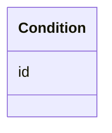
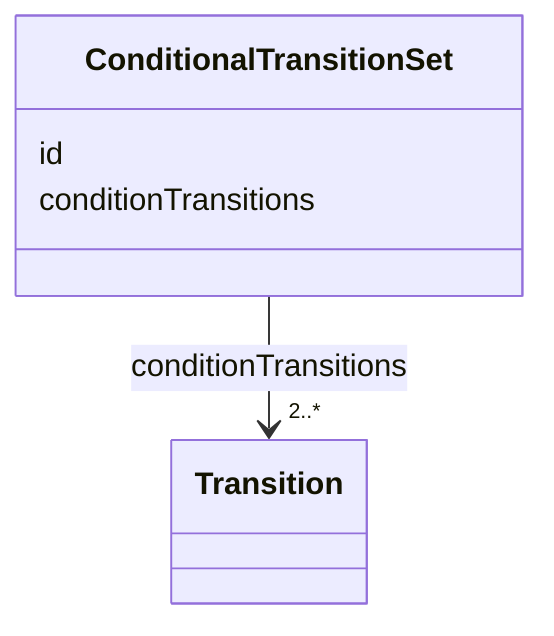

## Overview

This optional module defines a graph-native vocabulary for attaching domain-level conditions to UJG
Graph transitions.

A condition describes when a transition is eligible to be taken. A condition does not create a new
graph edge, does not act as a state, and does not point directly to a target state. All movement
between journey states remains represented by `Transition` nodes from the Graph module.

This module also defines `ConditionalTransitionSet`, an addressable grouping node for conditional branches. A
`ConditionalTransitionSet` groups two or more guarded transitions that share the same source state. In this
first version, a `ConditionalTransitionSet` represents a branching point where one path is intended to be taken.

This module is optional. It extends Graph traversal semantics for consumers that understand
conditions, but it does not replace Graph's topology model.

**Non-goals:**

* This module does **not** define a condition expression language.
* This module does **not** define domain state models such as Git branch state, payment provider
  state, inventory state, authentication state, or feature-flag state.
* This module does **not** define runtime evaluation APIs.
* This module does **not** create hidden state-to-state edges outside Graph `Transition` nodes.
* This module does **not** model user-choice branches that can already be represented by ordinary
  labeled transitions.

## Terminology

* <dfn>Condition</dfn>: An addressable predicate-like node that describes when a transition is
  eligible.
* <dfn>Guarded transition</dfn>: A Graph `Transition` that has a `condition`.
* <dfn>ConditionalTransitionSet</dfn>: An addressable grouping of guarded transitions that form one conditional
  branch point.
* <dfn>Condition branch</dfn>: A group of conditional transitions from the same source state where
  one path is intended to be taken.

## Condition {data-cop-concept="condition"}

A [=Condition=] is an addressable predicate-like node used to guard a Graph `Transition`. A condition
does not point to a target state and does not create an implicit graph edge.



Example node:

```ujg-example
./examples/example-05.yamlld
```

## ConditionalTransitionSet {data-cop-concept="conditional-transition-set"}

A [=ConditionalTransitionSet=] groups two or more guarded transitions that share one source state and form one
conditional branch point.



Example node:

```ujg-example
./examples/example-04.yamlld
```

## Attachment Model

The module introduces real JSON-LD terms and RDF edges for conditional branching:

* `condition` links a Graph `Transition` to a `Condition`.
* `conditionTransitions` links a `ConditionalTransitionSet` to the guarded transitions that form
  one branch point.

A `Condition` **MUST NOT** reference a target state directly.

Crossing a border that two states share through an `AdjacentTransition` is always possible, so it
carries no condition. A guarded movement between the same states is a Graph `Transition` with
`condition`.

A `ConditionalTransitionSet` **MUST NOT** reference a source state directly. Its effective source state is
derived from the common `from` value of all referenced transitions.

A `ConditionalTransitionSet` **MUST** reference transitions that all share the same `from` state.

A transition referenced by a `ConditionalTransitionSet` **MUST** have exactly one `condition`.

A consumer that implements this module **MUST** treat transitions in a `ConditionalTransitionSet` as conditional
branch alternatives. In this first version of the module, a `ConditionalTransitionSet` means that one referenced
transition is intended to be taken.

A consumer that does not implement this module **MAY** ignore condition semantics, but it **SHOULD**
preserve recognized JSON-LD data during read-transform-write when possible.

Opaque runtime bindings, expression syntax, platform-specific evaluators, and domain-state
references **SHOULD** remain in Core `extensions` unless a future optional module defines them as
interoperable vocabulary.

## Normative Artifacts

This module is published through the following artifacts:

- `condition.ttl`: ontology, published at `https://ujg.specs.openuji.org/ed/ns/condition`
- `condition.context.jsonld`: JSON-LD term mappings, published at `https://ujg.specs.openuji.org/ed/ns/condition.context.jsonld`
- `condition.shape.ttl`: SHACL validation rules, published at `https://ujg.specs.openuji.org/ed/ns/condition.shape`

Examples in this page compose the shared baseline context:

```ujg-example
./examples/example-03.yamlld
```

### Ontology {data-cop-concept="ontology"}

The normative Conditions ontology is defined below and is published at
`https://ujg.specs.openuji.org/ed/ns/condition`. It is the authoritative structural definition for
`Condition`, `ConditionalTransitionSet`, and the properties declared by this module.

:::include ./condition.ttl :::

### JSON-LD Context {data-cop-concept="jsonld-context"}

The normative Conditions JSON-LD context is defined below and is published at
`https://ujg.specs.openuji.org/ed/ns/condition.context.jsonld`. It provides the compact JSON-LD term
mappings and coercions for Conditions-specific properties and classes.

:::include ./condition.context.jsonld :::

---

### Validation {data-cop-concept="validation"}

The normative Conditions SHACL shape is defined below and is published at
`https://ujg.specs.openuji.org/ed/ns/condition.shape`. It is the authoritative validation artifact
for Conditions structural constraints.

:::include ./condition.shape.ttl :::

The rules below define the remaining module semantics beyond the structural constraints captured by
the SHACL shape.

1. **Graph preservation:** A condition **MUST NOT** create an implicit edge. Every possible movement
   between states **MUST** be represented by a Graph `Transition` or `AdjacentTransition`.
2. **Transition guard semantics:** A transition with `condition` is eligible only when the
   referenced condition is satisfied by the implementation's domain/runtime context.
3. **Branch semantics:** A `ConditionalTransitionSet` groups guarded transitions that form one branch point. In
   this version, a `ConditionalTransitionSet` represents a branch where one referenced transition is intended to
   be taken.
4. **No expression language:** The meaning and evaluation of a condition are intentionally outside
   this module unless another optional module defines expression semantics.
5. **Graceful degradation:** Consumers that do not understand this module **MAY** render the
   underlying Graph normally and **MAY** ignore conditional eligibility.

---

## Examples

### Combined JSON Example

Codex chat branch-check example:

```ujg-example
./examples/example-02.yamlld
```

### Opaque Runtime Hints

Runtime condition bindings are intentionally not standardized by this module. Implementations that
need to bind a `Condition` to product-specific runtime state can use Core `extensions`.

```ujg-example
./examples/example-01.yamlld
```
