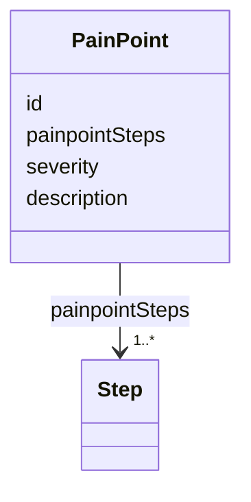

## Overview

This optional module defines qualitative annotations over the intended experience. Its
first standardized annotation is a [=PainPoint=]. Experience Annotation does not add Graph traversal,
Runtime ordering, or Mapping behavior.

Documents using this module compose the Phase context with
`https://ujg.specs.openuji.org/ed/ns/experience-annotation.context.jsonld`.

## Terminology

<dfn>PainPoint</dfn> is a qualitative UX issue experienced by a user.

## PainPoint {data-cop-concept="pain-point"}

A [=PainPoint=] is a named issue or friction hypothesis attached to one or more Phase
[=Step|Steps=].

<spec-statement>
1. A [=PainPoint=] **MUST** be identified by an IRI.
2. A [=PainPoint=] **MUST** declare one or more `painpointSteps` values.
3. Every `painpointSteps` value **MUST** resolve to a [=Step=].
4. A [=PainPoint=] **MAY** declare at most one `severity` in the inclusive range `0` through `1`.
5. A [=PainPoint=] **MAY** declare at most one `description`.
6. A [=PainPoint=] **MUST NOT** change Graph traversal or assert Runtime occurrence.
</spec-statement>



Example node:

```ujg-example
./examples/example-02.yamlld
```

## Normative Artifacts

### Ontology {data-cop-concept="ontology"}

:::include ./experience-annotation.ttl :::

### JSON-LD Context {data-cop-concept="jsonld-context"}

:::include ./experience-annotation.context.jsonld :::

### Validation {data-cop-concept="validation"}

:::include ./experience-annotation.shape.ttl :::

## Examples

### Combined Example

```ujg-example
./examples/example-01.yamlld
```
