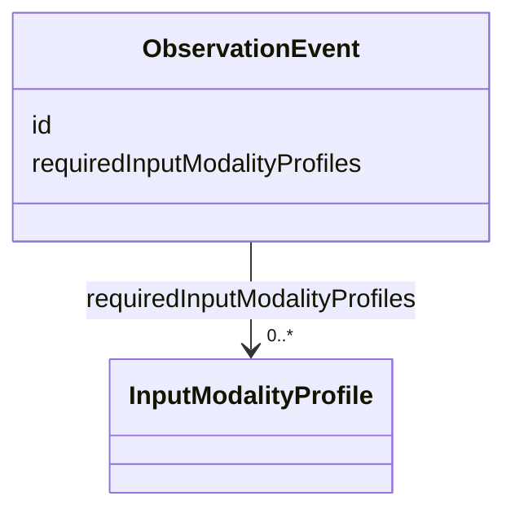
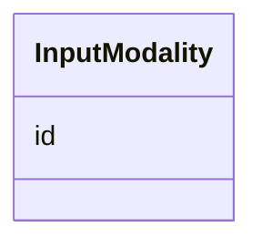
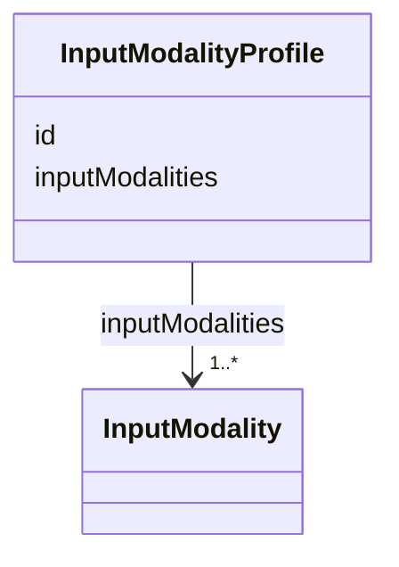
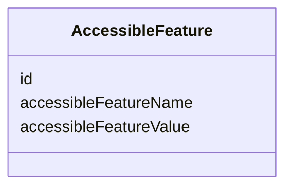
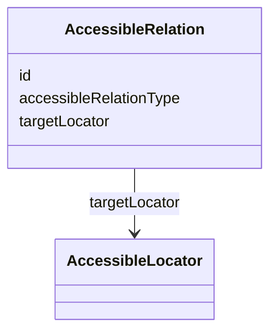
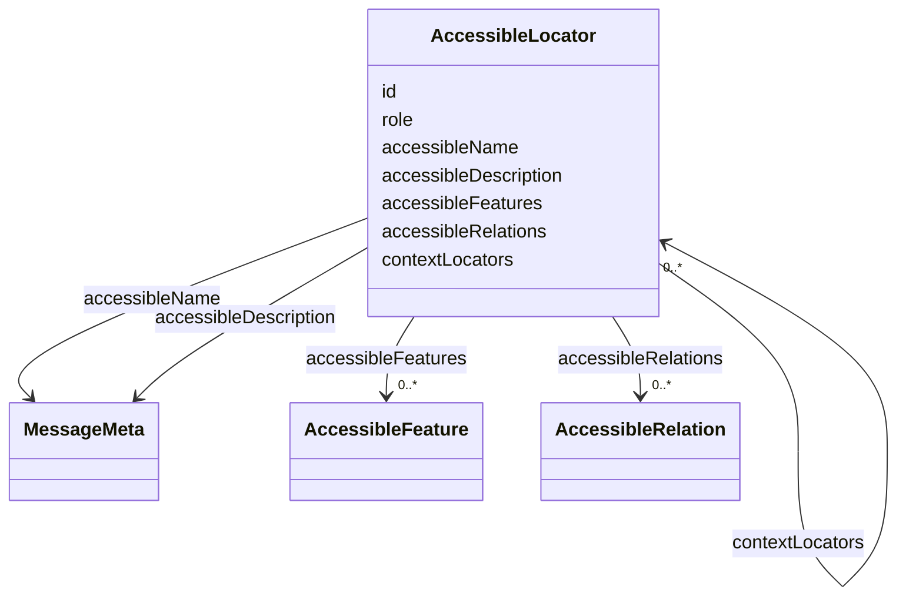
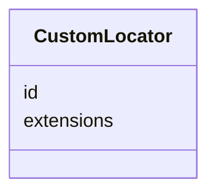
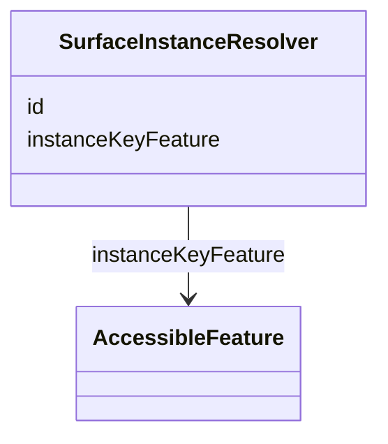
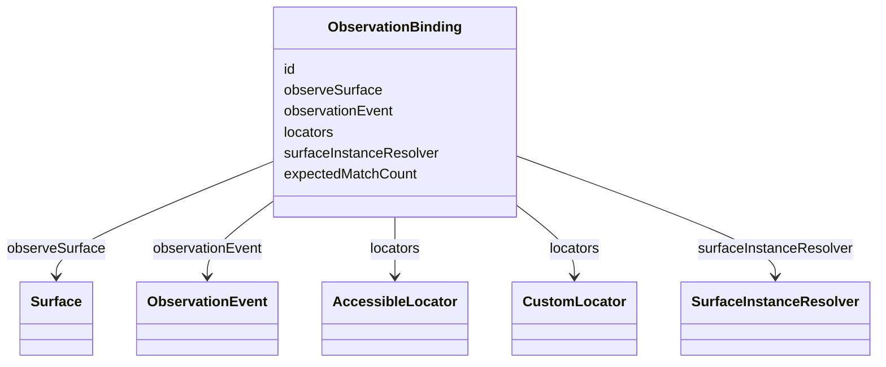

## Overview

This second-level optional module defines a recognition contract for [=Surface=] nodes. It lets
producers declare how a visible surface can be recognized by synthetic checks, browser collectors,
native collectors, or other observation adapters without changing Graph traversal or Runtime
ordering.

Observability depends on [[UJG Surface]] and [[UJG Localization]]. A binding points to a `Surface`
and uses localized message bundles when accessible names or descriptions are part of recognition.
Concrete runtime occurrence identity is derived by the collector when Runtime data is emitted. When a
binding has a `SurfaceInstanceResolver`, the resolver identifies the accessibility-exposed feature
used to derive the concrete instance key.

Observability has no direct dependency on Runtime. When Runtime data is present, a consumer can
correlate events to bindings by resolving `RuntimeEvent.surfaceInstance` to a `SurfaceInstance`
and matching that instance's `surface` to `ObservationBinding.observeSurface`.

Observation events can also reference input-modality profiles. This lets a producer describe
affordance recognition across independently evaluated input strategies while keeping the Graph
transition model unchanged. Observability standardizes keyboard and pointer modality identifiers;
other modality identifiers remain producer-defined.

## Terminology

- <dfn>ObservationBinding</dfn>: An addressable recognition contract for one `Surface`.
- <dfn>ObservationEvent</dfn>: An addressable, owner-defined semantic event contract.
- <dfn>InputModality</dfn>: An addressable input modality. `ujgobservability:keyboard` and
  `ujgobservability:pointer` are standard modalities; other concrete modality identifiers are
  producer-defined.
- <dfn>InputModalityProfile</dfn>: An addressable interaction strategy defined by one or more input
  modalities.
- <dfn>AccessibleLocator</dfn>: A locator that describes an accessible object using accessibility
  role, localized computed name or description references, state/property features, relations, and
  context.
- <dfn>AccessibleFeature</dfn>: An accessibility state or property used by an accessible locator.
- <dfn>AccessibleRelation</dfn>: A relationship between accessible objects used by an accessible
  locator.
- <dfn>CustomLocator</dfn>: An opaque extension-backed locator for adapter-specific matching.
- <dfn>SurfaceInstanceResolver</dfn>: A reusable resolver that identifies how an adapter derives a
  concrete `SurfaceInstance` key for repeated occurrences of the same stable `Surface`.
- <dfn>Collector</dfn>: A runtime observation component that evaluates `ObservationBinding` nodes
  against an observed environment, resolves or creates the applicable `SurfaceInstance` when Runtime
  data is emitted, and records observed events without changing Graph, Surface, or Observability
  definitions.
- <dfn>Synthetic Runner</dfn>: A collector that drives or inspects a journey through automated
  execution, such as a Playwright-based browser test. A synthetic runner may activate accessible
  objects, match locators, and emit Runtime events, but its automation commands are not modeled as
  Graph traversal rules or Observability vocabulary.

## ObservationEvent {data-cop-concept="observation-event"}

An [=ObservationEvent=] identifies the semantic event contract a binding observes. Event identifiers
are producer-defined; this module does not reserve standard event IRIs.

An event can optionally reference one or more [=InputModalityProfile|InputModalityProfiles=].



Example nodes:

```ujg-example
./examples/example-13.yamlld
```

## InputModality {data-cop-concept="input-modality"}

An [=InputModality=] identifies one input modality that can participate in an interaction strategy.
This module defines two standard input modality identifiers:

- `ujgobservability:keyboard`: keyboard-based interaction.
- `ujgobservability:pointer`: pointer-based interaction, including mouse, pen, touch, or equivalent
  pointing input.

Other concrete modality identifiers are producer-defined.

The standard modality identifiers are declared as [=InputModality=] resources by the normative
Observability ontology. Producers MAY reference them without serializing duplicate
[=InputModality=] nodes in a document.



Example nodes:

```ujg-example
./examples/example-12.yamlld
```

## InputModalityProfile {data-cop-concept="input-modality-profile"}

An [=InputModalityProfile=] identifies one independently evaluable interaction strategy. Its
`inputModalities` values identify the modalities that participate in that strategy.



Example node:

```ujg-example
./examples/example-11.yamlld
```

## AccessibleFeature {data-cop-concept="accessible-feature"}

An [=AccessibleFeature=] describes an accessibility state or property used by an
[=AccessibleLocator=] or [=SurfaceInstanceResolver=].



Example node:

```ujg-example
./examples/example-10.yamlld
```

## AccessibleRelation {data-cop-concept="accessible-relation"}

An [=AccessibleRelation=] describes a relationship between accessible objects used by an
[=AccessibleLocator=].



Example node:

```ujg-example
./examples/example-09.yamlld
```

## AccessibleLocator {data-cop-concept="accessible-locator"}

An [=AccessibleLocator=] describes an accessible object through role, localized name or description
references, accessibility features, relations, and optional context locators.



Example node:

```ujg-example
./examples/example-08.yamlld
```

## CustomLocator {data-cop-concept="custom-locator"}

A [=CustomLocator=] is an opaque extension-backed locator for adapter-specific matching when
interoperable accessible-object recognition is not enough.



Example node:

```ujg-example
./examples/example-07.yamlld
```

## SurfaceInstanceResolver {data-cop-concept="surface-instance-resolver"}

A [=SurfaceInstanceResolver=] declares which accessible feature supplies the instance key for
repeated concrete occurrences of the same stable [=Surface=].



Example node:

```ujg-example
./examples/example-06.yamlld
```

## ObservationBinding {data-cop-concept="observation-binding"}

An [=ObservationBinding=] binds one [=Surface=] to one [=ObservationEvent=] and one or more locator
nodes that define the recognition evidence.



Example node:

```ujg-example
./examples/example-05.yamlld
```

Example absence assertion:

```ujg-example
./examples/example-04.yamlld
```

## Binding Model

The module introduces one canonical interoperable attachment:

- `ujgobservability:observeSurface` links an `ObservationBinding` to one `Surface`.

An `ObservationBinding` also identifies:

- `observationEvent`: the semantic event being observed.
- `locators`: one or more locator nodes that define how the surface evidence is recognized.
- `surfaceInstanceResolver`: an optional resolver for deriving a concrete `SurfaceInstance` when
  the same stable surface is repeated.
- `expectedMatchCount`: an optional exact cardinality for the full conjunctive locator match.

`locators` inside one binding are conjunctive: all referenced locators must match. Alternative
recognition strategies SHOULD be modeled as separate `ObservationBinding` nodes that reference the
same surface.

When `expectedMatchCount` is present, a consumer that evaluates the binding MUST compare the number
of objects matching the binding's full `locators` contract in the current recognition scope to
that exact non-negative integer. `expectedMatchCount: 0` means the locator contract is expected to
find no matching objects. `expectedMatchCount: 1` means exactly one matching object is expected. If
`expectedMatchCount` is omitted, the binding preserves the existing positive recognition semantics
without exact cardinality.

One `ObservationBinding` can describe behavior for many repeated `SurfaceInstance` occurrences of
the same `Surface`. `SurfaceInstanceResolver` does not reference concrete `SurfaceInstance` nodes and
MUST NOT require one binding per repeated occurrence.

Input-modality profile references belong to the referenced `ObservationEvent`, not to
`ObservationBinding`. A binding that references an event with `requiredInputModalityProfiles`
uses those event-level profile references without changing its own surface, locator, or instance
resolver contract.

Observability does not define `graphNode`, `surface`, `surfaceInstance`, or touchpoint
boundary assignment such as `journeys`. Those are Surface and Runtime terms.
Observability does not define Runtime properties.

## Locator Model

`AccessibleLocator` is the preferred interoperable locator for human-facing UI. It is based on the
accessibility object exposed through an accessibility API, not on DOM structure, CSS selectors,
Playwright expressions, or raw text content. WAI-ARIA defines an accessibility API as platform
interfaces that expose object and event information to assistive technologies [[WAI-ARIA-1.2]].

`AccessibleLocator.accessibleName` and `AccessibleLocator.accessibleDescription` reference
localized `MessageMeta` nodes for the computed accessible-object name and description. For web DOM
environments, producers and consumers SHOULD compute accessible-object names and descriptions
according to [[ACCNAME-1.2]], then match the computed value against a locale-appropriate `Message`
for the referenced message meta.

Observability does not define standard raw string fallback properties for accessible names or
descriptions. Private adapter hints MAY appear in Core `extensions`, but such hints are not
normative Observability terms.

An `AccessibleLocator` MUST provide at least one of:

- `role`
- `accessibleName`
- `accessibleDescription`
- `accessibleFeatures`
- `accessibleRelations`
- `contextLocators`

`AccessibleFeature` names SHOULD be accessibility-model oriented, such as `selected`, `expanded`,
`disabled`, `checked`, `pressed`, `current`, `invalid`, `required`, `busy`, or `hidden`. Producers
SHOULD NOT use raw web-only names such as `aria-selected` when a platform-neutral state/property name
is available.

`AccessibleRelation` names SHOULD also be accessibility-model oriented, such as `controls`,
`labelled-by`, `described-by`, `owns`, `active-descendant`, `details`, or `error-message`.

`contextLocators` scope a locator by another accessible object. Multiple context locators are
conjunctive.

`CustomLocator` is the escape hatch for stable semantic markers, CSS selectors, tool-specific
queries, native automation identifiers, CLI patterns, server-log queries, kiosk signals, or other
adapter-specific matching. A `CustomLocator` MUST define its semantics in Core `extensions` and is
opaque to consumers that do not understand that extension.

## Runtime Correlation

Runtime correlation is derived, not modeled as an Observability-to-Runtime reference.

```text
RuntimeEvent.surfaceInstance -> SurfaceInstance.surface = ObservationBinding.observeSurface
```

An observation adapter that emits Runtime data SHOULD:

1. match the binding's `locators`;
2. when `expectedMatchCount` is present, compare the match count to that exact value;
3. when `surfaceInstanceResolver` is present, read the resolver's `instanceKeyFeature` from the
   matched accessible object or contextual accessible object;
4. resolve or create the matching `SurfaceInstance`;
5. emit the required Runtime `surfaceInstance`.

For `expectedMatchCount: 0`, a satisfied absence contract does not provide a matched accessible
object for instance resolution. Observability still does not require Runtime events to reference an
`ObservationBinding`.

If an instance key is not exposed through the accessibility API, adapters MUST use `CustomLocator` or
Core `extensions` for private resolver semantics. Runtime events MUST NOT be required to reference
an `ObservationBinding`.

## Normative Artifacts

This module is published through the following artifacts:

- `observability.ttl`: ontology, published at `https://ujg.specs.openuji.org/ed/ns/observability`
- `observability.context.jsonld`: JSON-LD term mappings, published at `https://ujg.specs.openuji.org/ed/ns/observability.context.jsonld`
- `observability.shape.ttl`: SHACL validation rules, published at `https://ujg.specs.openuji.org/ed/ns/observability.shape`

Examples in this page compose the shared baseline context `https://ujg.specs.openuji.org/ed/ns/context.jsonld`
with the Surface, Localization, and Observability contexts. Runtime appears only in the informative
correlation example.

### Ontology {data-cop-concept="ontology"}

The normative Observability ontology is defined below and is published at
`https://ujg.specs.openuji.org/ed/ns/observability`.

:::include ./observability.ttl :::

### JSON-LD Context {data-cop-concept="jsonld-context"}

The normative Observability JSON-LD context is defined below and is published at
`https://ujg.specs.openuji.org/ed/ns/observability.context.jsonld`.

:::include ./observability.context.jsonld :::

### Validation {data-cop-concept="validation"}

The normative Observability SHACL shape is defined below and is published at
`https://ujg.specs.openuji.org/ed/ns/observability.shape`.

:::include ./observability.shape.ttl :::

The rules below define the remaining module semantics beyond the structural constraints captured by
the SHACL shape.

1. **Surface first:** An `ObservationBinding` MUST identify exactly one `Surface` using
   `observeSurface`.
2. **No graph traversal:** Observability properties MUST NOT change Graph validity, graph traversal
   behavior, import resolution, or core node identity.
3. **No Runtime dependency:** Observability MUST NOT require Runtime data and MUST NOT define a
   Runtime property.
4. **Derived Runtime correlation:** Consumers MAY correlate Runtime events to bindings by matching
   `RuntimeEvent.surfaceInstance -> SurfaceInstance.surface` to
   `ObservationBinding.observeSurface`.
5. **Conjunctive locators:** `locators` inside one `ObservationBinding` are conjunctive.
6. **Exact match counts:** When `expectedMatchCount` is present on an `ObservationBinding`,
   consumers that evaluate the binding MUST compare the number of objects matching the full
   conjunctive locator contract in the current recognition scope to that exact non-negative integer.
   `expectedMatchCount: 0` means the locator contract is expected to find no matching objects. When
   `expectedMatchCount` is omitted, consumers MUST NOT infer exact cardinality from the binding.
7. **Event-level modality profiles:** Input-modality profile references MUST be declared on
   `ObservationEvent` with `requiredInputModalityProfiles`, not on `ObservationBinding` or Graph
   `Transition` nodes.
8. **Profile modality references:** `InputModalityProfile.inputModalities` values identify
   `InputModality` nodes. Consumers MUST NOT infer interaction order from the order of values.
9. **Standard and owner-defined modality IRIs:** Event identifiers remain producer-defined.
   Observability reserves `ujgobservability:keyboard` and `ujgobservability:pointer` as standard
   `InputModality` identifiers; producers define other concrete modality identifiers.
10. **Instance resolver:** `SurfaceInstanceResolver.instanceKeyFeature` MUST identify one
   `AccessibleFeature` that supplies the instance key source. A resolver MUST NOT reference concrete
   `SurfaceInstance` nodes.
11. **Accessible-object semantics:** `AccessibleLocator` identifies an accessible object, not an
   implementation node or selector expression.
12. **Localized name and description matching:** `accessibleName` and
   `accessibleDescription` MUST resolve to `MessageMeta` nodes. In web DOM environments,
   adapters SHOULD compute accessible names and descriptions according to [[ACCNAME-1.2]], then
   match the computed values against locale-appropriate `Message` values for those message metas.
13. **Accessibility API orientation:** Role, feature, and relation names SHOULD describe
   accessibility API concepts rather than DOM or tool-specific implementation details
   [[WAI-ARIA-1.2]].
14. **Opaque custom locators:** `CustomLocator` semantics live in Core `extensions`; consumers that
   do not understand the extension MAY ignore the locator semantics.
15. **Graceful degradation:** Consumers that do not implement Observability semantics MAY ignore
   Observability data, but SHOULD preserve recognized JSON-LD data during read-transform-write when
   possible.

## Examples

### Minimal Example

```ujg-example
./examples/example-03.yamlld
```

### Input Modality Requirement Example

This example shows a producer-defined activation event for a Surface attached to a Command. The event
references two producer-defined modality profiles that use standard keyboard and pointer modality
identifiers.

```ujg-example
./examples/example-02.yamlld
```

### Runtime Correlation Example

```ujg-example
./examples/example-01.yamlld
```

The runtime event can be correlated to `urn:binding:bob-pending-share-present` because its referenced
surface instance points back to `urn:ujgsurface:bob-pending-share`. The event does not reference the
binding.
