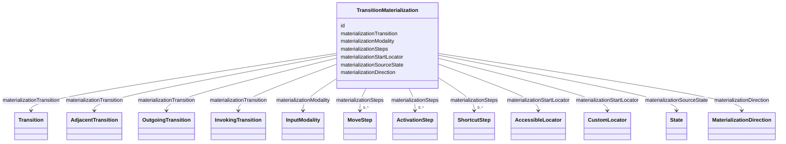
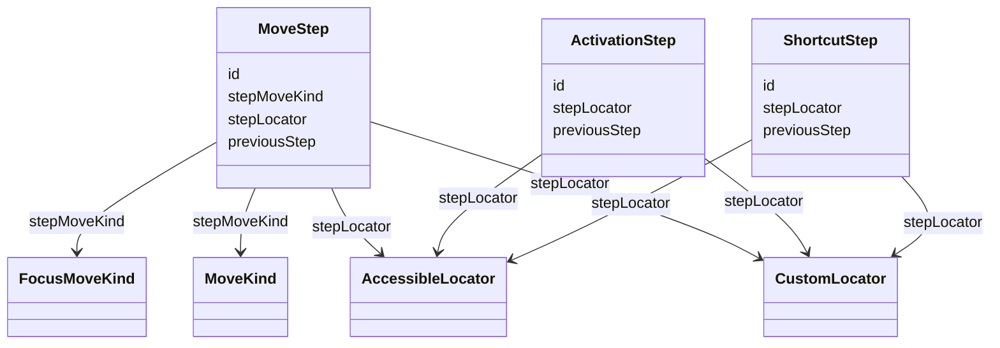
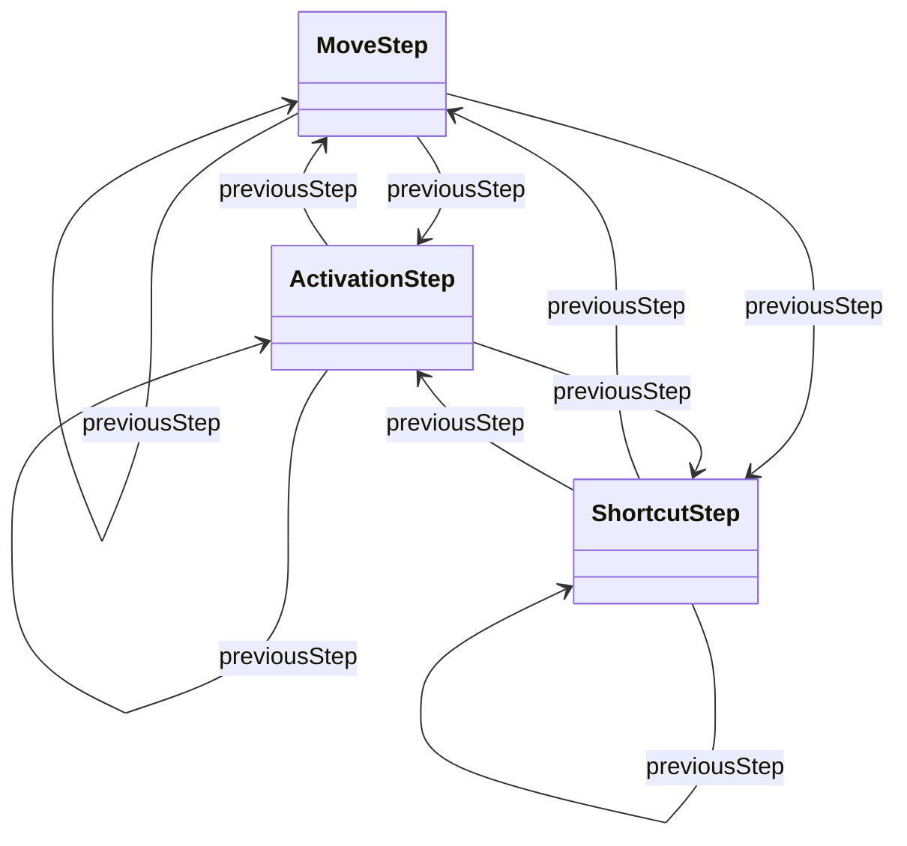
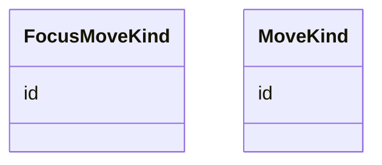
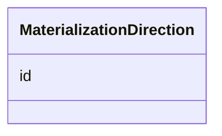

## Overview

This third-level optional module describes how a user performs a Graph transition through an input
modality.

Take two States with a Transition between them: "Home selected" and "Drafts selected", connected by
"Select Drafts". With a pointer, the user clicks the Drafts tab. With a keyboard, the user moves focus
over a few buttons in between, reaches the Drafts tab, and activates it. With a shortcut, the user
presses the keys that the Drafts tab offers as its shortcut. All three perform the same Transition.
Each one is a [=TransitionMaterialization=]. Each move past a button on the way is one of its
[=Materialization step|steps=], and so is the final activation.

Operability depends on [[UJG Graph]] for the transitions it describes, on [[UJG Surface]] for the
Surfaces of the Commands that steps act on, and on [[UJG Observability]] for input modalities and for
the locators that name the objects a step reaches. Observability is a second-level module, so
Operability is a third-level module. Graph does not depend on Operability: a transition without a
materialization is complete.

Surface gives Graph nodes a visible materialization. A TransitionMaterialization describes how a
transition is performed. Operability references Graph transitions directly because no lower-level
module covers them: a [=Surface=] never references a transition, and Observability attaches only to
Surfaces.

Operability names kinds of moves, such as "next item", not keys. A [=Platform adapter=] performs
each step with the gestures of its platform and input modality, for example ArrowRight in a web tab
list or the right button of a TV remote [[WAI-ARIA-APG]].

This version covers moving focus or the pointer between objects, moving the view by a page,
activating objects, and shortcuts. Entering or selecting
text, or changing a value, as part of a transition is outside this version.

## Terminology

- <dfn>TransitionMaterialization</dfn>: One way to perform one Graph transition through one input
  modality.
- <dfn>Materialization step</dfn>: One action of the user within a [=TransitionMaterialization=]: a
  [=MoveStep=], an [=ActivationStep=], or a [=ShortcutStep=].
- <dfn>MoveStep</dfn>: A materialization step in which the user moves to another object, such as the
  next button, or moves the view by a page.
- <dfn>ActivationStep</dfn>: A materialization step in which the user performs the default action of
  the object they are at.
- <dfn>ShortcutStep</dfn>: A materialization step in which the user performs the shortcut that an
  object exposes.
- <dfn>FocusMoveKind</dfn>: A platform-neutral kind of focus move, such as moving to the next item of
  a tab list.
- <dfn>MoveKind</dfn>: A platform-neutral kind of move that does not move focus, such as moving the
  pointer onto an object or moving the view by a page.
- <dfn>MaterializationDirection</dfn>: Which of the two movements of an [=AdjacentTransition=] a
  TransitionMaterialization performs.
- <dfn>Platform adapter</dfn>: The part of a consumer, such as a [=Synthetic Runner=], that turns
  materialization steps into the gestures of one platform and input modality, for example key
  presses in a browser.
- <dfn>Performable materialization</dfn>: A [=TransitionMaterialization=] whose every step can be
  performed without guessing a detail it leaves out.

## TransitionMaterialization {data-cop-concept="transition-materialization"}

A [=TransitionMaterialization=] references the transition it performs with
`materializationTransition`, the input modality it uses with `materializationModality`, and its
steps with `materializationSteps`. The transition can be a [=Transition=], an
[=AdjacentTransition=], an [=OutgoingTransition=], or an [=InvokingTransition=]. A transition can have
several materializations, for example one by keyboard, one by pointer, and one by shortcut.

Where the user starts matters for the steps. `materializationStartLocator` can name the object
the user is at before the first step, such as the Inbox tab right after Inbox was selected. When it
is omitted, the start is not described.

A [=Transition=] starts at its `from` vertex, so its steps happen there. An
[=Entry transition|entry transition=] has no `from`: every [=State=] that lists it offers it, and
each of those States can need different steps to reach it. `materializationSourceState` names the
State in which the steps are performed. Without it, the steps apply at every State that lists the
transition. In the same way, a transition that leaves a [=CompositeState=] is performed in one of
the States nested in it, and `materializationSourceState` can name that State.

Some transitions are not performed by a user action. A [=Transition=] with `fromExit` is taken
when a child Journey of its CompositeState reaches that [=JourneyExit=]. The user's steps lead to the
exit, so they belong to the child Journey's Transition into the exit, and that Transition is the one
to materialize.

<spec-statement>
1. A [=TransitionMaterialization=] describes one way to take its transition through its input
   modality: the user performs its steps one after another, and the last step takes the transition.
2. Several [=TransitionMaterialization|TransitionMaterializations=] of the same transition are
   alternatives. Any one of them takes the transition.
3. A TransitionMaterialization does not change its transition. Graph meaning never depends on
   Operability, and a transition without a materialization is complete.
4. Materialization steps stay below Graph. The steps before the last one take no Graph edge.
5. When the user passes through another State on the way, Producers **MUST** model each part as its
   own transition with its own materialization, not as steps of one materialization. In a tab list
   whose selection follows focus, for example, moving from the Home tab to the Drafts tab passes
   through the Inbox tab and so takes two transitions.
6. One materialization of a [=Member transition|member transition=] serves every
   [=Collection member|member=] of its [=StateCollection=]. Its locators name the kind of object, and
   the concrete object is known only when the step happens.
7. When the materialized transition has a `command`, the object that its last step reaches or
   acts on **SHOULD** be one that an [=ObservationBinding=] recognizes for a [=Surface=] of that
   [=Command=]. A transition without a Command can still be materialized.
</spec-statement>

How a materialization is performed and checked is described in the Performing a Materialization
section.



Example node:

```ujg-example
./examples/example-05.yamlld
```

## Materialization steps {data-cop-concept="materialization-steps"}

A materialization has three kinds of steps. A [=MoveStep=] covers each button or other object the
user passes or points at on the way, and each page the view moves by. An [=ActivationStep=]
activates the object the user is at. A [=ShortcutStep=] performs the shortcut that an object
exposes.

Each step can name the object it reaches or acts on with `stepLocator`. This detail is optional: a
step without a locator still counts as one step of the path. The number of steps describes how much
the user does to take the transition through that modality.

Each step names the step it follows with `previousStep`, and the first step follows none. This is
how the steps are ordered; the order of the `materializationSteps` values means nothing.

<spec-statement>
1. Each [=Materialization step|step=] follows the step it names in `previousStep`. The step that
   follows no step comes first, and the materialized transition happens when the last step is
   performed.
2. The order of `materializationSteps` values **MUST NOT** define step order.
3. A [=MoveStep=] moves the user to another object, or moves the view by a page. It is the last step
   only when the move itself takes the transition, as in a tab list whose selection follows focus.
4. An [=ActivationStep=] performs the default action of the object the user is at: the focused
   object for a keyboard, or the object pointed at for a pointer.
5. Every activation gesture of the platform performs an ActivationStep, such as Enter or Space on a
   web button, so the step does not say which one the user uses. A gesture that does something else, such as Enter submitting the
   form around a focused checkbox, is not an activation of that object. It is a [=ShortcutStep=] on
   the object it acts on, such as the form's submit button.
6. A [=ShortcutStep=] performs the shortcut that an object exposes. It acts on that object without
   the user reaching it first.
7. When a step names an object with `stepLocator`, the object it reaches or acts on matches that
   locator.
8. A MoveStep reaches what its kind designates: for a [=FocusMoveKind=], an object such as the next
   item in the order the platform presents; for `ujgoperability:pointAt`, the object its locator
   names; for a page move, the page that comes into view. Except with `ujgoperability:pointAt`, the
   locator describes what the step reaches; it does not choose it.
9. Operability defines no keys, buttons, or gestures. A [=Platform adapter=] performs each step with
   the gestures that its platform and input modality use for it.
10. The gesture of a ShortcutStep is the shortcut that the accessibility API exposes for the object
    its `stepLocator` names, such as `aria-keyshortcuts` on the web [[WAI-ARIA-1.2]]. When the
    shortcut is not exposed there, Producers **MAY** describe it as a private adapter hint in Core
    `extensions`.
</spec-statement>



Any step can follow any step:



Example nodes:

```ujg-example
./examples/example-04.yamlld
```

## FocusMoveKind and MoveKind {data-cop-concept="move-kind"}

A [=MoveStep=] names the kind of move it performs, without naming a key or gesture. There are two
kinds of moves. A [=FocusMoveKind=] moves focus, as a keyboard does. A [=MoveKind=] moves something
other than focus: the pointer, or the view.

This module defines six standard focus moves in two groups. The first group moves between the stops
of sequential focus navigation, which a desktop keyboard performs with Tab and Shift+Tab:

- `ujgoperability:nextStop`
- `ujgoperability:previousStop`

The second group moves among the items of a composite widget, such as a tab list, menu, or grid,
which a desktop keyboard performs with the arrow keys, Home, and End [[WAI-ARIA-APG]]:

- `ujgoperability:nextItem`
- `ujgoperability:previousItem`
- `ujgoperability:firstItem`
- `ujgoperability:lastItem`

It also defines three standard moves that do not move focus:

- `ujgoperability:pointAt` moves the pointer onto the object the step's locator names, for example to
  open a submenu by hovering.
- `ujgoperability:nextPage` and `ujgoperability:previousPage` move the view by one page, for example with
  PageDown, a mouse wheel, or a swipe in a carousel. They are a common way to cross an
  [=AdjacentTransition=], such as between the sections of a scrolling view.

The keys and gestures named here only illustrate what an adapter does; they are not part of the
vocabulary. The standard kinds are declared by the normative Operability ontology, so Producers can
reference them without serializing them.

<spec-statement>
1. A [=FocusMoveKind=] names a focus move, and a [=MoveKind=] names a move that does not move focus.
   Neither names a key or gesture.
2. "Next", "previous", "first", and "last" follow the order in which the platform presents the stops,
   items, or pages when the step happens. Operability declares no order of its own.
3. A pointer moves directly to an object, so a pointer materialization moves with
   `ujgoperability:pointAt` rather than with focus moves. Through a pointer, a click is a MoveStep with
   `ujgoperability:pointAt` followed by an [=ActivationStep=].
4. A [=MoveStep=] without a kind leaves the move undescribed. It documents the step, but a
   materialization that contains it is not [=Performable materialization|performable=].
5. Producers **MAY** define other FocusMoveKinds and MoveKinds.
</spec-statement>



## AdjacentTransition direction {data-cop-concept="materialization-direction"}

One [=AdjacentTransition=] describes movement in both directions across a border. A
materialization performs one of them, and `materializationDirection` says which. An
AdjacentTransition has exactly two movements, so there are exactly two
[=MaterializationDirection|MaterializationDirections=].

<spec-statement>
1. `ujgoperability:forward` moves from the AdjacentTransition's `from` vertex to its `to` vertex. For a
   [=Member transition|member=] AdjacentTransition, it moves to the neighboring member after the
   border.
2. `ujgoperability:backward` moves the other way.
3. Each direction can have its own materializations, which are alternatives for that direction.
</spec-statement>



## Performing a Materialization {data-cop-concept="performing-materializations"}

A [=Synthetic Runner=] can perform a materialization to check that a transition works through an
input modality. It performs each step with its [=Platform adapter=] and checks along the way that
the user is where the steps say. This section says what such a runner must do. Which
materializations a runner performs, and how it reports results, is up to the runner; it can name a
materialization by its IRI.

A materialization can leave details out and still describe a way of acting, which is enough to
document it. To perform it, a runner needs every step to be determined. A materialization is
[=Performable materialization|performable=] when:

- every [=MoveStep=] names its kind, a [=FocusMoveKind=] or a [=MoveKind=]. A locator alone would
  leave the runner searching for the object, which is guessing;
- every MoveStep with `ujgoperability:pointAt` also names its object with `stepLocator`, because the
  pointer moves straight to that object;
- every [=ShortcutStep=] names an object that exposes its shortcut through the accessibility API, or
  carries a private adapter hint in Core `extensions`.

An [=ActivationStep=] acts on the object the user is at, so it needs nothing more. Without
`materializationStartLocator`, the steps start wherever the user is when the runner begins them.

<spec-statement>
1. Before the first step, a [=Synthetic Runner=] that performs a materialization **MUST** check that
   the user is at the object `materializationStartLocator` names, when it names one.
2. Before a [=MoveStep=] with `ujgoperability:pointAt`, the runner **MUST** check that the step's
   locator matches exactly one object. When it matches several, the runner **MUST NOT** choose one,
   and the materialization cannot be performed there.
3. After each MoveStep, the runner **MUST** check that the move happened: focus or the pointer is at
   a different object, or the view shows a different page. When the step names an object, the
   runner **MUST** also check that what the step reached matches the step's locator. With a
   keyboard, the user is at the object that has focus.
4. Before each [=ActivationStep=] that names an object, the runner **MUST** check that the user is at
   an object that matches the step's locator.
5. When a check fails, the materialization has failed, even if the transition happens afterwards.
6. The runner **MUST NOT** place focus on an object programmatically. The steps describe what the
   user does, and placing focus for them would hide a defect that the steps are meant to reveal.
7. The runner **MUST NOT** fill in a detail that a step leaves out. It does not perform a
   materialization that is not [=Performable materialization|performable=].
8. After the last step, the runner **MUST** check that the materialized transition was taken: that
   the user reached its destination. How the runner recognizes the destination is up to the runner,
   for example through an [=ObservationBinding=] for a [=Surface=] of the destination State.
9. Every activation gesture of the platform performs an ActivationStep, so choosing one is not
   filling in a detail. Performing the step with one gesture shows nothing about the others; to
   check several, the runner performs the step once with each.
10. A materialization works when every check passes, including the check that the transition was
    taken. Each materialization is its own claim: one that works shows nothing about the others,
    even those through the same modality.
</spec-statement>

A materialization also shows whether an Observability requirement is met. Take an
[=ObservationBinding=] that observes a [=Surface=] whose `graphNode` is a [=Command=]. When the
binding's [=ObservationEvent=] requires an [=InputModalityProfile=] that lists exactly one modality,
a runner can check the requirement by performing one materialization through that modality of a
transition whose `command` is that Command. One materialization that works is enough for
that requirement; checking that every materialization of the transition works means performing each
of them. Each required profile is checked on its own, as Observability evaluates profiles
independently. Profiles that list several modalities are outside this version.

## Normative Artifacts

This module is published through the following artifacts:

- `operability.ttl`: ontology, published at `https://ujg.specs.openuji.org/ed/ns/operability`
- `operability.context.jsonld`: JSON-LD term mappings, published at `https://ujg.specs.openuji.org/ed/ns/operability.context.jsonld`
- `operability.shape.ttl`: SHACL validation rules, published at `https://ujg.specs.openuji.org/ed/ns/operability.shape`

Examples in this page compose the shared baseline context
`https://ujg.specs.openuji.org/ed/ns/context.jsonld` with the Surface, Localization, Observability,
and Operability contexts.

### Ontology {data-cop-concept="ontology"}

The normative Operability ontology is defined below and is published at
`https://ujg.specs.openuji.org/ed/ns/operability`.

:::include ./operability.ttl :::

### JSON-LD Context {data-cop-concept="jsonld-context"}

The normative Operability JSON-LD context is defined below and is published at
`https://ujg.specs.openuji.org/ed/ns/operability.context.jsonld`.

:::include ./operability.context.jsonld :::

### Validation {data-cop-concept="validation"}

The normative Operability SHACL shape is defined below and is published at
`https://ujg.specs.openuji.org/ed/ns/operability.shape`.

:::include ./operability.shape.ttl :::

The remaining module semantics beyond the structural SHACL constraints are:

1. **No Graph change:** Operability properties **MUST NOT** change Graph validity, graph traversal,
   import resolution, or core node identity.
2. **No Observability change:** Operability **MUST NOT** change how an [=ObservationBinding=]
   recognizes a [=Surface=] or what `requiredInputModalityProfiles` requires.
3. **Graceful degradation:** Consumers that do not implement Operability semantics **MAY** ignore
   Operability data, but **SHOULD** preserve recognized JSON-LD data during read-transform-write when
   possible.

## Examples

### Mail Tabs Example

"Select Drafts" takes the user from "Home selected" to "Drafts selected". The example gives it three
materializations:

- By keyboard, the user moves focus past a button that sits before the tab list, onto the Home tab,
  past the Inbox tab, and onto the Drafts tab, and then activates it. Only two of the four moves name
  the object they reach.
- By pointer, the user points at the Drafts tab and activates it.
- By shortcut, the user performs the shortcut that the Drafts tab exposes.

The example does not name where the keyboard steps start. All three materializations are
[=Performable materialization|performable=]: every MoveStep names its kind, the step that points
names the Drafts tab, and the shortcut step names the tab that exposes the shortcut.

```ujg-example
./examples/example-03.yamlld
```

The binding observes the Surface of the "Select Drafts" Command, and its activation event requires
two profiles. Each profile is checked on its own:

- The keyboard profile can be checked with `urn:materialization:select-drafts:keyboard`, or with
  `urn:materialization:select-drafts:shortcut`, which also uses the keyboard.
- The pointer profile can be checked with `urn:materialization:select-drafts:pointer`.

### Selection Follows Focus Example

In some tab lists, moving focus to a tab also selects it. A keyboard user who goes from Home to
Drafts then passes through Inbox, which is a State of its own. The Graph has two more transitions,
"Select Inbox" from Home and "Select Drafts" from Inbox, and each one gets a keyboard materialization
whose last step is a MoveStep. The second one starts at the Inbox tab.

The Home → Drafts transition keeps its pointer and shortcut materializations from the previous
example. It has no keyboard materialization in this tab list: a keyboard user cannot reach Drafts
from Home without passing Inbox, so those steps would pass through another State.

To turn the previous example into this one:

- remove `urn:materialization:select-drafts:keyboard` and its five steps;
- replace the `urn:journey:mail` node with the one below, which lists the new State and Transitions;
- add the other nodes below.

```ujg-example
./examples/example-02.yamlld
```

### Carousel Example

A carousel shows one slide at a time, and a tab list lets the user pick a slide. Each slide is a
[=Collection member|member=] of a [=StateCollection=], and a member [=AdjacentTransition=] connects
neighboring slides. By keyboard, the user moves focus onto the slide tab list and then to the next
or previous tab, which shows the neighboring slide. The adjacency gets one materialization for each
direction.

```ujg-example
./examples/example-01.yamlld
```

One pair of materializations serves every slide. The slide tab locator names any tab in the slide
tab list, and which tab the user reaches is known only when the step happens.

A pointer materialization of the same adjacency would point at a slide tab with
`ujgoperability:pointAt`. The slide tab locator matches every tab, so a runner could not choose one,
and such a materialization documents the interaction without being performable. A pointer user can
also swipe: a pointer materialization with one MoveStep using `ujgoperability:nextPage` is performable.
