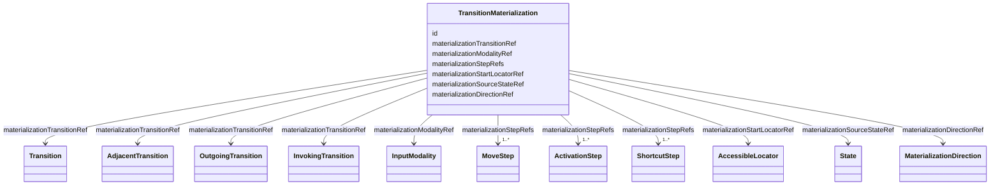
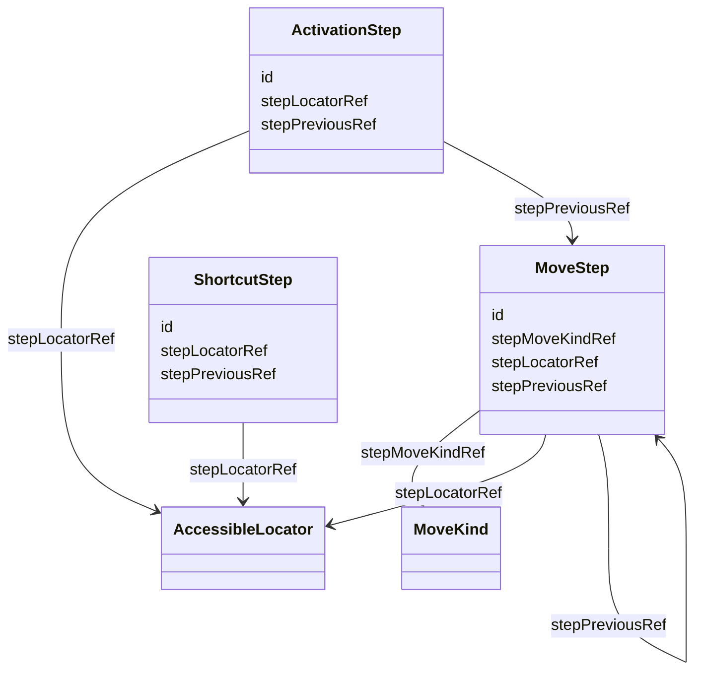
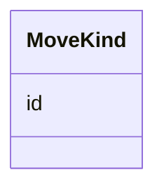
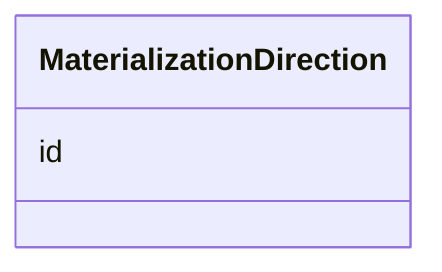

## Overview

This third-level optional module describes how a user performs a Graph transition through an input
modality.

Take two States with a Transition between them: "Home selected" and "Drafts selected", connected by
"Select Drafts". With a pointer, the user clicks the Drafts tab. With a keyboard, the user moves focus
over a few buttons in between, reaches the Drafts tab, and activates it. With a shortcut, the user
presses the keys that the Drafts tab offers as its shortcut. All three perform the same Transition.
Each one is a [=TransitionMaterialization=], and the buttons passed on the way are its
[=Materialization step|steps=].

Operability depends on [[UJG Graph]] for the transitions it describes and on [[UJG Observability]] for
input modalities and for the locators that name the objects a step reaches. Observability is a
second-level module, so Operability is a third-level module. Graph does not depend on Operability: a
transition without a materialization is complete.

[[UJG Surface]] gives Graph nodes a visible materialization. A TransitionMaterialization describes how
a transition is performed, which a [=Surface=] cannot express because a Surface never references a
transition.

Operability names kinds of moves, such as "next item", not keys. A [=Platform adapter=] performs
each step with the gestures of its platform and input modality, for example ArrowRight in a web tab
list or the right button of a TV remote [[WAI-ARIA-APG]].

## Terminology

- <dfn>TransitionMaterialization</dfn>: One way to perform one Graph transition through one input
  modality.
- <dfn>Materialization step</dfn>: One action of the user within a [=TransitionMaterialization=]: a
  [=MoveStep=], an [=ActivationStep=], or a [=ShortcutStep=].
- <dfn>MoveStep</dfn>: A materialization step in which the user moves to another object, such as the
  next button.
- <dfn>ActivationStep</dfn>: A materialization step in which the user activates the object they are
  at.
- <dfn>ShortcutStep</dfn>: A materialization step in which the user performs the shortcut that an
  object exposes.
- <dfn>MoveKind</dfn>: A platform-neutral kind of focus move, such as moving to the next item of a
  tab list.
- <dfn>MaterializationDirection</dfn>: Which of the two movements of an [=AdjacentTransition=] a
  TransitionMaterialization performs.
- <dfn>Platform adapter</dfn>: The part of a consumer that performs materialization steps with the
  gestures of one platform and input modality, such as a [=Synthetic Runner=] that drives a browser
  by keyboard.

## TransitionMaterialization {data-cop-concept="transition-materialization"}

A [=TransitionMaterialization=] references the transition it performs with
`materializationTransitionRef`, the input modality it uses with `materializationModalityRef`, and its
steps with `materializationStepRefs`. The transition can be a [=Transition=], an
[=AdjacentTransition=], an [=OutgoingTransition=], or an [=InvokingTransition=]. A transition can have
several materializations, for example one by keyboard, one by pointer, and one by shortcut.

Where the user starts matters for the steps. `materializationStartLocatorRef` can name the object
the user is at before the first step, such as the Inbox tab right after Inbox was selected. When it
is omitted, the start is not described.

A [=Transition=] starts at its `from` vertex, so its steps happen there. An
[=Entry transition|entry transition=] has no `from`: every [=State=] that lists it offers it, and
each of those States can need different steps to reach it. `materializationSourceStateRef` names the
State in which the steps are performed. Without it, the steps apply at every State that lists the
transition. In the same way, a transition that leaves a [=CompositeState=] is performed in one of
the States nested in it, and `materializationSourceStateRef` can name that State.

<spec-statement>
1. A [=TransitionMaterialization=] describes one way to take its transition through its input
   modality: the user performs its steps one after another, and the last step takes the transition.
2. Several [=TransitionMaterialization|TransitionMaterializations=] of the same transition are
   alternatives. Any one of them takes the transition.
3. A TransitionMaterialization does not change its transition. Graph meaning never depends on
   Operability, and a transition without a materialization is complete.
4. Materialization steps stay below Graph. The steps before the last one take no Graph edge.
5. When the user passes through another State on the way, Producers **MUST** model each part as its
   own transition with its own materialization, not as steps of one materialization. In a tab list
   whose selection follows focus, for example, moving from the Home tab to the Drafts tab passes
   through the Inbox tab and so takes two transitions.
6. One materialization of a [=Member transition|member transition=] serves every
   [=Collection member|member=] of its [=StateCollection=]. Its locators name the kind of object, and
   the concrete object is known only when the step happens.
7. When the materialized transition has a `commandRef`, the object that its [=ActivationStep=] or
   [=ShortcutStep=] acts on **SHOULD** be one that an [=ObservationBinding=] recognizes for a
   [=Surface=] of that [=Command=]. A transition without a Command can still be materialized.
</spec-statement>

A materialization also shows whether a requirement is met. An [=ObservationEvent=] that requires an
[=InputModalityProfile=] listing only `observability:keyboard` can be checked by performing a keyboard
materialization of the transition whose Command the event's binding observes. Profiles that list
several modalities are outside this version.



Example JSON node:

```json
{
  "@type": "TransitionMaterialization",
  "@id": "urn:ujg:materialization:select-drafts:pointer",
  "materializationTransitionRef": "urn:ujg:transition:select-drafts",
  "materializationModalityRef": "observability:pointer",
  "materializationStepRefs": ["urn:ujg:step:select-drafts:pointer:1"]
}
```

## Materialization steps {data-cop-concept="materialization-steps"}

A materialization has three kinds of steps. A [=MoveStep=] covers each button or other object the
user passes on the way. An [=ActivationStep=] activates the object the user is at. A [=ShortcutStep=]
performs the shortcut that an object exposes.

Each step can name the object it reaches or acts on with `stepLocatorRef`. This detail is optional: a
step without a locator still counts as one step of the path. The number of steps describes how much
the user does to take the transition through that modality.

Each step names the step it follows with `stepPreviousRef`, and the first step follows none. This is
how the steps are ordered; the order of the `materializationStepRefs` values means nothing.

<spec-statement>
1. Each [=Materialization step|step=] follows the step it names in `stepPreviousRef`. The step that
   follows no step comes first, and the materialized transition happens when the last step is
   performed.
2. The order of `materializationStepRefs` values **MUST NOT** define step order.
3. A [=MoveStep=] moves the user to another object. It is the last step only when the move itself
   takes the transition, as in a tab list whose selection follows focus.
4. An [=ActivationStep=] activates the object the user is at: the focused object for a keyboard, or
   the object pointed at for a pointer.
5. A [=ShortcutStep=] performs the shortcut that an object exposes. It acts on that object without
   the user reaching it first.
6. When a step names an object with `stepLocatorRef`, the user is at that object after a MoveStep,
   and acts on that object with an ActivationStep or a ShortcutStep. Consumers can check this
   through the accessibility API, for example through the focused state of the object.
7. A consumer that performs a materialization **MUST NOT** place focus on an object
   programmatically. The steps describe what the user does, and placing focus for them would hide a
   defect that the steps are meant to reveal.
8. Operability defines no keys, buttons, or gestures. A [=Platform adapter=] performs each step with
   the gestures that its platform and input modality use for it.
9. The gesture of a ShortcutStep is the shortcut that the accessibility API exposes for the object
   its `stepLocatorRef` names, such as `aria-keyshortcuts` on the web [[WAI-ARIA-1.2]]. When the
   shortcut is not exposed there, Producers **MAY** describe it as a private adapter hint in Core
   `extensions`.
</spec-statement>



Example JSON nodes:

```json
[
  {
    "@type": "MoveStep",
    "@id": "urn:ujg:step:select-drafts:keyboard:4",
    "stepPreviousRef": "urn:ujg:step:select-drafts:keyboard:3",
    "stepMoveKindRef": "operability:nextItem",
    "stepLocatorRef": "urn:ujg:locator:drafts-tab"
  },
  {
    "@type": "ActivationStep",
    "@id": "urn:ujg:step:select-drafts:keyboard:5",
    "stepPreviousRef": "urn:ujg:step:select-drafts:keyboard:4"
  }
]
```

## MoveKind {data-cop-concept="move-kind"}

A [=MoveKind=] tells a [=Platform adapter=] which focus move a [=MoveStep=] performs, without naming
a key. This module defines six standard kinds in two groups.

The first group moves between the stops of sequential focus navigation, which a desktop keyboard
performs with Tab and Shift+Tab:

- `operability:nextStop`
- `operability:previousStop`

The second group moves among the items of a composite widget, such as a tab list, menu, or grid,
which a desktop keyboard performs with the arrow keys, Home, and End [[WAI-ARIA-APG]]:

- `operability:nextItem`
- `operability:previousItem`
- `operability:firstItem`
- `operability:lastItem`

The keys named here only illustrate what an adapter does; they are not part of the vocabulary. The
standard kinds are declared as [=MoveKind=] resources by the normative Operability ontology, so
Producers can reference them without serializing them.

<spec-statement>
1. A [=MoveKind=] names a focus move independently of any key or gesture.
2. "Next", "previous", "first", and "last" follow the order in which the platform presents the stops
   or items when the step happens. Operability declares no order of its own.
3. A [=MoveStep=] without a MoveKind leaves the kind of move undescribed.
4. Producers **MAY** define other MoveKinds.
</spec-statement>



## AdjacentTransition direction {data-cop-concept="materialization-direction"}

One [=AdjacentTransition=] describes movement in both directions across a border. A
materialization performs one of them, and `materializationDirectionRef` says which.

<spec-statement>
1. `operability:forward` moves from the AdjacentTransition's `from` vertex to its `to` vertex. For a
   [=Member transition|member=] AdjacentTransition, it moves to the neighboring member after the
   border.
2. `operability:backward` moves the other way.
3. Each direction can have its own materializations, which are alternatives for that direction.
</spec-statement>



## Normative Artifacts

This module is published through the following artifacts:

- `operability.ttl`: ontology, published at `https://ujg.specs.openuji.org/ed/ns/operability`
- `operability.context.jsonld`: JSON-LD term mappings, published at `https://ujg.specs.openuji.org/ed/ns/operability.context.jsonld`
- `operability.shape.ttl`: SHACL validation rules, published at `https://ujg.specs.openuji.org/ed/ns/operability.shape`

Examples in this page compose the shared baseline context
`https://ujg.specs.openuji.org/ed/ns/context.jsonld` with the Surface, Localization, Observability,
and Operability contexts.

### Ontology {data-cop-concept="ontology"}

The normative Operability ontology is defined below and is published at
`https://ujg.specs.openuji.org/ed/ns/operability`.

:::include ./operability.ttl :::

### JSON-LD Context {data-cop-concept="jsonld-context"}

The normative Operability JSON-LD context is defined below and is published at
`https://ujg.specs.openuji.org/ed/ns/operability.context.jsonld`.

:::include ./operability.context.jsonld :::

### Validation {data-cop-concept="validation"}

The normative Operability SHACL shape is defined below and is published at
`https://ujg.specs.openuji.org/ed/ns/operability.shape`.

:::include ./operability.shape.ttl :::

The remaining module semantics beyond the structural SHACL constraints are:

1. **No Graph change:** Operability properties **MUST NOT** change Graph validity, graph traversal,
   import resolution, or core node identity.
2. **No Observability change:** Operability **MUST NOT** change how an [=ObservationBinding=]
   recognizes a [=Surface=] or what `requiredInputModalityProfileRefs` requires.
3. **Graceful degradation:** Consumers that do not implement Operability semantics **MAY** ignore
   Operability data, but **SHOULD** preserve recognized JSON-LD data during read-transform-write when
   possible.

## Examples

### Mail Tabs Example

"Select Drafts" takes the user from "Home selected" to "Drafts selected". The example gives it three
materializations:

- By keyboard, the user moves focus past a button that sits before the tab list, onto the Home tab,
  past the Inbox tab, and onto the Drafts tab, and then activates it. Only two of the four moves name
  the object they reach.
- By pointer, the user activates the Drafts tab.
- By shortcut, the user performs the shortcut that the Drafts tab exposes.

The example does not name where the keyboard steps start.

```json
{
  "@context": [
    "https://ujg.specs.openuji.org/ed/ns/context.jsonld",
    "https://ujg.specs.openuji.org/ed/ns/surface.context.jsonld",
    "https://ujg.specs.openuji.org/ed/ns/l10n.context.jsonld",
    "https://ujg.specs.openuji.org/ed/ns/observability.context.jsonld",
    "https://ujg.specs.openuji.org/ed/ns/operability.context.jsonld"
  ],
  "@id": "https://example.com/ujg/operability/mail-tabs.jsonld",
  "@type": "UJGDocument",
  "nodes": [
    {
      "@type": "Journey",
      "@id": "urn:journey:mail",
      "label": "Mail",
      "defaultEntryRef": "urn:entry:mail",
      "entryRefs": ["urn:entry:mail"],
      "stateRefs": ["urn:state:home-selected", "urn:state:drafts-selected"],
      "transitionRefs": ["urn:transition:select-drafts"]
    },
    {
      "@type": "JourneyEntry",
      "@id": "urn:entry:mail",
      "stateRef": "urn:state:home-selected"
    },
    {
      "@type": "State",
      "@id": "urn:state:home-selected",
      "label": "Home selected"
    },
    {
      "@type": "State",
      "@id": "urn:state:drafts-selected",
      "label": "Drafts selected"
    },
    {
      "@type": "Transition",
      "@id": "urn:transition:select-drafts",
      "label": "Select Drafts",
      "from": "urn:state:home-selected",
      "to": "urn:state:drafts-selected",
      "commandRef": "urn:command:select-drafts"
    },
    {
      "@type": "Command",
      "@id": "urn:command:select-drafts",
      "label": "Select Drafts"
    },
    {
      "@type": "Surface",
      "@id": "urn:surface:select-drafts",
      "graphNodeRef": "urn:command:select-drafts"
    },
    {
      "@type": "Locale",
      "@id": "urn:locale:en",
      "localeCode": "en"
    },
    {
      "@type": "MessageMeta",
      "@id": "urn:message-meta:home",
      "defaultLocaleRef": "urn:locale:en"
    },
    {
      "@type": "Message",
      "@id": "urn:message:home:en",
      "messageMetaRef": "urn:message-meta:home",
      "localeRef": "urn:locale:en",
      "value": "Home"
    },
    {
      "@type": "MessageMeta",
      "@id": "urn:message-meta:drafts",
      "defaultLocaleRef": "urn:locale:en"
    },
    {
      "@type": "Message",
      "@id": "urn:message:drafts:en",
      "messageMetaRef": "urn:message-meta:drafts",
      "localeRef": "urn:locale:en",
      "value": "Drafts"
    },
    {
      "@type": "AccessibleLocator",
      "@id": "urn:locator:mail-tablist",
      "role": "tablist"
    },
    {
      "@type": "AccessibleLocator",
      "@id": "urn:locator:home-tab",
      "role": "tab",
      "accessibleNameRef": "urn:message-meta:home",
      "contextLocatorRefs": ["urn:locator:mail-tablist"]
    },
    {
      "@type": "AccessibleLocator",
      "@id": "urn:locator:drafts-tab",
      "role": "tab",
      "accessibleNameRef": "urn:message-meta:drafts",
      "contextLocatorRefs": ["urn:locator:mail-tablist"]
    },
    {
      "@type": "InputModalityProfile",
      "@id": "urn:input-modality-profile:keyboard",
      "label": "Keyboard",
      "inputModalityRefs": ["observability:keyboard"]
    },
    {
      "@type": "InputModalityProfile",
      "@id": "urn:input-modality-profile:pointer",
      "label": "Pointer",
      "inputModalityRefs": ["observability:pointer"]
    },
    {
      "@type": "ObservationEvent",
      "@id": "urn:observation-event:select-drafts-activation",
      "label": "Select Drafts activation",
      "requiredInputModalityProfileRefs": [
        "urn:input-modality-profile:keyboard",
        "urn:input-modality-profile:pointer"
      ]
    },
    {
      "@type": "ObservationBinding",
      "@id": "urn:binding:select-drafts-activation",
      "observeSurfaceRef": "urn:surface:select-drafts",
      "observationEventRef": "urn:observation-event:select-drafts-activation",
      "locatorRefs": ["urn:locator:drafts-tab"]
    },
    {
      "@type": "TransitionMaterialization",
      "@id": "urn:materialization:select-drafts:keyboard",
      "label": "Select Drafts by keyboard",
      "materializationTransitionRef": "urn:transition:select-drafts",
      "materializationModalityRef": "observability:keyboard",
      "materializationStepRefs": [
        "urn:step:select-drafts:keyboard:1",
        "urn:step:select-drafts:keyboard:2",
        "urn:step:select-drafts:keyboard:3",
        "urn:step:select-drafts:keyboard:4",
        "urn:step:select-drafts:keyboard:5"
      ]
    },
    {
      "@type": "MoveStep",
      "@id": "urn:step:select-drafts:keyboard:1",
      "stepMoveKindRef": "operability:nextStop"
    },
    {
      "@type": "MoveStep",
      "@id": "urn:step:select-drafts:keyboard:2",
      "stepPreviousRef": "urn:step:select-drafts:keyboard:1",
      "stepMoveKindRef": "operability:nextStop",
      "stepLocatorRef": "urn:locator:home-tab"
    },
    {
      "@type": "MoveStep",
      "@id": "urn:step:select-drafts:keyboard:3",
      "stepPreviousRef": "urn:step:select-drafts:keyboard:2",
      "stepMoveKindRef": "operability:nextItem"
    },
    {
      "@type": "MoveStep",
      "@id": "urn:step:select-drafts:keyboard:4",
      "stepPreviousRef": "urn:step:select-drafts:keyboard:3",
      "stepMoveKindRef": "operability:nextItem",
      "stepLocatorRef": "urn:locator:drafts-tab"
    },
    {
      "@type": "ActivationStep",
      "@id": "urn:step:select-drafts:keyboard:5",
      "stepPreviousRef": "urn:step:select-drafts:keyboard:4"
    },
    {
      "@type": "TransitionMaterialization",
      "@id": "urn:materialization:select-drafts:pointer",
      "label": "Select Drafts by pointer",
      "materializationTransitionRef": "urn:transition:select-drafts",
      "materializationModalityRef": "observability:pointer",
      "materializationStepRefs": ["urn:step:select-drafts:pointer:1"]
    },
    {
      "@type": "ActivationStep",
      "@id": "urn:step:select-drafts:pointer:1",
      "stepLocatorRef": "urn:locator:drafts-tab"
    },
    {
      "@type": "TransitionMaterialization",
      "@id": "urn:materialization:select-drafts:shortcut",
      "label": "Select Drafts by shortcut",
      "materializationTransitionRef": "urn:transition:select-drafts",
      "materializationModalityRef": "observability:keyboard",
      "materializationStepRefs": ["urn:step:select-drafts:shortcut:1"]
    },
    {
      "@type": "ShortcutStep",
      "@id": "urn:step:select-drafts:shortcut:1",
      "stepLocatorRef": "urn:locator:drafts-tab"
    }
  ]
}
```

Both the keyboard and the pointer materialization satisfy the requirement that the activation event
declares, because each one performs the transition whose Command the binding observes.

### Selection Follows Focus Example

In some tab lists, moving focus to a tab also selects it. A keyboard user who goes from Home to
Drafts then passes through Inbox, which is a State of its own. The Graph has two more transitions,
"Select Inbox" from Home and "Select Drafts" from Inbox, and each one gets a keyboard materialization
whose last step is a MoveStep. The second one starts at the Inbox tab.

The Home → Drafts transition from the previous example keeps its pointer and shortcut
materializations. It has no keyboard materialization in this tab list, because a keyboard user
cannot reach Drafts from Home without passing Inbox.

The nodes below extend the previous example.

```json
[
  {
    "@type": "State",
    "@id": "urn:state:inbox-selected",
    "label": "Inbox selected"
  },
  {
    "@type": "Transition",
    "@id": "urn:transition:select-inbox",
    "label": "Select Inbox",
    "from": "urn:state:home-selected",
    "to": "urn:state:inbox-selected",
    "commandRef": "urn:command:select-inbox"
  },
  {
    "@type": "Transition",
    "@id": "urn:transition:select-drafts-from-inbox",
    "label": "Select Drafts",
    "from": "urn:state:inbox-selected",
    "to": "urn:state:drafts-selected",
    "commandRef": "urn:command:select-drafts"
  },
  {
    "@type": "Command",
    "@id": "urn:command:select-inbox",
    "label": "Select Inbox"
  },
  {
    "@type": "MessageMeta",
    "@id": "urn:message-meta:inbox",
    "defaultLocaleRef": "urn:locale:en"
  },
  {
    "@type": "Message",
    "@id": "urn:message:inbox:en",
    "messageMetaRef": "urn:message-meta:inbox",
    "localeRef": "urn:locale:en",
    "value": "Inbox"
  },
  {
    "@type": "AccessibleLocator",
    "@id": "urn:locator:inbox-tab",
    "role": "tab",
    "accessibleNameRef": "urn:message-meta:inbox",
    "contextLocatorRefs": ["urn:locator:mail-tablist"]
  },
  {
    "@type": "TransitionMaterialization",
    "@id": "urn:materialization:select-inbox:keyboard",
    "materializationTransitionRef": "urn:transition:select-inbox",
    "materializationModalityRef": "observability:keyboard",
    "materializationStepRefs": [
      "urn:step:select-inbox:keyboard:1",
      "urn:step:select-inbox:keyboard:2",
      "urn:step:select-inbox:keyboard:3"
    ]
  },
  {
    "@type": "MoveStep",
    "@id": "urn:step:select-inbox:keyboard:1",
    "stepMoveKindRef": "operability:nextStop"
  },
  {
    "@type": "MoveStep",
    "@id": "urn:step:select-inbox:keyboard:2",
    "stepPreviousRef": "urn:step:select-inbox:keyboard:1",
    "stepMoveKindRef": "operability:nextStop",
    "stepLocatorRef": "urn:locator:home-tab"
  },
  {
    "@type": "MoveStep",
    "@id": "urn:step:select-inbox:keyboard:3",
    "stepPreviousRef": "urn:step:select-inbox:keyboard:2",
    "stepMoveKindRef": "operability:nextItem",
    "stepLocatorRef": "urn:locator:inbox-tab"
  },
  {
    "@type": "TransitionMaterialization",
    "@id": "urn:materialization:select-drafts-from-inbox:keyboard",
    "materializationTransitionRef": "urn:transition:select-drafts-from-inbox",
    "materializationModalityRef": "observability:keyboard",
    "materializationStartLocatorRef": "urn:locator:inbox-tab",
    "materializationStepRefs": ["urn:step:select-drafts-from-inbox:keyboard:1"]
  },
  {
    "@type": "MoveStep",
    "@id": "urn:step:select-drafts-from-inbox:keyboard:1",
    "stepMoveKindRef": "operability:nextItem",
    "stepLocatorRef": "urn:locator:drafts-tab"
  }
]
```

### Carousel Example

A carousel shows one slide at a time, and a tab list lets the user pick a slide. Each slide is a
[=Collection member|member=] of a [=StateCollection=], and a member [=AdjacentTransition=] connects
neighboring slides. By keyboard, the user moves focus onto the slide tab list and then to the next
or previous tab, which shows the neighboring slide. The adjacency gets one materialization for each
direction.

```json
[
  {
    "@type": "Journey",
    "@id": "urn:journey:product-gallery",
    "label": "Product gallery",
    "defaultEntryRef": "urn:entry:product-gallery",
    "entryRefs": ["urn:entry:product-gallery"],
    "stateRefs": ["urn:state:slide"]
  },
  {
    "@type": "JourneyEntry",
    "@id": "urn:entry:product-gallery",
    "stateRef": "urn:state:slide"
  },
  {
    "@type": "State",
    "@id": "urn:state:slide",
    "label": "Slide"
  },
  {
    "@type": "StateCollection",
    "@id": "urn:collection:slides",
    "label": "Slides",
    "memberStateRef": "urn:state:slide",
    "memberTransitionRefs": ["urn:adjacent:slide-neighbors"]
  },
  {
    "@type": "AdjacentTransition",
    "@id": "urn:adjacent:slide-neighbors",
    "from": "urn:state:slide",
    "to": "urn:state:slide"
  },
  {
    "@type": "AccessibleLocator",
    "@id": "urn:locator:slide-tablist",
    "role": "tablist"
  },
  {
    "@type": "AccessibleLocator",
    "@id": "urn:locator:slide-tab",
    "role": "tab",
    "contextLocatorRefs": ["urn:locator:slide-tablist"]
  },
  {
    "@type": "TransitionMaterialization",
    "@id": "urn:materialization:next-slide:keyboard",
    "materializationTransitionRef": "urn:adjacent:slide-neighbors",
    "materializationDirectionRef": "operability:forward",
    "materializationModalityRef": "observability:keyboard",
    "materializationStepRefs": [
      "urn:step:next-slide:keyboard:1",
      "urn:step:next-slide:keyboard:2"
    ]
  },
  {
    "@type": "MoveStep",
    "@id": "urn:step:next-slide:keyboard:1",
    "stepMoveKindRef": "operability:nextStop",
    "stepLocatorRef": "urn:locator:slide-tab"
  },
  {
    "@type": "MoveStep",
    "@id": "urn:step:next-slide:keyboard:2",
    "stepPreviousRef": "urn:step:next-slide:keyboard:1",
    "stepMoveKindRef": "operability:nextItem",
    "stepLocatorRef": "urn:locator:slide-tab"
  },
  {
    "@type": "TransitionMaterialization",
    "@id": "urn:materialization:previous-slide:keyboard",
    "materializationTransitionRef": "urn:adjacent:slide-neighbors",
    "materializationDirectionRef": "operability:backward",
    "materializationModalityRef": "observability:keyboard",
    "materializationStepRefs": [
      "urn:step:previous-slide:keyboard:1",
      "urn:step:previous-slide:keyboard:2"
    ]
  },
  {
    "@type": "MoveStep",
    "@id": "urn:step:previous-slide:keyboard:1",
    "stepMoveKindRef": "operability:nextStop",
    "stepLocatorRef": "urn:locator:slide-tab"
  },
  {
    "@type": "MoveStep",
    "@id": "urn:step:previous-slide:keyboard:2",
    "stepPreviousRef": "urn:step:previous-slide:keyboard:1",
    "stepMoveKindRef": "operability:previousItem",
    "stepLocatorRef": "urn:locator:slide-tab"
  }
]
```

One pair of materializations serves every slide. The slide tab locator names any tab in the slide
tab list, and which tab the user reaches is known only when the step happens.
